# Лекция 5. Тема 6.1. Организация памяти в МПС

**МДК.02.01 «Микропроцессорные системы» · 4 курс колледжа · специальность 09.02.01.** Объём темы по РПМ 2026 года — **4 академических часа**.

Цель лекции — понять, как устроены полупроводниковые запоминающие устройства, каким способом они удерживают бит, как выполняются чтение, запись и программирование и как память подключается к процессору. После изучения темы студент должен объяснять внутренние узлы микросхемы памяти; различать SRAM, DRAM, масочное ПЗУ, PROM, EPROM, Flash и EEPROM; понимать роль усилителя считывания и генератора накачки; различать внешнюю передачу данных и завершение внутренней записи; читать схемы параллельного, SPI- и I²C-подключения.

## Оглавление

1. [От бита к микросхеме памяти](#s1)
2. [ПЗУ: матрица и считывание слова](#s2)
3. [Программирование PROM и EPROM](#s3)
4. [SRAM: ячейка, хранение, чтение и запись](#s4)
5. [DRAM: заряд, усилитель и регенерация](#s5)
6. [Энергонезависимая ячейка и плавающий затвор](#s6)
7. [EEPROM: внутренняя запись и ресурс](#s7)
8. [Flash: NOR, NAND, страницы и стирание](#s8)
9. [Прошивка и обновление программы](#s9)
10. [Параллельная память на шине процессора](#s10)
11. [Подключение I²C EEPROM](#s11)
12. [Подключение SPI Flash](#s12)
13. [Выбор памяти, выводы и самоконтроль](#s13)
14. [Источники](#sources)

## 1. От бита к микросхеме памяти

**Память** — устройство, которое сохраняет состояния и позволяет их воспроизводить. В цифровой системе отдельное состояние представляют битом: 0 или 1. Но на кристалле цифра не записана как знак. В одном типе памяти бит соответствует устойчивому состоянию транзисторной схемы, в другом — заряду конденсатора, в третьем — наличию заряда на изолированном затворе. Физический способ хранения определяет энергозависимость, скорость, ресурс и сложность управления.

**Запоминающая ячейка** хранит один бит или, в некоторых технологиях, несколько бит. **Адресуемое слово** — группа разрядов, которую выбирают как целое. Поэтому выражение «ячейка содержит байт» в программной модели не означает, что на кристалле один транзистор хранит сразу восемь независимых битов. В восьмибитном устройстве выбранное слово обычно собирают из восьми битовых ячеек.

Миллионы ячеек организуют в **матрицу**: строки и столбцы. Строка выбирается дешифратором строк; столбцовая логика выбирает нужную группу разрядов. Внутреннюю линию выбора строки называют **словной линией (WL, Word Line)**, а линии передачи состояния ячеек — **битовыми линиями (BL, Bit Line)**. Усилители считывания превращают небольшой электрический сигнал массива в устойчивый логический уровень. Внутренняя организация показана на рисунке 1.

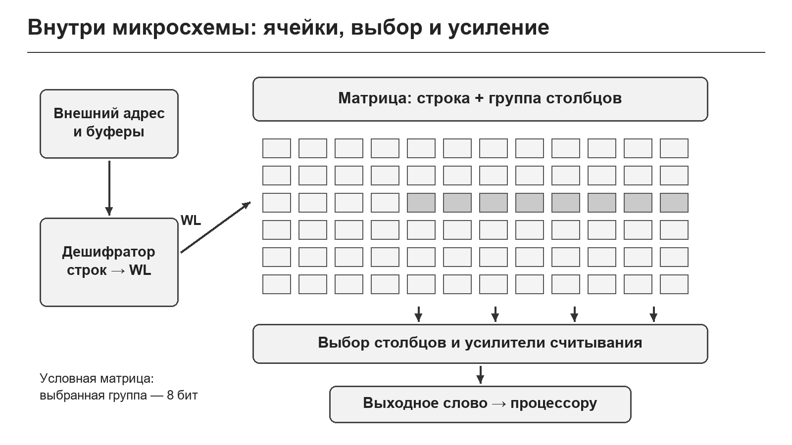

**Рисунок 1 — Внутренняя организация микросхемы памяти.**

На рисунке внешнему адресу соответствует путь внутри кристалла: входной буфер → выбор строки и столбцов → выбранные ячейки → усилители → выходной буфер. Это позволяет увидеть, почему память содержит больше, чем сам массив. Для записи требуются дополнительные драйверы, а для электрически программируемой памяти — схемы формирования повышенного напряжения и управления внутренними операциями.

Выбор строки и столбца здесь относится к **внутренней организации кристалла**. Процессор не обязан выдавать их отдельными командами: в простой SRAM он подаёт полный адрес, а микросхема выполняет внутреннее разделение сама. У DRAM порядок работы со строками сложнее, и его задаёт контроллер.

Надпись **8К × 8** означает 8192 адресуемых слова по 8 бит, всего 8 КиБ. Она описывает логическую организацию, но не раскрывает точное количество физических строк, банков и резервных ячеек. **КиБ** равен 1024 байтам. Этот расчёт нужен для чтения документации; карту адресов системы и условия внешней дешифрации рассматриваем как уже изученные в теме 5.3.

## 2. ПЗУ: матрица и считывание слова

**Постоянное запоминающее устройство (ПЗУ, ROM — Read-Only Memory)** хранит код программы, таблицы и другие данные, которые при обычной работе только читаются. Классическое **масочное ПЗУ** получает содержимое при изготовлении. Наличие или отсутствие определённого элемента, контакта либо проводящего пути в каждой позиции задаёт бит. Конкретная реализация может использовать разные схемы и полярности; важен принцип: заданная структура массива воспроизводит одно и то же слово при выборе адреса.

Представим учебную матрицу из четырёх восьмибитных слов. Для адресов 0, 1, 2 и 3 сохранены соответственно `3Ch`, `A5h`, `5Ah` и `F0h`. Дешифратор включает одну словную линию, а восемь столбцов дают восемь разрядов выбранного слова. На рисунке 2 выбрана строка 1, поэтому результат чтения — `A5h = 1010 0101₂`.

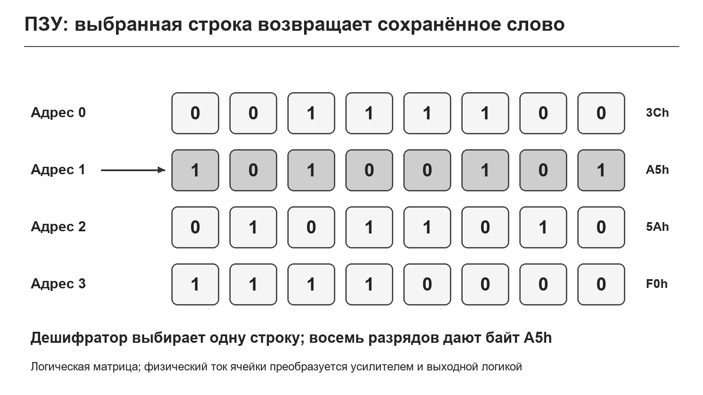

**Рисунок 2 — Логическая матрица содержимого ПЗУ.**

Рисунок представляет **логическую матрицу содержимого**, а не электрическую схему с прямым соединением всех пересечений. В реальном ПЗУ состояние выбранного элемента влияет на ток или напряжение битовой линии. Усилитель определяет состояние, а выходная логика формирует нужную полярность. Поэтому присутствие транзистора нельзя без схемы автоматически назвать логической единицей: оно может соответствовать нулю после принятого способа считывания.

При чтении параллельного ПЗУ процессор подаёт адрес и разрешение выбора. Микросхема выбирает строку и группу столбцов, усилители определяют сохранённые биты, выходной буфер выдаёт слово. На это требуется время доступа. Если выход запрещён, данные не должны поступать на общую шину, даже если внутренний массив уже выбран.

Масочное ПЗУ не требует удерживающего питания для сохранения информации: его содержимое задано структурой кристалла. Но питание требуется для дешифрации и считывания. Энергонезависимость не означает возможность читать обесточенную микросхему.

Для устройства с окончательно отлаженной неизменяемой программой масочное ПЗУ может быть подходящим решением. Когда программу нужно исправлять после изготовления, выбирают программируемую память. Разновидности ПЗУ различаются прежде всего способом создания и изменения состояния ячейки; эта связь приведена в таблице 1.

**Таблица 1 — Разновидности ПЗУ и изменение содержимого**

| Тип | Как задают содержимое | Как стирают | Что означает для пользователя |
|---|---|---|---|
| Mask ROM | Структурой кристалла при изготовлении | Не стирают | Программа фиксирована |
| PROM | Необратимым изменением программируемых элементов | Не стирают | Однократное программирование |
| EPROM | Электрическим программированием заряда | Ультрафиолетом, обычно весь массив | Нужны программатор и УФ-стирание |
| OTP EPROM | Как EPROM, но корпус без УФ-окна | Пользовательского УФ-стирания нет | Однократно программируемая версия |
| EEPROM | Электрическим изменением состояния выбранной области | Электрически, мелкими единицами по документации | Удобна для изменяемых настроек |
| Flash | Электрическим программированием | Электрически, секторами или блоками | Удобна для прошивок и больших массивов |

## 3. Программирование PROM и EPROM

Слово **«программирование»** в контексте памяти означает физическое занесение битов в запоминающий массив. Это другая операция, чем написание исходного текста программы на языке C или ассемблере. Сначала компилятор или ассемблер создаёт машинный код, затем программатор переносит полученный образ в память.

В классической **PROM (Programmable ROM)** использовались элементы, состояние которых менялось необратимо: например, плавкие перемычки. Во время программирования заданное воздействие разрывает проводящую связь. Существуют также технологии с созданием связи и другие варианты; способ кодирования 0 и 1 зависит от реализации. Общее свойство PROM — отсутствие штатной обратимой перезаписи.

**EPROM (Erasable Programmable ROM)** использует электрически программируемые ячейки с длительно сохраняемым зарядом. Перед новой прошивкой весь массив обычно стирают ультрафиолетовым облучением через окно корпуса. После стирания программатор снова записывает машинный код. OTP-версия EPROM содержит сходный кристалл, но корпус не имеет окна: обычный пользовательский способ стирания становится недоступным.

Программатор формирует адрес, данные, управляющие импульсы и, если нужно, специальное напряжение **VPP**. Его величина и длительности должны соответствовать именно выбранной модели. Подача «типичного напряжения для ПЗУ» вместо значения из документации способна повредить микросхему или создать ненадёжную запись. В рабочем режиме VPP и программирующие входы устанавливают в режим чтения, предписанный изготовителем.

Рассмотрим последовательность записи готового образа. Сначала выбирают в программе программатора точную модель микросхемы и проверяют распиновку. Затем проверяют идентификатор, если он поддерживается, и состояние стёртой памяти. Загружают образ, выполняют программирование и после завершения считывают массив для **верификации** — сравнения с исходными данными. Положительный результат передачи файла в программатор ещё не доказывает, что каждый бит памяти записан правильно. Общая последовательность показана на рисунке 3.

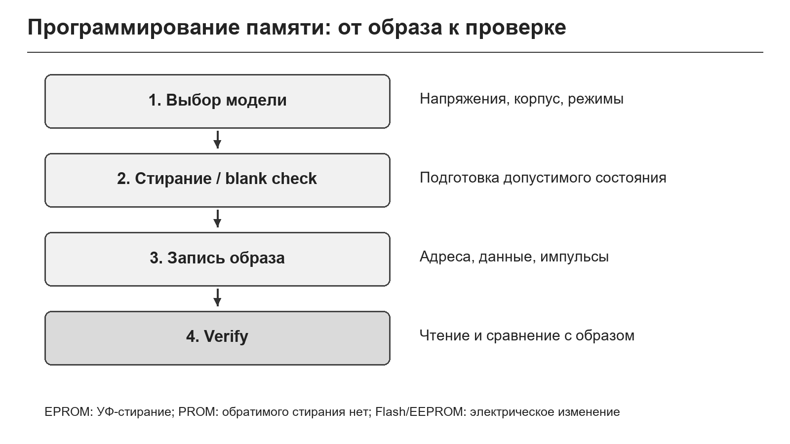

**Рисунок 3 — Запись образа и верификация программируемой памяти.**

Операция **blank check** проверяет, что память находится в допустимом стёртом состоянии. Для многих EPROM это единицы во всех разрядах, но конкретное значение и порядок проверки задаёт документация. **Verify** проверяет совпадение записанного образа с требуемым. Внешний программатор и встроенный загрузчик различаются способом доступа, но смысл проверки результата одинаков.

Если программируемые биты допустимо изменить только в одном направлении, произвольная замена уже записанного слова невозможна без стирания. Нельзя рассчитывать, что серия произвольных обычных записей превратит один образ EPROM в другой. Любое допустимое допрограммирование также проверяют по правилам конкретного устройства.

## 4. SRAM: ячейка, хранение, чтение и запись

**Оперативное запоминающее устройство (ОЗУ)** предназначено для данных, которые меняются во время работы. **SRAM (Static Random Access Memory)** — статическая память с произвольным доступом. Типичная CMOS-ячейка SRAM содержит **шесть транзисторов (6T)**: четыре образуют два инвертора с перекрёстной обратной связью, ещё два подключают внутренние узлы к битовым линиям. **CMOS** — комплементарная технология на МОП-транзисторах; инвертор содержит транзисторы двух типов.

Обозначим внутренние состояния как Q и ¬Q. Если Q = 1, второй узел равен 0; обратная связь поддерживает эту пару. Если Q = 0, ¬Q = 1, и схема удерживает противоположное состояние. Изолированная от битовых линий ячейка остаётся в одном из двух устойчивых состояний, пока питание соответствует требованиям. Устройство типичной ячейки показано на рисунке 4.

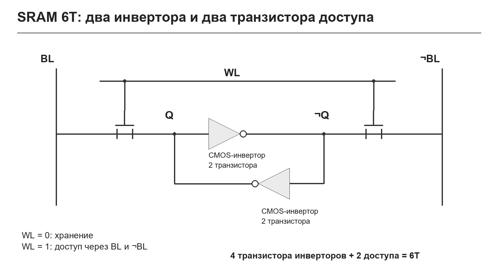

**Рисунок 4 — Типичная SRAM-ячейка 6T в логическом представлении.**

На рисунке каждый треугольник с инверсией представляет CMOS-инвертор из двух транзисторов. Два отдельно изображённых ключа — транзисторы доступа; оба управляются одной линией WL. Поэтому схема включает шесть транзисторов, хотя для наглядности четыре показаны как два логических элемента. Это типичная учебная 6T-ячейка; существуют и другие SRAM-ячейки.

**Хранение.** Линия WL неактивна, транзисторы доступа закрыты. Битовые линии не должны изменять состояние Q и ¬Q. Обратная связь работает непрерывно, поэтому SRAM не требует периодической регенерации. Слово «статическая» относится к удержанию состояния, а не к запрету записи.

**Чтение.** Перед чтением пару битовых линий подготавливают внутренние схемы. WL открывает транзисторы доступа. Сохранённое состояние вызывает небольшое различие сигналов BL и ¬BL. Дифференциальный усилитель считывания определяет, какая линия соответствует большему уровню, и восстанавливает логический бит на выходе. В исправной ячейке чтение не должно менять сохранённое состояние. Быстрое считывание обеспечивается тем, что усилителю достаточно различить малую разность, а не ждать полного изменения длинной битовой линии.

**Запись.** Драйверы записи принудительно задают противоположные значения на BL и ¬BL. При активной WL они меняют Q и ¬Q на требуемую пару. Затем WL снимается, и обратная связь удерживает новое состояние. Например, для записи Q = 0 драйверы задают соответствующую пару 0/1. Внешнему пользователю не нужно отдельно управлять внутренними ключами — SRAM делает это по адресу и входам выбора, выхода и записи.

Двухинверторная ячейка занимает сравнительно много площади кристалла. Это объясняет, почему SRAM удобна для небольших быстрых массивов, буферов и кешей, а большие объёмы оперативной памяти часто строят на DRAM. Цена и скорость конкретных изделий зависят также от технологии и интерфейса; число транзисторов не заменяет чтение документации.

Обычная SRAM энергозависима. После полного отключения питания состояние теряется; после включения его нельзя считать заданным. Удержание при пониженном напряжении или резервное питание возможно только в предусмотренных режимах. Если SRAM работает от батареи, данные сохраняются благодаря продолжающемуся питанию, а не из-за превращения ячейки в энергонезависимую.

## 5. DRAM: заряд, усилитель и регенерация

**DRAM (Dynamic Random Access Memory)** — динамическая оперативная память. Типичная ячейка **1T1C** содержит один транзистор доступа и один конденсатор. Транзистор соединяет конденсатор с битовой линией, когда активна словная линия WL. Такая ячейка компактнее типичной SRAM-ячейки, что позволяет создавать плотные массивы. Принцип показан на рисунке 5.

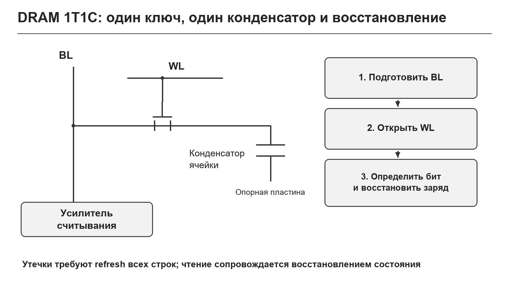

**Рисунок 5 — Типичная DRAM-ячейка 1T1C и цикл считывания.**

Для упрощённого объяснения один уровень заряда соответствует одному логическому состоянию, другой — противоположному. Реальные опорные напряжения и кодирование могут отличаться; нельзя для любой DRAM считать, что конденсатор обязательно заряжается ровно до внешнего VDD и затем соединяется с землёй.

**Запись** выполняется при открытом транзисторе доступа: драйвер устанавливает требуемый уровень на битовой линии и меняет заряд конденсатора. После закрытия транзистора заряд некоторое время сохраняется. Но из-за утечек он постепенно изменяется, и различие между состояниями уменьшается.

**Чтение** начинается с подготовки битовой линии к опорному уровню. При открытии транзистора заряд маленького конденсатора перераспределяется между ним и ёмкостью битовой линии. Возникает небольшое изменение напряжения. Усилитель считывания определяет его знак, формирует устойчивое логическое состояние и восстанавливает заряд ячейки. Поэтому чтение связано с восстановлением; простое подключение конденсатора к выходу не дало бы устойчивого результата.

**Регенерация (refresh)** — периодическое восстановление содержимого до того, как утечки сделают его неразличимым. Контроллер и сама микросхема организуют обход строк в установленные сроки. Нельзя заменять регенерацию правилом «данные не пропадут, если иногда обращаться к памяти»: обычные обращения могут не охватывать все строки.

У современных SDRAM и DDR-памяти контроллер управляет активацией строк, чтением и записью столбцов, предварительной подготовкой и обновлением. Поэтому внешнее подключение существенно сложнее, чем у асинхронной SRAM. DDR требует соответствующего контроллера, точных временных параметров и правильной разводки; на рисунке 5 рассматривается физический принцип ячейки, а не схема подключения модуля DDR к любой микропроцессорной шине.

Сравнение SRAM и DRAM приведено в таблице 2. Свойства объясняются способом хранения бита, а не только назначением памяти.

**Таблица 2 — Почему SRAM и DRAM работают по-разному**

| Свойство | Типичная SRAM | Типичная DRAM |
|---|---|---|
| Физическое состояние | Устойчивая пара состояний с обратной связью | Заряд конденсатора |
| Учебная ячейка | 6T | 1T1C |
| Чтение | Различие сигналов битовой пары | Перераспределение заряда и восстановление |
| Регенерация | Не нужна при нормальном питании | Обязательна |
| Без питания | Обычно теряет данные | Обычно теряет данные |
| Подключение | Возможен простой асинхронный интерфейс | Требуется подходящий контроллер |

## 6. Энергонезависимая ячейка и плавающий затвор

В классических EPROM, EEPROM и многих Flash-ячеках бит хранится благодаря заряду на **плавающем затворе**. Это проводящая область, изолированная диэлектриком: она не имеет обычного внешнего электрического контакта. Над ней находится управляющий затвор. Под затворами расположен канал между истоком и стоком МОП-транзистора. **МОП** означает структуру металл–оксид–полупроводник; в современных технологических вариантах материалы и геометрия отличаются от исторического названия.

Заряд на плавающем затворе изменяет **пороговое напряжение**: напряжение, при котором транзистор начинает проводить заметный ток при заданных условиях. Чтобы прочитать состояние, прикладывают заданное напряжение к управляющему затвору и проверяют ток канала. Ячейки с разным зарядом дают разные результаты сравнения. Разрез и смысл изменения порога показаны на рисунке 6.

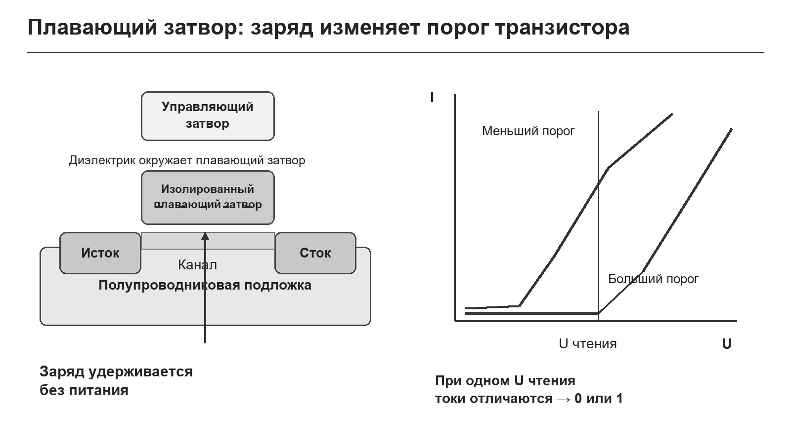

**Рисунок 6 — Плавающий затвор и изменение порогового напряжения.**

Для выбранной учебной модели NOR отрицательный заряд повышает порог. При напряжении чтения стёртая ячейка проводит ток, а запрограммированная — не проводит достаточный ток. Усилитель переводит результат в логические значения. Полярность кодирования и физические режимы зависят от технологии; рисунок объясняет типичный принцип, а не устройство всех энергонезависимых микросхем.

При **чтении** напряжения выбраны так, чтобы измерить состояние и не выполнять программирование. При **программировании** или **стирании** создают значительно более сильное электрическое поле, позволяющее изменить заряд. В разных технологиях используют инжекцию горячих электронов, туннелирование либо другие способы. Для EEPROM важен механизм туннелирования через тонкий диэлектрик. Его можно понимать как перенос электронов при специальных электрических условиях; обычный ток входа логического элемента не описывает такую операцию.

Если для изменения заряда нужны повышенные внутренние напряжения, это не означает, что их всегда надо подавать на выводы платы. Во многих современных устройствах их формирует **генератор накачки (charge pump)** — внутренняя схема повышения напряжения. Ею управляет логика памяти. Пользователь подаёт штатное питание и команду; внутренние схемы создают необходимые воздействия. Для старых EPROM может требоваться внешний VPP, поэтому эти случаи необходимо различать.

Изоляция удерживает заряд без питания, но имеет конечную надёжность. Циклы программирования и стирания постепенно изменяют свойства диэлектрика. Время хранения и ресурс зависят от температуры, истории записи и технологии. **Ресурс перезаписи** описывает допустимое число циклов изменения, а **retention** — срок удержания данных при заданных условиях; это разные параметры.

Плавающий затвор — удобная учебная модель. В современных Flash, особенно многослойной NAND, применяется и **ловушечное хранение заряда (charge trap)**. В многобитовых ячейках различают несколько диапазонов порога. SLC хранит один бит в ячейке, MLC в распространённой терминологии — два, TLC — три, QLC — четыре. Чем больше различаемых уровней, тем сложнее надёжно отделить их друг от друга. Подробная технология 3D NAND выходит за рамки этой темы.

## 7. EEPROM: внутренняя запись и ресурс

**EEPROM (Electrically Erasable Programmable Read-Only Memory)** допускает электрическое изменение небольших адресуемых областей. Её массив включает средства выбора области, внутреннего стирания, программирования и проверки. Типичная структура серийной EEPROM содержит интерфейсную логику, регистр адреса, буфер данных, управляющий автомат, генератор накачки и усилители считывания. Эти узлы показаны на рисунке 7.

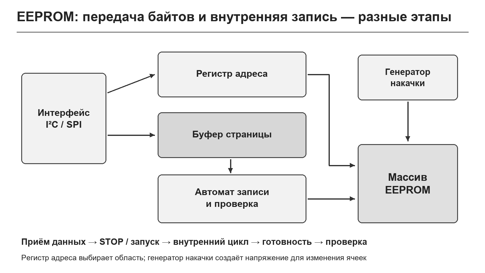

**Рисунок 7 — Внутренние узлы EEPROM и выполнение записи.**

При чтении EEPROM выбирает адресованные ячейки, определяет их состояния и возвращает байты через интерфейс. При записи полученные байты сначала могут попасть в **буфер страницы**, после чего внутренний автомат выполняет цикл изменения массива. Следовательно, подтверждение приёма байта и физическое завершение записи — разные события.

Во многих серийных EEPROM команда записи включает внутреннее стирание и программирование нужной области. Пользователю не требуется отдельная команда «стереть сектор», как в рассматриваемой SPI NOR Flash. Но операция занимает время, а размер записываемой группы и правила перехода границы страницы ограничены. EEPROM нельзя считать SRAM, которая просто сохраняет данные без питания.

Конкретный пример — **24LC256**, EEPROM с интерфейсом I²C, массивом 32 768 × 8 и буфером записи 64 байта. Если отправить четыре байта начиная с `003Eh` одной страничной операцией, первые два относятся к адресам `003Eh` и `003Fh`, а последующие у этой микросхемы могут попасть в начало той же страницы. Правильная передача делится на две записи: два байта с `003Eh`, затем после готовности два байта с `0040h`. Размер страницы — свойство конкретного устройства, а не всех EEPROM.

После окончания передачи запись во внутренний массив продолжается. У 24LC256 готовность можно проверять **ACK polling**: повторно обращаться к устройству и ждать предусмотренного подтверждения. Необходимо ограничить время ожидания и обработать ошибку. Бесконечный цикл ожидания превращает отсоединённую память или неисправную шину в зависание программы.

EEPROM хорошо подходит для калибровки, конфигурации и редко изменяемых параметров. Допустим, настройку сохраняют в одном и том же месте раз в секунду. За сутки это 86 400 циклов, за неделю — 604 800. Даже большой паспортный ресурс при такой записи расходуется быстро. Если ресурс условно равен 10⁶ циклов, простая оценка даёт около 11,6 суток; это расчёт для выбранного допущения, а не характеристика всех EEPROM.

Ресурс берегут, когда записывают только изменившиеся значения, объединяют несколько изменений или распределяют записи по разным позициям. Не следует считать, что запись того же байта гарантированно бесплатна для ресурса: такое поведение должно быть подтверждено изготовителем. Для устойчивости к отключению питания используют две копии, номер версии записи и контрольную сумму. Сначала записывают и проверяют новую копию, затем отмечают её актуальность. Эти меры относятся к организации хранения, а не изменяют физическое устройство EEPROM.

## 8. Flash: NOR, NAND, страницы и стирание

**Flash** объединяет энергонезависимое хранение с групповым электрическим стиранием. Упрощение выбора мелких областей позволяет повысить плотность массива, но пользователь получает другие правила изменения данных. Главная особенность для разработчика: **единица чтения, единица программирования и единица стирания могут иметь разные размеры**.

В **NOR Flash** запоминающие транзисторы подключены к битовой линии параллельными ветвями. Состояние выбранной ячейки можно определить через её проводимость, не пропуская ток через длинную цепочку соседних ячеек. В **NAND Flash** ячейки образуют последовательные цепочки. Для чтения выбранной ячейки другие элементы цепочки переводятся в проводящий режим, а выбранная определяет результат. Упрощённое различие соединений показано на рисунке 8.

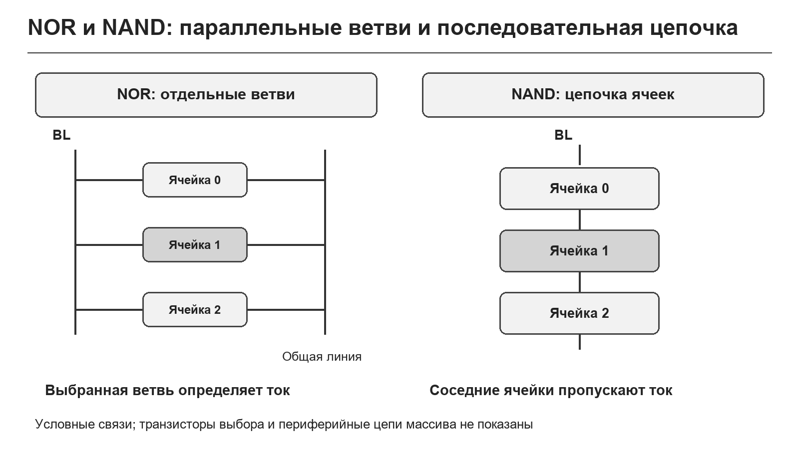

**Рисунок 8 — Упрощенная организация массивов NOR и NAND.**

Названия NOR и NAND связаны с организацией массива; это не утверждение, что микросхема памяти работает как обычный логический вентиль на своих внешних выводах. Последовательные цепочки NAND уменьшают затраты площади и связей, но делают естественным страничный обмен. Для NAND обычно необходимы учёт плохих блоков и **ECC (Error-Correcting Code)** — коррекция ошибок. В готовой карте памяти или SSD эти задачи выполняет контроллер.

NOR удобна для программ и таблиц, где важны адресуемое чтение и иногда непосредственное исполнение. NAND удобна для больших массивов данных. При этом NOR может иметь параллельный или последовательный внешний интерфейс; слово NOR не означает «обязательно много адресных выводов».

В типичной NOR стёртые биты читаются как 1. Программирование меняет выбранные биты 1 → 0, а возврат 0 → 1 требует стирания соответствующей области. Поясним на байтах: `A5h = 1010 0101₂`, `A7h = 1010 0111₂`. Для замены A5h на A7h один нулевой бит должен стать единицей. Простого программирования недостаточно — нужен цикл со стиранием. Отдельные изделия ограничивают даже повторное программирование в направлении 1 → 0, поэтому допустимые действия определяются документацией.

Пример SPI NOR — **W25Q64JV**: программирование до 256 байт в пределах страницы, стирание сектора 4 КиБ. Если меняется один байт занятого сектора, остальные данные необходимо сохранить, затем восстановить вместе с изменением. Разницу размеров и последовательность восстановления показывает рисунок 9.

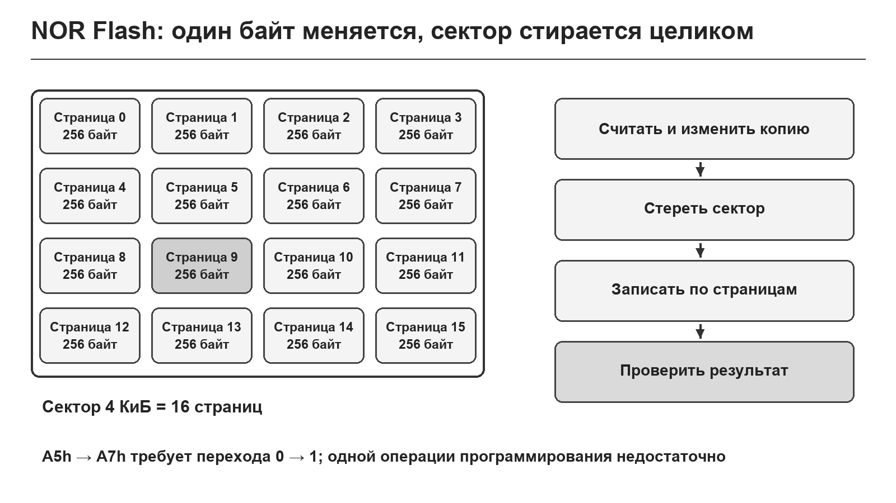

**Рисунок 9 — Страница, сектор и восстановление данных NOR Flash.**

Обновление сектора начинается с чтения нужного содержимого в буфер, внесения изменения в копию, стирания сектора, записи данных допустимыми порциями и проверки. Если весь сектор не помещается в ОЗУ, используют другую организацию обновления: резервный сектор, журнал или внешний буфер. Прерывание питания после стирания способно потерять информацию, поэтому надёжная схема не должна единственным действием уничтожать последнюю исправную копию.

EEPROM и Flash сравниваются в таблице 3. Отличие определяется гранулярностью и механизмом изменения массива, а не тем, что одна память «постоянная», а другая «обычная».

**Таблица 3 — Что меняется при переходе от EEPROM к Flash**

| Свойство | EEPROM | Рассматриваемая NOR Flash |
|---|---|---|
| Изменение небольшого параметра | Часто байтовая/страничная операция с внутренним стиранием | Может требовать сохранения и стирания сектора |
| Внешняя команда стирания | Для типичной I²C EEPROM не требуется отдельно | Требуется для возврата битов в стёртое состояние |
| Запись | С ожиданием завершения внутреннего цикла | С ожиданием завершения программирования |
| Основная задача | Настройки и калибровка | Код, таблицы, журналы |
| Ограничения | Границы страниц, ресурс, питание | Границы страниц/секторов, ресурс, питание |

## 9. Прошивка и обновление программы

**Образ прошивки** содержит машинный код и постоянные данные в формате, понятном загрузчику или программатору. Варианты BIN и Intel HEX различаются представлением: BIN — последовательность байтов без встроенных адресных записей, Intel HEX — текстовые записи с адресами и контрольными суммами. Это не делает один формат сам по себе безопаснее; инструмент должен знать, куда и что записывать.

Прошивку можно записать внешним программатором, через штатный отладочный интерфейс, например SWD или JTAG, либо через **загрузчик (bootloader)**. Загрузчик принимает данные по доступному интерфейсу, проверяет их и управляет записью памяти. Наличие Flash ещё не означает, что плата может автоматически обновляться через USB или UART: для этого нужны аппаратный путь и соответствующая программа.

**ISP (In-System Programming)** — программирование установленного в системе устройства. **IAP (In-Application Programming)** — программное изменение памяти средствами самого устройства в предусмотренном режиме. Эти термины близки по назначению, но конкретные изготовители используют их со своими деталями. Не следует смешивать ISP и интерфейс SPI только из-за сходства букв.

Внутренняя Flash во время стирания или программирования может быть недоступна для чтения. Если процессор продолжает выбирать из того же банка команды, он может остановиться, ожидать готовности или получить предусмотренную архитектурой ошибку. Возможные решения — выполнять процедуру из ОЗУ, из отдельного ROM-загрузчика или из другого банка, если поддерживается чтение во время записи. Такой режим называют **Read-While-Write**; его наличие и границы проверяют по документации.

Обновление затрагивает также обработчики прерываний и таблицу векторов. Даже если основная процедура перенесена в ОЗУ, её обращение к недоступной Flash через константу или прерывание способно нарушить работу. Поэтому недостаточно переместить только несколько команд: нужен согласованный режим работы на всё время операции.

После записи выполняют проверку прочитанных данных и целостности образа. Контрольная сумма выявляет случайные изменения, но не доказывает правильность алгоритма программы. Подпись образа при соответствующей системе ключей решает другую задачу — подтверждение подлинности. Для нашей темы достаточно различать проверку записанных байтов и проверку работоспособности прошивки.

В устройстве с двумя областями прошивки обновление удобно писать в неактивную область, проверять и лишь затем переключать запуск. В однобанковой системе возможна другая схема с сохраняемым загрузчиком и восстановлением. Конкретное решение зависит от памяти и процессора. Универсального правила «при обновлении всегда можно читать ту же Flash» не существует.

## 10. Параллельная память на шине процессора

У параллельной памяти адрес, данные и управление представлены отдельными группами выводов. Для устройства 8К × 8 адресные входы обычно обозначаются `A0–A12`, а восемь информационных линий — `D0–D7` или `I/O0–I/O7`. Параллельное ПЗУ имеет выходное направление данных в режиме чтения; у SRAM данные передаются в обе стороны. Подключение на уровне сигналов показано на рисунке 10.

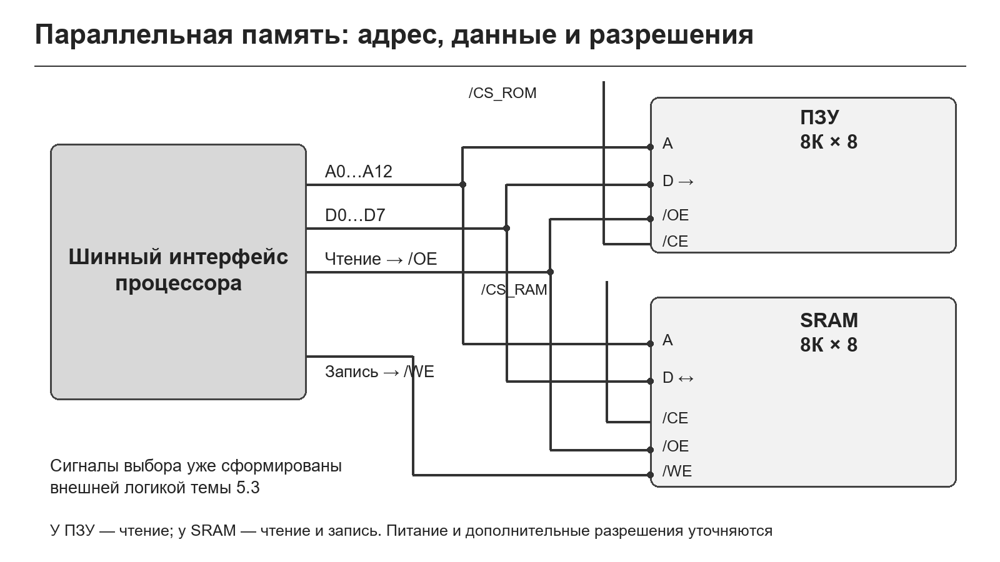

**Рисунок 10 — Сигнальное подключение параллельных ПЗУ и SRAM.**

**`/CE` (Chip Enable)** разрешает работу выбранной микросхемы. **`/OE` (Output Enable)** разрешает выдачу данных. **`/WE` (Write Enable)** разрешает запись. Символ `/` означает активный низкий уровень; изготовитель может использовать черту или знак `#`. Некоторые SRAM имеют два входа выбора с разными активными уровнями — схема должна учитывать оба.

При чтении шинный интерфейс устанавливает адрес и выбирает память. В SRAM `/WE` остаётся неактивным, `/OE` разрешает выход. Внутри кристалла выбираются строка и столбцы, усилители формируют слово, а выходные буферы выдают его на шину. Процессор должен считывать данные после требуемой задержки. Поэтому время доступа включает внутренний путь от входа адреса до выхода данных, а не только электрическое переключение вывода.

При записи SRAM процессор выдаёт адрес и байт, выходы памяти отключены, управляющий импульс запускает драйверы записи выбранного слова. Требуется выдержать время установки данных, длительность импульса и время удержания. Для разных SRAM завершение записи может определяться фронтом `/WE` или снятием выбора согласно временной диаграмме изготовителя.

Обычный цикл записи в SRAM меняет ячейку напрямую. Такой же импульс на параллельной Flash не означает произвольную мгновенную перезапись: Flash может требовать последовательность команд и ожидание внутреннего автомата. Физически похожие адресные и информационные выводы не делают правила записи одинаковыми.

Выход памяти имеет **высокоимпедансное состояние Z**: при отключении он освобождает общую шину. Z не является ни нулём, ни единицей. В любой момент только разрешённый источник должен активно выдавать данные. При переходе от чтения к записи учитывают задержку отключения выходов памяти, чтобы процессор и память не управляли линиями одновременно.

Здесь достаточно короткого напоминания темы 5.3: сигнал выбора памяти формирует внешняя логика из адреса и состояния шинного цикла. На рисунке он уже готов. Нельзя путать внешний выбор корпуса и внутренний дешифратор строк, который выбирает ячейки внутри этого корпуса. Подробная карта диапазонов и частичная дешифрация не являются задачей этой лекции.

На схемах используются уже сформированные команды чтения и записи памяти. Для реального КР580ВМ80А их получают с учётом состояния цикла, DBIN, `/WR` и системного контроллера либо соответствующей логики. Для процессора с мультиплексированным адресом адрес фиксируют по предусмотренному сигналу. Переход к монтажной схеме требует точных выводов и режимов конкретных компонентов.

Перед соединением проверяют питание, уровни логических сигналов, допустимые нагрузки, дополнительные разрешения и режим программирующих входов. Возле питания устанавливают развязывающий конденсатор согласно документации. Устройство 5 В не следует подключать к входу 3,3 В без проверки допустимых уровней. Для сохранения данных при сбое питания важен также запрет случайной записи в период неустойчивых сигналов.

## 11. Подключение I²C EEPROM

**I²C (Inter-Integrated Circuit)** передаёт данные по двум линиям: **SDA** — данные, **SCL** — тактирование. Ведущий контроллер формирует обмен, а EEPROM отвечает как ведомое устройство. Выходы устройств используют открытый сток и освобождают линии для высокого уровня; поэтому нужны **подтягивающие резисторы**. Они соединяют линии с допустимым напряжением питания шины.

На рисунке 11 показано подключение 24LC256 в восьмивыводном корпусе: VCC и VSS — питание; SDA и SCL — обмен; A0, A1, A2 — выбор аппаратного адреса; WP — защита записи. В примере адресные входы и WP подключены к нулю, а питание и уровни процессора согласованы. Подтяжки изображены отдельно для обеих линий.

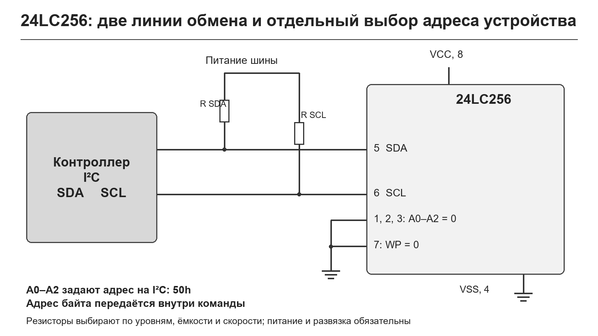

**Рисунок 11 — Сигнальное подключение EEPROM 24LC256.**

WP, **Write Protect**, при активном уровне защищает массив от записи в соответствии с правилами микросхемы. Если настройки должны быть неизменяемыми, этот вход можно использовать для аппаратного запрета записи. Он не заменяет обработку ошибок шины и не делает отсутствие питания безопасным во время уже начатой операции.

У 24LC256 аппаратный семибитный адрес имеет вид `1010 A2 A1 A0`. При A2 = A1 = A0 = 0 он равен `50h`. Это адрес **микросхемы на I²C-шине**, а не адрес байта внутри её массива. Адрес нужного байта передаётся отдельно. Важно также различать семибитное значение `50h` и байт управления: для записи он получается `A0h`, для чтения — `A1h`. Библиотека может требовать семибитный адрес или уже сдвинутый байт — нужно учитывать её соглашение.

Разберём запись байта `5Ah` по внутреннему адресу `0040h`. Ведущий формирует START, передаёт байт управления на запись, затем два адресных байта `00h` и `40h`, затем данные `5Ah`; ведомое подтверждает предусмотренные этапы. STOP завершает внешнюю передачу и запускает внутренний цикл записи. После готовности результат проверяют чтением. Последовательность приведена в таблице 4.

**Таблица 4 — Разобранный обмен с 24LC256 при A2…A0 = 000**

| Операция | Последовательность ведущего | Что важно |
|---|---|---|
| Запись `5Ah` в `0040h` | START → `A0h` → `00h` → `40h` → `5Ah` → STOP | Проверить ACK; затем дождаться внутренней записи |
| Чтение по `0040h` | START → `A0h` → `00h` → `40h` → повторный START → `A1h` → принять байт → NACK → STOP | Первая часть задаёт внутренний адрес; последняя завершает чтение |

В таблице показаны байты на проводе, а не аргументы какой-либо конкретной программной библиотеки. ACK сопровождает подтверждаемые передачи; NACK после последнего принятого байта сообщает об окончании чтения. Повторный START позволяет перейти к чтению без отпускания шины между заданием адреса и получением данных.

Подтягивающий резистор выбирают по напряжению, допустимому току низкого уровня, ёмкости проводников и времени нарастания. Номинал нельзя назначать одинаковым для всех схем. Слишком большой резистор даёт медленный фронт, слишком маленький — чрезмерный ток при низком уровне. Конкретный расчёт относится к теме интерфейсов; здесь важно понять физическую необходимость подтяжек.

I²C EEPROM не подключается к параллельным A0–A12 и D0–D7 процессора. Её выводы A0–A2 выбирают адрес устройства на последовательной шине; они не являются младшими тремя разрядами адреса каждой ячейки. Это одно из самых важных различий при чтении схем.

## 12. Подключение SPI Flash

**SPI (Serial Peripheral Interface)** в однолинейном режиме использует тактовую линию SCK, выбор устройства `/CS`, передачу от ведущего MOSI и от ведомого MISO. Для SPI NOR процессор передаёт команду и адрес последовательно. Отдельные адресные выводы, как у параллельного ПЗУ, не нужны.

На рисунке 12 показано сигнальное подключение W25Q64JV в восьмивыводном варианте: `/CS` — вывод 1; DO/IO1 — 2; IO2 — 3; GND — 4; DI/IO0 — 5; CLK — 6; IO3 — 7; VCC — 8. Дополнительные IO2 и IO3 соединены с соответствующими GPIO контроллера; использование зависит от одно-, двух- или четырёхлинейного режима. Их назначение нельзя автоматически подменять надписями `/WP` и `/HOLD` от другой модели Flash.

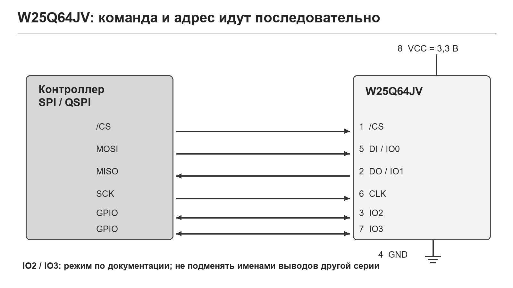

**Рисунок 12 — Сигнальное подключение SPI NOR Flash W25Q64JV.**

На рисунке питание 3,3 В относится к выбранной серии и согласованным уровням контроллера. Для другой памяти необходимо проверить напряжение. Линия `/CS` должна оставаться неактивной вне обмена, в том числе при сбросе процессора. Рекомендуемый способ задания её исходного уровня и режим дополнительных выводов определяются документацией и схемой контроллера.

Для обычного чтения ведущий активирует `/CS`, передаёт команду чтения и адрес, затем тактирует выдачу данных и завершает обмен. У быстрых команд могут присутствовать дополнительные такты и режимы; это не произвольная задержка, а часть протокола выбранной команды.

Программирование включает разрешение записи, передачу команды и данных, ожидание готовности и проверку. Страница не должна пересекаться одной операцией вопреки правилам памяти. Для стирания дополнительно задают адрес стираемой области. **WEL** обозначает внутренний признак разрешения записи, **BUSY** — выполнения операции. У W25Q64JV после завершения стирания или программирования WEL сбрасывается: **Write Enable повторяют перед каждой операцией изменения**, в том числе перед каждой программируемой страницей. После Sector Erase сначала дожидаются BUSY = 0, затем снова разрешают запись и передают Page Program. Снятие `/CS` завершает передачу, но внутреннее программирование ещё может продолжаться.

Программа должна опрашивать готовность с ограничением времени и проверять ошибки. Перед чтением результата важно дождаться окончания операции; иначе устройство может возвращать только статус или обслуживать ограниченный набор команд. Разрешённые действия во время занятости берут из документации.

Через обычный SPI-контроллер доступ реализуют командами программы. Специальный контроллер может отображать внешнюю NOR Flash в адресное пространство и автоматически выполнять обмен. **XIP (Execute In Place)** — исполнение кода непосредственно из такого отображения. Его поддержка требует согласованных возможностей памяти и контроллера; наличие разъёма SPI само по себе недостаточно.

Последовательный интерфейс уменьшает число выводов, но добавляет время передачи команды и адреса. Поэтому скорость чтения одного случайного байта и скорость длинного последовательного блока различаются. Выбор памяти зависит от характера обращений, а не только от частоты SCK.

## 13. Выбор памяти, выводы и самоконтроль

Тип памяти выбирают по требуемому поведению данных. Если значения часто меняются и нужны быстрые чтение и запись, подходит SRAM либо DRAM с контроллером. Если хранится исполняемая программа с возможностью обновления, рассматривают Flash. Если меняется небольшое число сохраняемых параметров, удобна EEPROM. Если код неизменяем и технология производства оправдывает фиксированное содержимое, возможны Mask ROM или однократно программируемая память.

В таблице 5 выбор связан с физическим принципом хранения и способом подключения. Ёмкость — лишь один из параметров: дополнительно проверяют разрядность, питание, время доступа, режим записи, ресурс и требования к контроллеру.

**Таблица 5 — От задачи к типу памяти**

| Задача | Возможная память | Причина | Подключение |
|---|---|---|---|
| Быстрый небольшой буфер | SRAM | Устойчивая ячейка, многократная оперативная запись | Параллельное или последовательное по модели |
| Большой массив оперативных данных | DRAM | Компактная ячейка 1T1C | Через DRAM-контроллер |
| Неизменяемая таблица | Mask ROM / PROM | Содержимое фиксировано | По интерфейсу микросхемы |
| Обновляемая прошивка | NOR Flash | Энергонезависимость и адресуемое чтение | Встроенная, параллельная, SPI/QSPI |
| Калибровка и настройки | EEPROM | Удобное изменение небольших областей | Встроенная, I²C, SPI или параллельная |
| Большой накопитель | NAND с контроллером | Высокая плотность, страничные операции | Через соответствующий контроллер |

Сравним ошибочные ожидания с устройством памяти. От SRAM не следует ждать сохранности без питания: состояние поддерживается работающей обратной связью. От DRAM нельзя ждать сохранности без refresh: заряд утекает. От EEPROM нельзя ждать мгновенной записи: внутренний автомат выполняет физическое изменение. От Flash нельзя ждать произвольного возврата 0 → 1 без стирания: состояние ячейки изменяется по специальным правилам. Эти ограничения прямо следуют из того, **как хранится бит**.

При подключении нужно понимать два уровня. Внутри корпуса работают ячейки, дешифраторы, усилители и управляющий автомат. Снаружи процессор видит адресные и информационные сигналы либо последовательный протокол. Для одной технологии хранения возможны разные внешние интерфейсы, а похожий внешний интерфейс не гарантирует одинакового способа записи.

### Вопросы для самоконтроля

1. Почему один адресуемый байт обычно требует нескольких физических битовых ячеек?
2. Для чего в кристалле нужны дешифраторы строк и столбцов?
3. Как усилитель считывания превращает состояние массива в цифровой сигнал?
4. Чем фиксированная матрица Mask ROM отличается от программируемой памяти?
5. Что физически изменяется в классической PROM с перемычками?
6. Зачем EPROM требуется УФ-стирание и чем отличается OTP-корпус?
7. Что означают blank check и verify при программировании?
8. Какие шесть транзисторов образуют типичную 6T-ячейку SRAM?
9. Чем режим хранения SRAM отличается от чтения и записи?
10. Почему чтение DRAM связано с восстановлением заряда?
11. Зачем нужна регенерация всех строк DRAM?
12. Как заряд плавающего затвора меняет порог транзистора?
13. Чем напряжения чтения отличаются по назначению от воздействий программирования?
14. Для чего нужен генератор накачки?
15. Чем ресурс циклов отличается от срока удержания данных?
16. Почему принятый EEPROM байт ещё не означает завершённую запись?
17. Что происходит при пересечении страницы 24LC256 и зачем ACK polling?
18. Чем организация NOR отличается от последовательной цепочки NAND?
19. Почему изменение одного байта Flash может затронуть целый сектор?
20. Где должна выполняться процедура обновления, если банк Flash недоступен для чтения?
21. Как различаются `/CE`, `/OE`, `/WE` и состояние Z?
22. Чем адресные входы A0–A2 I²C EEPROM отличаются от адресных входов параллельной SRAM?
23. Для чего нужны подтяжки SDA и SCL?
24. Чем семибитный I²C-адрес `50h` отличается от передаваемого байта `A0h`?
25. Почему нужно проверять назначение IO2 и IO3 именно выбранной SPI Flash?
26. Почему наличие SPI не гарантирует исполнение XIP?

## Источники

1. Рабочая программа МДК.02.01 «Микропроцессорные системы», специальность 09.02.01, 2026. Тема 6.1, 4 часа; практическая работа №11. Предоставленный файл `РП_МДК0201_МПС_КСК_2026.md`.
2. Русанов В. В., Шевелёв М. Ю. **Микропроцессорные устройства и системы**. Томск: ТУСУР, 2012. 184 с. ISBN 978-5-94154-128-7. [Пособие](https://edu.study.tusur.ru/publications/867/download), раздел 3.3, печатные с. 44–52 — типы памяти и принципы программирования.
3. Акименков М. В. **Основы микропроцессорной техники**. Алматы: АУЭС, 2016. [Конспект](https://libr.aues.kz/facultet/eef/kaf_epp/72/umm/epp_1.pdf), разделы 3.2 и 6.3 — память программ и данных, разновидности ПЗУ.
4. [Microchip. EEPROM Operation and Endurance](https://ww1.microchip.com/downloads/en/Market_Communication/MicroSolutions_July_2013_optimized.pdf), MicroSolutions, July/August 2013, с. 25–26 — плавающий затвор, считывание и ресурс.
5. [Microchip. 24AA256/24LC256/24FC256 Data Sheet, DS20001203Y](https://ww1.microchip.com/downloads/aemDocuments/documents/MPD/ProductDocuments/DataSheets/24AA256-24LC256-24FC256-256K-I2C-Serial-EEPROM-DS20001203.pdf) — выводы, страничная запись, ACK polling и чтение.
6. [Winbond. W25Q64JV Datasheet, Revision C](https://media.digikey.com/pdf/Data%20Sheets/Winbond%20PDFs/W25Q64JV_Rev_C.pdf) — организация NOR, выводы, команды и статус. Документ изготовителя размещён у дистрибьютора.
7. [Micron. DDR5 SDRAM](https://www.micron.com/products/memory/dram-components/ddr5-sdram) — ячейка DRAM и роль обновления; [Infineon. Asynchronous SRAM](https://www.infineon.com/products/memories/sram-static-ram/asynchronous-sram) — асинхронная SRAM.

