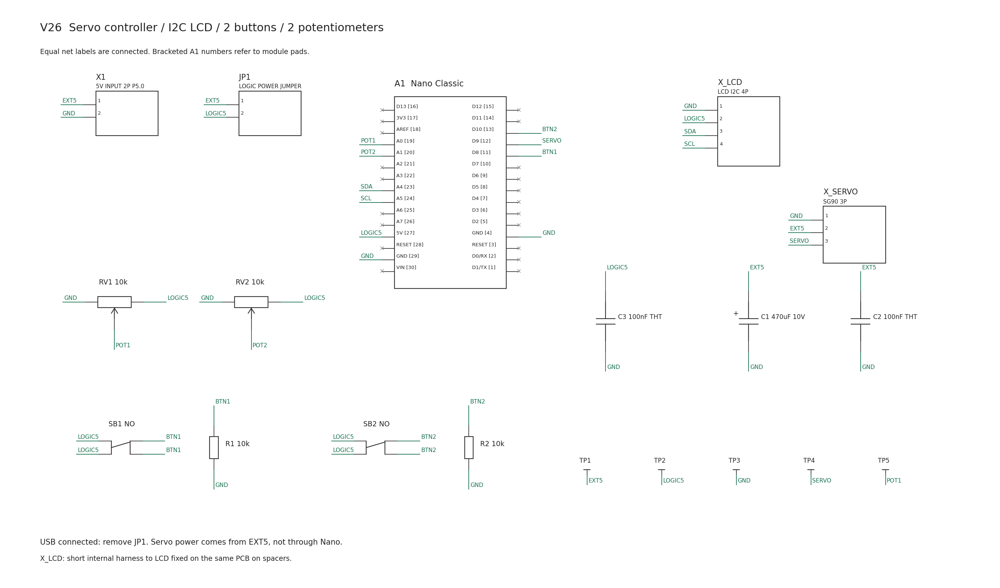
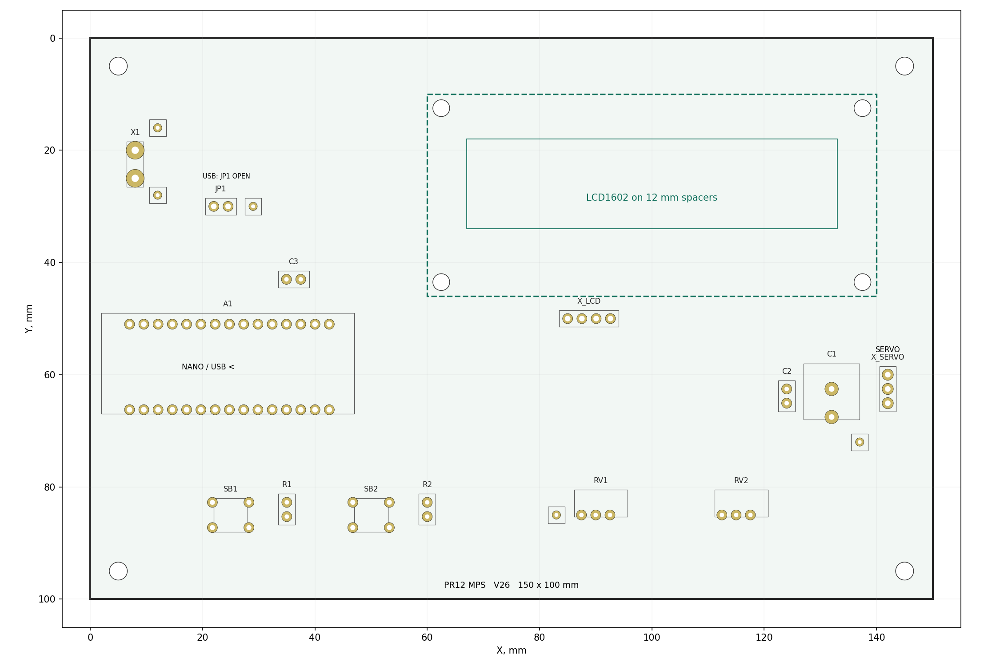
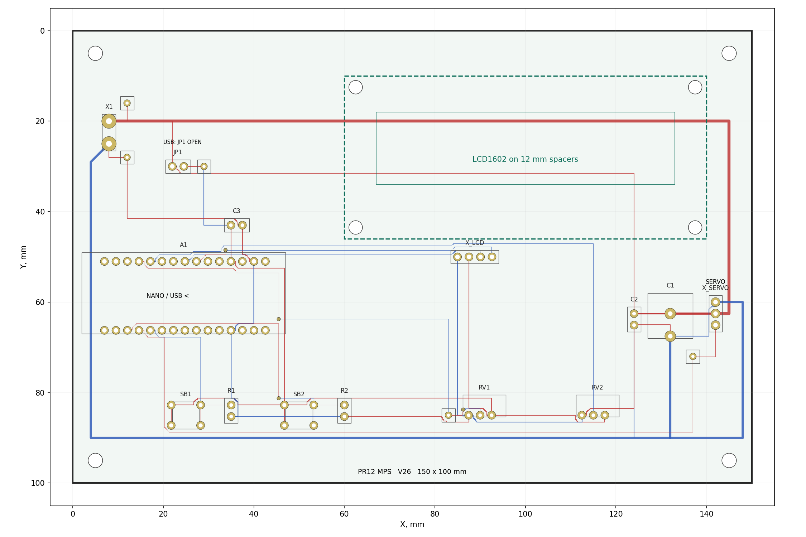
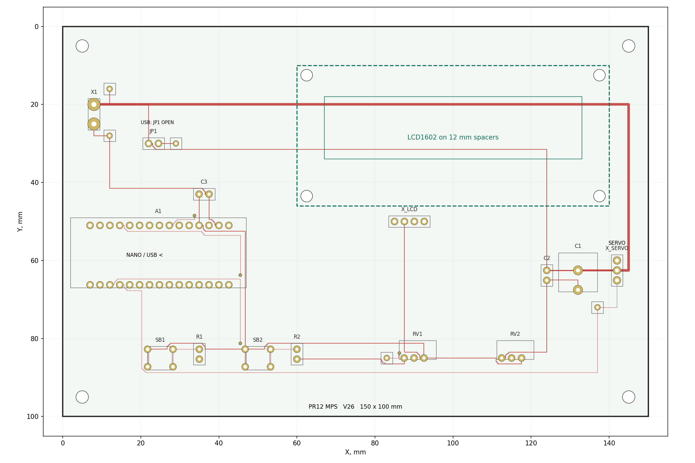
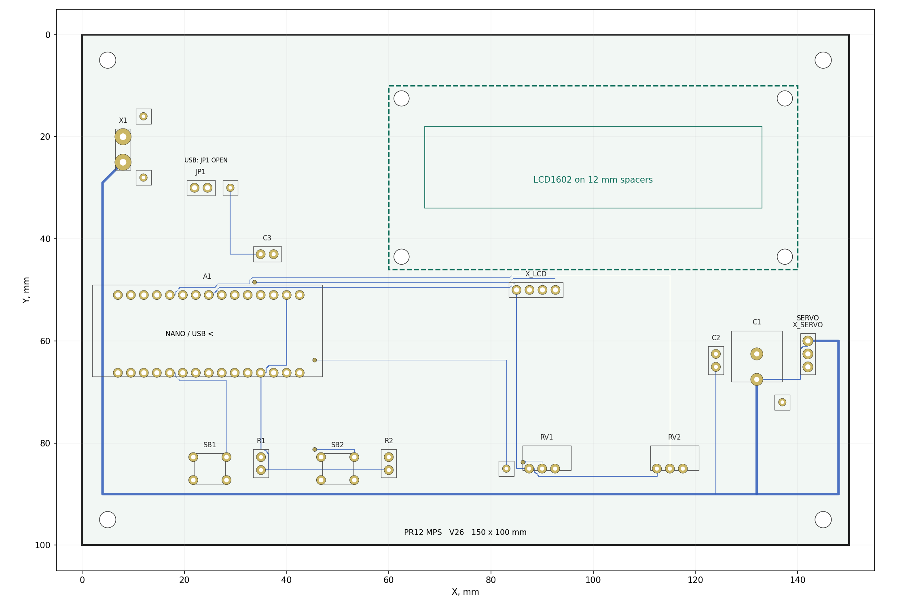

# Пример выполнения ПР12 по микропроцессорным системам

## Вариант 26 Устройство управления сервоприводом с LCD по I²C

**Состав:** Arduino Nano Classic, LCD1602 с I²C-адаптером, две кнопки, два регулировочных потенциометра, разъем SG90, питание и контрольные точки. Плата 150 × 100 мм, два медных слоя.

Это дополнительный преподавательский вариант. Он показывает готовую электрическую модель, размещение и разводку. Геометрия эталона построена программно и проверена в EasyEDA Standard; комплект **не изображает историю ручной работы студента**. В самостоятельной ПР12 студент выполняет размещение и трассировку вручную по условиям задания.

## 1 Выбранные решения

| Узел | Решение |
| --- | --- |
| Контроллер | Nano Classic на ATmega328P, установлен на двух колодках |
| LCD | I²C, расположен в северо-восточной части несущей платы на стойках |
| Кнопки | SB1 на D8, SB2 на D10, отдельные резисторы подтяжки 10 кОм к GND |
| Регуляторы | RV1 10 кОм → A0; RV2 10 кОм → A1; трехвыводные делители напряжения |
| Серво | Внешний SG90, разъем X_SERVO: 1 GND, 2 внешние +5 В, 3 сигнал D9 |
| Питание | Вход 5 В через X1; серво питается напрямую от входа; логика — через JP1 либо USB |
| Слои | Красный — Top, синий — Bottom; без полигонной заливки |
| Размер | 150 × 100 мм; четыре крепления PCB и четыре отверстия LCD |

В примере потенциометры выполнены как компактные подстроечные элементы с трехконтактным рядом 2,54 мм. Для крупного ручного регулятора необходимо заменить посадочное место и повторить размещение. Кнопки имеют учебное четырехконтактное посадочное место 6 × 6 мм. Конкретный заказной артикул и механические допуски окончательно не закреплены: это геометрический учебный эталон, а не выпуск в производство.

## 2 Электрическая схема

На рисунке 1 показана схема соединений. Nano и разъемы представлены пользовательскими блоками; резисторы, потенциометры, кнопки и конденсаторы — графическими символами. Указаны физические номера контактов, одинаковые метки означают соединенные цепи. Это редактируемая электрическая модель, не оформленная по ЕСКД. Полная таблица выводов находится в `export/connections.csv`.

*Рисунок 1 — Схема соединений. NC обозначает намеренно свободный контакт.*

Основные выводы Nano сведены в таблицу 1. Номера относятся к контактам пользовательского символа модуля, а не к ножкам микросхемы ATmega328P.

**Таблица 1 — Выводы модуля Nano**

| Функция | Имя на Nano | Контакт символа A1 | Сеть |
| --- | --- | --- | --- |
| Серво | D9 | 12 | SERVO |
| SB1 | D8 | 11 | BTN1 |
| SB2 | D10 | 13 | BTN2 |
| RV1 | A0 | 19 | POT1 |
| RV2 | A1 | 20 | POT2 |
| SDA | A4 | 23 | SDA |
| SCL | A5 | 24 | SCL |
| Питание логики | 5V | 27 | LOGIC5 |
| Земля | GND | 29 и 4 | GND |

### Как соединены кнопки

Левые контакты 1 и 2 каждой кнопки принадлежат одной электрической группе и подключены к LOGIC5. Правые 3 и 4 образуют вторую группу, подключенную к BTN1 либо BTN2. Соответствующая кнопка замыкает эти группы при нажатии. R1 и R2 по 10 кОм соединяют входы с GND.

Проверка схемы: отпущенная кнопка дает LOW через 10 кОм; нажатая подает HIGH. Ни один резистор не соединяет +5 В и GND напрямую без сопротивления.

### Как соединены потенциометры

Контакт 1 — GND, контакт 2 — подвижный контакт POT1/POT2, контакт 3 — LOGIC5. Номинал каждого — 10 кОм. При последующем выборе реального корпуса проверьте, что его контакт 2 действительно является движком и направление регулировки соответствует маркировке.

### Дисплей

На несущей плате установлен X_LCD с четырьмя контактами: 1 GND, 2 LOGIC5, 3 SDA, 4 SCL. Дисплей расположен на той же несущей плате на стойках, соединяется коротким внутренним четырехпроводным кабелем с I²C-адаптером. Согласованная длина кабеля — до 80 мм.

Предполагается адаптер со штатными подтяжками SDA/SCL и регулятором контраста; это проверяется по конкретному модулю до сборки. Отдельные дублирующие подтяжки на PCB не установлены. Контрастный потенциометр адаптера не входит в число RV1/RV2.

### Питание

EXT5 — внешние стабилизированные 5 В, GND — общая земля. JP1 соединяет EXT5 и LOGIC5 в автономном режиме. При подключенном USB JP1 снимается. Серво питается от EXT5 напрямую, через Nano его ток не проходит.

C1 470 мкФ/10 В и C2 100 нФ стоят около разъема двигателя. C3 100 нФ — около питания Nano. Плюсовой контакт C1 — 1, минусовой — 2.

## 3 Размещение и механика

На рисунке 2 показано размещение до трассировки. Прозрачный/пунктирный контур LCD нужен для проверки сборки; он не заменяет электрический разъем.

*Рисунок 2 — Размещение и габарит LCD. Все координаты в миллиметрах, начало — верхний левый угол платы.*

**Таблица 2 — Основные координаты**

| Элемент | Положение |
| --- | --- |
| Nano | Габарит x=2…47, y=49…67; ряды контактов y=51 и 66,24; USB направлен влево |
| LCD | Учебный габарит x=60…140, y=10…46; стойки высотой 12 мм |
| Крепления LCD | (62,5; 12,5), (137,5; 12,5), (62,5; 43,5), (137,5; 43,5); отверстия 3 мм |
| X1 | Контакты (8; 20) и (8; 25); шаг 5 мм |
| JP1 | (22; 30) и (24,54; 30) |
| X_LCD | Первый контакт (85; 50), шаг 2,54 мм по X |
| X_SERVO | Первый контакт (142; 60), шаг 2,54 мм по Y |
| SB1 / SB2 | Центры около (25; 85) и (50; 85) |
| RV1 / RV2 | Подвижные контакты (90; 85) и (115; 85) |
| Крепления PCB | (5; 5), (145; 5), (5; 95), (145; 95); отверстия 3,2 мм |

Габариты LCD и места креплений приняты как исходные размеры учебного модуля. Перед реальной сборкой их необходимо сопоставить с конкретным экземпляром, включая расположение I²C-адаптера, разъема и доступ к его подстроечнику. Высоких компонентов под контуром LCD нет; медные дорожки под модулем допустимы при обеспеченном зазоре.

USB и разъемы доступны с краев, кнопки и подстроечники не перекрываются LCD. Для крепежа оставлены зоны без меди радиусом 3,5 мм.

## 4 Разводка

Общий вид двух медных слоев дан на рисунке 3.

*Рисунок 3 — Дорожки, площадки, четыре переходных отверстия и монтажные отверстия.*

Верхний и нижний слои отдельно показаны на рисунках 4 и 5.

*Рисунок 4 — Верхний медный слой, вид сверху.*

*Рисунок 5 — Нижний медный слой, также вид сверху, без зеркалирования.*

### Почему цепи разведены так

1. Входная плюсовая цепь идет широкой дорожкой по верхнему слою и отдельной ветвью приходит к разъему серво. Выходы конденсаторов соединены рядом с разъемом.
2. Силовой возврат серво идет по нижнему слою к GND X1, не используя колодки Nano и тонкую землю аналоговых регуляторов.
3. LOGIC5 после JP1 питает Nano, LCD, кнопки и регуляторы. Ее не следует объединять меткой с EXT5 в обход перемычки.
4. Сигнальные сети разведены дорожками 0,25 мм. Логические питание и земля — от 0,50 мм; локальная ветвь C2 имеет ширину 0,80 мм; силовые участки — 1,50 и 2,00 мм.
5. Четыре via обеспечивают переход между слоями для сигнальных/логических маршрутов. Подача и силовой возврат сервопривода не проходят через одиночное сигнальное via.

Учебная трассировка содержит прямоугольные и короткие ступенчатые участки. Она показывает связность и разделение цепей; студент может сделать более плавные маршруты 45° при сохранении соединений и правил. Это не оптимизация минимальной площади или помехоустойчивости.

### Как повторить один маршрут вручную

В копии платы удалите дорожки SERVO, сохранив площадки. Найдите контакт 12 A1, контакт 3 X_SERVO и TP4. Инструментом Track соедините их одной сетью, используя второй слой только при необходимости. Проверьте подсветку всей сети, отсутствие пересечений с чужой медью и повторите DRC. Не удаляйте силовую подачу и землю вместе с сигналом.

## 5 Проверки и их пределы

Проверки выполнены двумя разными способами: по точной геометрии исходных данных и в браузерном EasyEDA Standard 6.5.61 после импорта.

**Таблица 3 — Фактически полученные результаты**

| Проверка | Результат |
| --- | --- |
| Импорт схемы в EasyEDA | Успешен; 19 символов, 10 рабочих сетей |
| Импорт PCB в EasyEDA | Успешен; 19 компонентов; площадки, дорожки и via отображаются |
| DRC PCB в EasyEDA | 0 ошибок после повторной проверки |
| Локальная связность | Каждая из 10 рабочих сетей образует одну связанную медную структуру |
| Чужие медные сети на одном слое | Пересечений нет; минимальный геометрический зазор около 0,226 мм, требование 0,20 мм |
| Отступ меди от края | Не менее 0,50 мм |
| Зоны крепежа | Медь не входит в круг радиусом 3,5 мм вокруг центров |
| Via | 4; площадка 0,80 мм, сверление 0,35 мм |
| Слои / полигоны | Два медных слоя; полигонной заливки нет |
| Физическая сборка и работа | Не выполнялись |
| Подтверждение ручного выполнения | Не заявляется: это программно созданный преподавательский эталон |

В PCB неиспользуемые площадки Nano имеют индивидуальные метки NC_*. Они не являются требуемыми внешними соединениями. Два свободных контакта RESET намеренно имеют разные локальные метки, поскольку их внутренняя связь на готовом Nano не требует дополнительной дорожки несущей платы. Схема помечает их NC.

Успешная DRC проверяет геометрию и обнаруживаемые редактором соединения, но не подтверждает номиналы, допустимый ток контактов, нагрев, точность чертежей модулей и работоспособность прошивки.

## 6 Как открыть исходники

Файлы рассчитаны на **EasyEDA Standard**. Это исходный JSON Standard, а не формат EasyEDA Pro.

1. Распакуйте архив целиком.
2. В Standard выберите «Файл → Открыть → EasyEDA».
3. Выберите `project/V26_schematic_EasyEDA_Std.json`, действие «Импортировать файл», нажмите «Импорт».
4. Аналогично откройте `project/V26_PCB_EasyEDA_Std.json`.
5. При необходимости нажмите «В размер окна». В менеджере проектирования обновите списки компонентов и цепей; после импорта они могут показывать старый счетчик до обновления.
6. Запустите DRC повторно в вашей редакции и убедитесь, что результат воспроизводится.

`V26_placement_EasyEDA_Std.json` содержит те же компоненты до трассировки. Это демонстрационное состояние, подготовленное из модели, а не сохраненная история действий студента. Искусственное состояние `routing_half` для имитации ручной работы не создавалось.

Схема и PCB даны отдельными документами. Пользовательские посадочные места встроены в PCB; это не зарегистрированные компоненты публичной библиотеки. Для автоматического повторного преобразования схемы в PCB необходимо предварительно извлечь/сохранить эти посадочные места и назначить их символам в своем проекте. **Не выполняйте обновление готовой платы из схемы, пока не проверено назначение пользовательских корпусов.** Открытие и редактирование готовой PCB доступны непосредственно после импорта.

## 7 Комплект файлов

| Папка или файл | Содержание |
| --- | --- |
| `project/V26_schematic_EasyEDA_Std.json` | Редактируемая схема соединений |
| `project/V26_PCB_EasyEDA_Std.json` | Редактируемая разведенная плата |
| `project/V26_placement_EasyEDA_Std.json` | Демонстрация размещения до трассировки |
| `project/geometry.json` | Исходные координаты, площадки, сети, дорожки и отверстия в мм |
| `images` | Схема и виды платы в PNG/SVG |
| `export/BOM.csv` | Состав элементов несущей платы |
| `export/connections.csv` | Полная таблица контактов и сетей |
| `export/schematic.pdf` | Читаемая схема соединений |
| `export/gerber` | Учебный экспорт меди, маски, контура и сверления из общей геометрической модели |
| `checks/verification.json` | Результаты локальной проверки и сведения о проверке в EasyEDA |

BOM несущей платы содержит X_LCD, но сам LCD с адаптером также нужен для сборки; установите его на четыре стойки 12 мм. Сервопривод SG90, кабель LCD, колпачок JP1, стойки, винты и внешний источник — элементы комплектации сборки, а не отдельные корпуса в медном проекте. Ниже они перечислены отдельно, чтобы разъемы не подменяли реальные узлы.

**Таблица 4 — Дополнительная комплектация сборки**

| Позиция | Количество |
| --- | --- |
| LCD1602 с I²C-адаптером | 1 |
| SG90 со штатным трехпроводным кабелем | 1 |
| Внутренний кабель LCD, 4 проводника, до 80 мм | 1 |
| Колодки Nano 1 × 15, шаг 2,54 мм | 2; представлены в PCB единым посадочным местом A1 |
| Колпачок JP1 | 1 |
| Стойки LCD 12 мм, винты/крепеж под согласованные отверстия | 4 комплекта |
| Стойки несущей платы и винты М3 | 4 комплекта |
| Источник стабилизированных 5 В, не менее 2 А | 1 |

Gerber в комплекте сформированы локально из тех же координат, не экспортированы из авторизованного облачного проекта. Перед изготовлением следует окончательно выбрать реальные компоненты, проверить их посадочные места, обновить маркировку и получить проверенный производственный экспорт непосредственно в САПР. Учебный комплект не является разрешением на заказ без этих проверок.

## 8 Пример выводов по работе

Получена схема управления позиционным сервоприводом с двумя кнопками, двумя аналоговыми регуляторами и LCD по I²C. На несущей плате предусмотрены Nano, дисплейный узел, органы управления, вход питания и разъем внешнего привода. Силовой ток двигателя не проходит через Nano. Разделены EXT5 и LOGIC5, предусмотрена перемычка для двух взаимоисключающих режимов питания.

Плата импортирована в EasyEDA Standard и прошла DRC без ошибок. Независимая проверка подтвердила связность десяти рабочих сетей и соблюдение заданных зазоров. Эти результаты относятся к электрической модели и геометрии; работу устройства, точность механической сборки и пригодность конкретных деталей подтверждают на последующих этапах.

## Источники

- [Arduino Nano Classic — официальная документация](https://docs.arduino.cc/hardware/nano).
- [Официальная распиновка Nano](https://docs.arduino.cc/resources/pinouts/A000005-full-pinout.pdf).
- [EasyEDA Standard — открытый формат исходников](https://github.com/easyeda/easyeda-std-file-format).
- [EasyEDA Standard — DRC](https://docs.easyeda.com/en/PCB/Design-Rule-Check/).
