# Практическая работа № 11

## Перерисовка электрической схемы из EasyEDA и разработка печатной платы с ручной трассировкой

**Дисциплина:** МДК.02.01 «Микропроцессорные системы».  
**Специальность:** 09.02.01 «Компьютерные системы и комплексы».  
**Курс, семестр:** 4-й курс, 7-й семестр.  
**Продолжительность:** 4 академических часа — 180 минут без учёта перерывов.  
**Форма работы:** индивидуальная, 25 вариантов. Номер варианта соответствует номеру студента по списку в журнале.

В [РПД на 2026–2027 учебный год](../../../../РПД/2026/РП_МДК0201_МПС_КСК_2026.md) работа № 11 называется «Проектирование узла памяти микропроцессорной системы», объём — 4 часа. По заданию преподавателя содержание этой работы расширено: используются разные несложные устройства на микросхемах. Общая задача — освоение полного маршрута «готовая электрическая схема → собственная схема в EasyEDA → самостоятельно разработанная плата».

## Содержание

- [1. Цель и задачи](#sec-1)
- [2. Оборудование и подготовка](#sec-2)
- [3. Что нужно знать](#sec-3)
- [4. Общее задание](#sec-4)
- [5. Порядок выполнения](#sec-5)
- [6. Индивидуальные варианты и схемы](#sec-6)
- [7. Результаты и отчёт](#sec-7)
- [8. Контрольные вопросы](#sec-8)
- [9. Оценивание](#sec-9)
- [10. Источники и локальные материалы](#sec-10)

<a id="sec-1"></a>
## 1. Цель и задачи

**Цель:** научиться самостоятельно воспроизводить готовую электрическую принципиальную схему в EasyEDA, назначать посадочные места, размещать компоненты и вручную разводить печатную плату.

**Задачи:**

1. Прочитать электрическую схему своего варианта: определить микросхемы, питание, входы, выходы и обвязку.
2. Создать новый проект и вручную нарисовать схему по образцу.
3. Проверить обозначения, номиналы, номера выводов и электрические соединения.
4. Выбрать подходящие посадочные места и проверить соответствие «вывод — контактная площадка».
5. Создать контур платы, самостоятельно расставить компоненты и развести все дорожки без автотрассировщика.
6. Выполнить проверку правил проектирования, сохранить исходный проект и оформить отчёт.

<a id="sec-2"></a>
## 2. Оборудование и подготовка

Работа выполняется на учебном компьютере под обычной учётной записью. Права администратора для браузерной версии не нужны.

Необходимы EasyEDA Standard или установленная у преподавателя редакция EasyEDA Pro, средство просмотра Markdown и PNG, личная папка `ПР11_Группа_Фамилия_VNN` с подпапками `project`, `export`, `screenshots`. В отчёте укажите использованную редакцию САПР.

Перед началом проверьте, что редактор открывается, поиск компонентов работает, проект сохраняется, а локальная схема варианта читается при увеличении. Если готового компонента нет, создайте символ по распиновке либо используйте проверенный библиотечный символ с теми же номерами и назначением выводов. Сходство названий или числа ножек не доказывает совместимость.

**Материалы задания доступны без интернета:** все 25 изображений находятся в `images`, копия исходного сборника — в `sources/Задание_УП_2025.docx`. Сохраните папку задания целиком. Для чтения номиналов откройте PNG в исходном разрешении. В карточках указаны номера схем исходного документа.

Для браузерной EasyEDA нужен доступ к сервису. При работе без сети заранее подготовьте установленный клиент и библиотеку нужных компонентов. Наличие локальных картинок само по себе не обеспечивает автономную работу браузерной САПР.

В этой работе разрабатывается проект. Покупать детали, паять плату, подключать аккумуляторы и источники питания, заказывать изготовление, писать и загружать прошивку не требуется. В вариантах с микроконтроллером назначение устройства описывает авторский проект; без прошивки одно наличие схемы не обеспечивает его функцию.

<a id="sec-3"></a>
## 3. Что нужно знать

Электрическая принципиальная схема определяет, какие выводы компонентов соединены между собой. Расположение символов на листе служит удобству чтения и не задаёт положение деталей на плате. Поэтому схему следует перерисовать с сохранением соединений, а компоненты на плате разместить самостоятельно.

Метки с одинаковым именем в пределах соответствующей области схемы соединяют цепи без длинного провода на рисунке. Например, все метки `GND` относятся к общей земле. Имена `VIN`, `VOUT`, `3V3` и `+5V` обозначают разные цепи и не должны объединяться. Точка на пересечении означает электрическое соединение; простое пересечение линий может его не иметь. Знак NC означает намеренно неподключённый вывод.

**Символ компонента** содержит электрические выводы. **Посадочное место** содержит площадки, отверстия и контуры корпуса на PCB. Вывод 1 символа должен соответствовать площадке 1 выбранного корпуса. У транзисторов, стабилизаторов, USB-разъёмов и микросхем разных производителей порядок выводов может различаться.

Один символ модуля на схеме не означает необходимость проектировать модуль изнутри. Arduino Nano, дисплей, радиомодуль, внешний датчик или пьезоизлучатель подключают так, как показано у автора. Если показан разъём модуля, на разрабатываемой плате размещают этот разъём, а не всю электронику модуля.

После преобразования схемы в PCB редактор показывает линии связей — ещё не реализованные соединения. Линии связей не являются дорожками. Прокладка дорожек инструментом Track вручную превращает электрические связи в геометрию меди. Переходное отверстие соединяет дорожки разных медных слоёв.

**DRC (Design Rule Check)** проверяет геометрические правила: ширину, зазоры, некоторые пересечения и другие ограничения. Нулевое число сообщений DRC не доказывает совпадение схемы с образцом. Нужны две отдельные проверки: электрическое сравнение с исходником и проверка готовой платы.

Для импульсных преобразователей важно не только наличие соединений: контуры между микросхемой, дросселем, диодом и конденсаторами делают короткими, а цепь обратной связи удаляют от переключающего узла. В этой работе оцениваются проект и осмысленная компоновка; электрическая работоспособность и электромагнитная совместимость не подтверждаются проверкой DRC.

<a id="sec-4"></a>
## 4. Общее задание

Откройте рисунок своего варианта в разделе 6 и **самостоятельно перерисуйте показанную электрическую схему в новом проекте EasyEDA**. После проверки создайте по ней плату, вручную расставьте компоненты и вручную разведите все соединения.

Исходные рисунки взяты из предоставленного преподавателем документа «Задание УП.docx» за 2025 год. В разделе 6 сохранено соответствие номерам схем этого сборника. Рисунки содержат исходные номиналы, связи, рамки и имеющиеся авторские подписи; перерисовка нужна для освоения САПР.

**Правила перерисовки:**

- Создайте пустую схему и расставляйте символы самостоятельно. Не импортируйте готовую схему, не используйте Clone, копирование фрагмента проекта или подстановку готового JSON.
- Сохраните модели микросхем, номиналы, полярность, номера выводов и электрические связи образца. Имена компонентов можно перенумеровать последовательно, сохранив таблицу соответствия авторским обозначениям.
- Все показанные на листе электрические узлы входят в задание. Текст «optional» и пометки NC перенесите вместе с их смыслом. Компоненты с вариантом комплектации не удаляйте молча: отметьте в BOM, если они не устанавливаются.
- Рамку листа, логотип и расположение текста воспроизводить не требуется. Укажите в своей схеме источник: «По сборнику “Задание УП”, 2025, схема № …»; при наличии подписи автора перенесите её в сведения об источнике.
- Если источник содержит только метки входа/выхода питания, добавьте разъёмы для подключения этих цепей и обозначьте это как своё дополнение. Это явно заданная учебная доработка. Не добавляйте произвольный стабилизатор, перемычки или датчики.
- Питание определяется исходной схемой. Единого требования «3,3 В для всех вариантов» нет.
- Размер платы выбирайте исходя из реальных корпусов и требований таблицы 1. Форму авторской платы и её расположение компонентов копировать не требуется.

Нормы учебной платы приведены в таблице 1. Они предназначены для выполнения задания и не заменяют проверку требований изготовителя, токов нагрузки и теплового режима при реальном производстве.

**Таблица 1 — Требования к плате**

| Параметр | Требование |
|---|---|
| Контур | Один замкнутый прямоугольный контур Board Outline; размер выбрать самостоятельно, с учётом габаритов корпусов и разъёмов; для платы расширения сохраните геометрию подключения к базовой плате |
| Слои | Два медных слоя: Top и Bottom; компоненты разместить сверху |
| Сигнальные дорожки | Не уже 0,25 мм |
| Цепи питания, земли и силовые соединения | Не уже 0,50 мм на свободных участках; короткий выход из площадки меньшей ширины допускается по геометрии корпуса с объяснением в отчёте |
| Зазор между медью разных цепей | Не менее 0,20 мм |
| Медь — край платы | Не менее 0,50 мм |
| Переходное отверстие | Площадка не менее 0,70 мм, сверление 0,35 мм |
| Разъёмы и органы управления | Доступны с края платы, корпус разъёма не пересекает соседние детали |
| Развязывающие конденсаторы | Рядом с выводами питания соответствующей микросхемы |
| Маркировка | Фамилия, вариант, обозначения компонентов, ключи микросхем, полярность и назначение контактов питания |
| Завершённость | Ноль неразведённых соединений и ноль неисправленных нарушений DRC |

**Автотрассировщик запрещён:** не использовать встроенный Auto Router, внешний Freerouting или импорт уже разведённой платы. Автоматическую расстановку также не применять. Разрешены DRC, сетка, подсветка цепей и привязка курсора. Для проверки ручной разводки не используйте полигонную заливку: питание и землю тоже соедините дорожками.

Сохраните три состояния проекта: `placement` — после расстановки, `routing_half` — в процессе трассировки, `final` — после завершения. На защите преподаватель выбирает одну сигнальную цепь: удалите её дорожки, проложите их заново вручную и повторите проверку.

<a id="sec-5"></a>
## 5. Порядок выполнения

Все действия выполняйте в своей редакции EasyEDA на учебном компьютере. Промежуточные копии сохраняйте в личной папке работы; после ошибочного изменения возвращайтесь к последней сохранённой версии. Названия меню Standard и Pro могут различаться.

### Этап 1. Прочитать исходную схему — 20 минут

1. Откройте карточку своего варианта и локальный PNG. Увеличьте изображение так, чтобы читались все номиналы и номера ножек.
2. Найдите основные микросхемы, цепи питания, входные и выходные разъёмы. Проследите одну сигнальную цепь и одну цепь питания.
3. Выпишите все компоненты: авторское обозначение, модель/номинал, назначение, планируемый корпус. Для основной микросхемы выпишите таблицу «номер вывода — функция — подключённая цепь».
4. Прочитайте примечания на рисунке и требования карточки. Обратите внимание на напряжения конденсаторов, обозначения NC и особые исполнения компонентов.

**Ожидается:** понятны состав и соединения устройства. **Проверка:** по своей таблице найдите каждый компонент на исходном рисунке; пропущенных узлов быть не должно.

### Этап 2. Вручную нарисовать схему — 40 минут

1. Создайте проект `PR11_Группа_Фамилия_VNN` и пустой документ Schematic.
2. Найдите и расставьте символы. Проверьте их выводы, подпишите модели и номиналы.
3. Инструментом Wire соедините компоненты по образцу. Одинаковые метки цепей должны иметь одинаковое написание.
4. Добавьте только те физические разъёмы, которые прямо требуются в карточке. Подпишите назначение и номера их контактов.
5. Запустите доступную проверку схемы / Design Manager. Исправьте оборванные связи, дубли обозначений и реальные ошибки. Обоснованные предупреждения о NC объясните в отчёте.
6. Сравните схему с образцом по каждому выводу микросхем и каждой метке питания. Отдельно проверьте аноды/катоды диодов, полярность конденсаторов и распиновку транзисторов.

**Ожидается:** новая собственная схема, электрически соответствующая заданному образцу с разрешёнными доработками. **Проверка:** сохраните `01_schematic` и таблицу сравнения; одинаковый внешний вид без совпадения связей не засчитывается.

### Этап 3. Назначить корпуса и создать PCB — 20 минут

1. В менеджере посадочных мест назначьте каждому компоненту корпус. Для модулей и разъёмов учитывайте физический шаг и порядок контактов.
2. Сверьте номера выводов символа с площадками корпуса. У разъёма USB-C проверьте конкретное исполнение и контакты CC; у микросхем с тепловой площадкой — её наличие и подключение.
3. Преобразуйте свою схему в PCB. При ошибке отсутствующего корпуса исправьте назначение; не исключайте компонент из платы.
4. Создайте замкнутый контур и задайте правила таблицы 1. Запишите фактические размеры платы.

**Ожидается:** все компоненты схемы присутствуют на плате, корпуса соответствуют символам. **Проверка:** снимок `02_rules`, таблица выбранных корпусов и проверка ключей микросхем.

### Этап 4. Самостоятельно расставить компоненты — 25 минут

1. Поставьте разъёмы, переключатели и кнопки у доступных краёв платы.
2. Разместите основную микросхему и связанные с ней компоненты по функциональным группам.
3. Поставьте конденсаторы питания рядом с соответствующими выводами. У преобразователей сблизьте дроссель, диод, входной/выходной конденсаторы и микросхему; не проводите длинную обратную связь рядом с узлом SW.
4. Просмотрите линии связей. При большом количестве пересечений измените компоновку до трассировки.
5. Расставьте обозначения и полярности так, чтобы маркировка не попадала на площадки.

**Ожидается:** компоновка удобна для ручной разводки, корпуса не перекрываются. **Проверка:** сохраните проект `placement`, снимок `03_placement` и предварительный 3D-вид.

### Этап 5. Развести дорожки вручную — 45 минут

1. Выберите ручной инструмент Track. Сначала соедините локальные цепи питания и конденсаторы, затем критичные короткие цепи и остальные сигналы.
2. Выбирайте ширину под назначение цепи по таблице 1. Предпочитайте повороты 45° и короткие понятные маршруты.
3. При пересечениях сначала рассмотрите перемещение компонентов; при необходимости используйте второй слой и переходное отверстие.
4. В середине работы сохраните `routing_half` и снимок `04_routing_half`: на нём должны одновременно присутствовать готовые дорожки и неразведённые связи.
5. Доведите число неразведённых соединений до нуля. У разветвлённой цепи проверьте подключение всех площадок, а не одной пары.

**Ожидается:** все соединения реализованы дорожками, включая GND. **Проверка:** подсветите питание, землю и несколько сигнальных сетей, проверьте счётчик оставшихся соединений. Сохраните `05_pcb`.

### Этап 6. Проверить и экспортировать — 20 минут

1. Запустите DRC, исправьте нарушения и повторите проверку после последнего изменения. Не снижайте правила ради исчезновения сообщения.
2. Отдельно проверьте ширины, зазор до края, распиновку разъёмов и соответствие исходной схеме. Убедитесь, что линии связей не просто скрыты, а их счётчик равен нулю.
3. Откройте 3D-вид. Проверьте корпуса и доступность разъёмов. Отсутствующая 3D-модель не заменяет проверку посадочного места в 2D.
4. Экспортируйте редактируемую схему и PCB в `project`. Откройте экспортированную копию и проверьте, что оба документа доступны для редактирования.
5. В `export` сохраните PDF собственной схемы, изображения платы с видимыми слоями, BOM, Gerber и файл сверления. Откройте производственные файлы в просмотрщике и проверьте контур, медь и отверстия. Заказ изготовления не оформляйте.

**Ожидается:** исходный проект и экспорты читаются, неисправленных ошибок нет. **Проверка:** снимки `06_drc`, `07_unrouted`, `08_3d`, `09_gerber` с пояснениями в отчёте.

### Этап 7. Оформить результат и защитить — 10 минут

Запишите выводы, покажите промежуточные копии и вручную повторите трассировку выбранной преподавателем цепи. После демонстрации повторите DRC и сохраните окончательный проект.

### Типовые ошибки

- **Провод визуально касается вывода, но не соединён.** Проверьте привязку к сетке и подсветку цепи.
- **Схемы похожи, но питание объединено неверно.** Сверьте каждую метку VIN/VOUT/VCC/GND с образцом.
- **Символ подходит, корпус другой.** Проверьте номера площадок и чертёж конкретного корпуса.
- **OLED или датчик изображены как модуль.** Перенесите показанное подключение модуля; не добавляйте в задание его внутреннюю схему.
- **На плате остались разрывы при скрытых линиях связей.** Включите отображение связей и проверьте счётчик.
- **После правки схемы плата не обновлена.** Обновите PCB из схемы, проверьте изменения и выполните DRC снова.

<a id="sec-6"></a>
## 6. Индивидуальные варианты и схемы

**Номер варианта соответствует номеру студента по списку в журнале.** В таблице 2 указано соответствие новым вариантам и номерам строк таблицы «№ варианта — схема» в исходном документе «Задание УП.docx» за 2025 год. Названия ниже служат для навигации; модели компонентов, номиналы и соединения определяйте по рисунку.

Все 25 рисунков извлечены из документа без изменения исходных байтов. Перерисуйте схему своего варианта целиком, затем самостоятельно разместите компоненты на плате и вручную разведите все соединения. Одинаковые навыки проверяются на схемах разной сложности. Не подменяйте сложную микросхему более простой и не удаляйте узлы.

**Таблица 2 — Варианты и соответствие исходному сборнику**

| Вариант работы № 11 | Схема | № схемы в исходном документе |
|---|---|---|
| [1](#v1) | Регулятор яркости лампы на таймере 555 | 1 |
| [2](#v2) | Усилитель звукового сигнала | 3 |
| [3](#v3) | Узел питания с зарядным устройством | 4 |
| [4](#v4) | Многоканальное устройство управления светодиодами | 5 |
| [5](#v5) | Программатор AVR на Arduino Nano | 6 |
| [6](#v6) | Микроконтроллерный узел с разъёмами | 8 |
| [7](#v7) | Микроконтроллерный узел с интерфейсами | 9 |
| [8](#v8) | Устройство управления на микроконтроллере | 10 |
| [9](#v9) | Микроконтроллерный узел с дисплеем | 11 |
| [10](#v10) | Узел управления с датчиком | 12 |
| [11](#v11) | Светодиодные часы на Arduino Nano | 14 |
| [12](#v12) | Плата расширения Arduino для датчика | 15 |
| [13](#v13) | Радиоустройство на ESP32 | 16 |
| [14](#v14) | Усилитель звуковой частоты | 17 |
| [15](#v15) | Управляющий узел с входными цепями | 18 |
| [16](#v16) | Микроконтроллерный интерфейсный узел | 19 |
| [17](#v17) | Интерфейсный узел с несколькими микросхемами | 20 |
| [18](#v18) | Узел заряда и преобразования питания | 21 |
| [19](#v19) | Микроконтроллерный регулятор с оптосвязью | 22 |
| [20](#v20) | Микроконтроллерная плата с разъёмами | 23 |
| [21](#v21) | Контроллер с выходными каналами | 24 |
| [22](#v22) | Микроконтроллерный узел обмена данными | 25 |
| [23](#v23) | Светодиодный автомат на 555 и CD4017 | 26 |
| [24](#v24) | Устройство с матрицей светодиодов 6 × 6 | 27 |
| [25](#v25) | Микроконтроллерный узел с зарядным устройством | 28 |

<a id="v1"></a>
### Вариант 1 — Регулятор яркости лампы на таймере 555

**Источник:** схема № 1, вторая таблица документа [«Задание УП», 2025](sources/Задание_УП_2025.docx). [Открыть рисунок в исходном разрешении](images/easyeda_v01.png).

**Задание:** вручную перерисовать электрическую схему на рисунке 1 в пустом проекте EasyEDA, проверить модели и номера выводов микросхем, назначить посадочные места, самостоятельно расставить компоненты и вручную развести плату. Показанные готовые модули переносите как модули или их разъёмы, сохраняя распиновку.

Перед трассировкой выделите питание и землю, входы и выходы, составьте перечень микросхем и таблицу соединений основной микросхемы. Укажите её модель и назначение в отчёте. Если подпись неоднозначна даже при открытии исходного PNG, согласуйте её с преподавателем до выбора компонента; номинал не угадывайте.

На рисунке 1 приведена схема № 1 исходного сборника. Сохраняйте все электрические связи, обозначения питания и авторские примечания; рамку и интерфейс редактора перерисовывать не требуется.

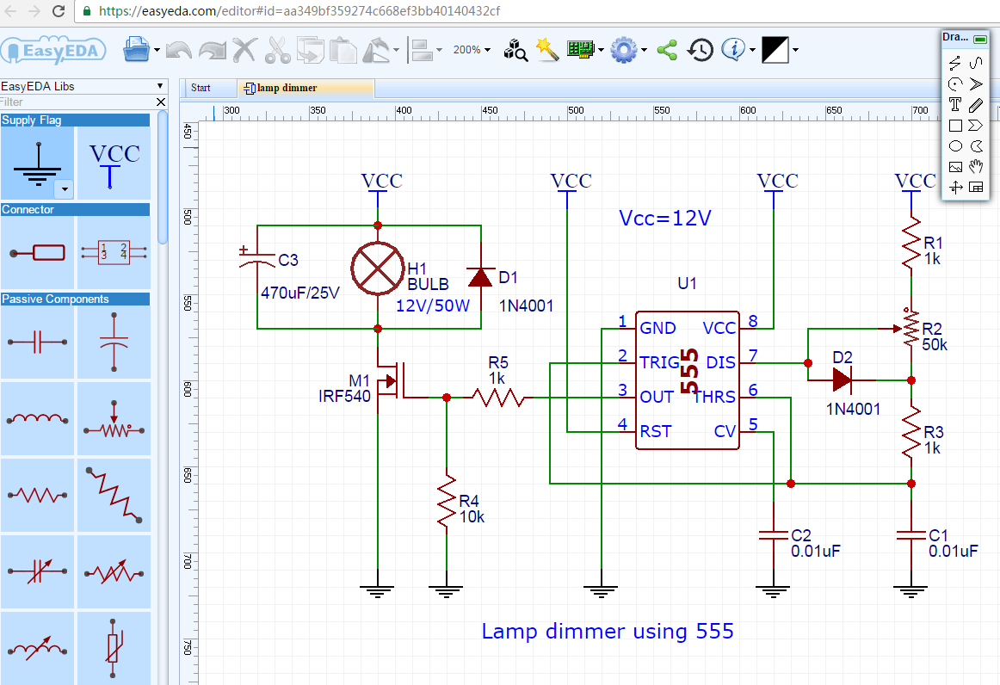

_Рисунок 1 — Регулятор яркости лампы на таймере 555. Источник: «Задание УП.docx», 2025, схема № 1; исходное изображение сохранено без изменений, включая имеющиеся подписи автора._

[К таблице вариантов](#sec-6)

<a id="v2"></a>
### Вариант 2 — Усилитель звукового сигнала

**Источник:** схема № 3, вторая таблица документа [«Задание УП», 2025](sources/Задание_УП_2025.docx). [Открыть рисунок в исходном разрешении](images/easyeda_v02.png).

**Задание:** вручную перерисовать электрическую схему на рисунке 2 в пустом проекте EasyEDA, проверить модели и номера выводов микросхем, назначить посадочные места, самостоятельно расставить компоненты и вручную развести плату. Показанные готовые модули переносите как модули или их разъёмы, сохраняя распиновку.

Перед трассировкой выделите питание и землю, входы и выходы, составьте перечень микросхем и таблицу соединений основной микросхемы. Укажите её модель и назначение в отчёте. Если подпись неоднозначна даже при открытии исходного PNG, согласуйте её с преподавателем до выбора компонента; номинал не угадывайте.

На рисунке 2 приведена схема № 3 исходного сборника. Сохраняйте все электрические связи, обозначения питания и авторские примечания; рамку и интерфейс редактора перерисовывать не требуется.

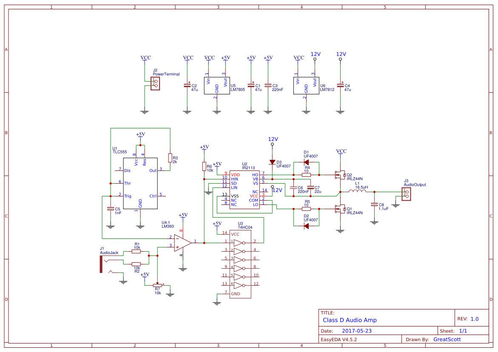

_Рисунок 2 — Усилитель звукового сигнала. Источник: «Задание УП.docx», 2025, схема № 3; исходное изображение сохранено без изменений, включая имеющиеся подписи автора._

[К таблице вариантов](#sec-6)

<a id="v3"></a>
### Вариант 3 — Узел питания с зарядным устройством

**Источник:** схема № 4, вторая таблица документа [«Задание УП», 2025](sources/Задание_УП_2025.docx). [Открыть рисунок в исходном разрешении](images/easyeda_v03.png).

**Задание:** вручную перерисовать электрическую схему на рисунке 3 в пустом проекте EasyEDA, проверить модели и номера выводов микросхем, назначить посадочные места, самостоятельно расставить компоненты и вручную развести плату. Показанные готовые модули переносите как модули или их разъёмы, сохраняя распиновку.

Перед трассировкой выделите питание и землю, входы и выходы, составьте перечень микросхем и таблицу соединений основной микросхемы. Укажите её модель и назначение в отчёте. Если подпись неоднозначна даже при открытии исходного PNG, согласуйте её с преподавателем до выбора компонента; номинал не угадывайте.

На рисунке 3 приведена схема № 4 исходного сборника. Сохраняйте все электрические связи, обозначения питания и авторские примечания; рамку и интерфейс редактора перерисовывать не требуется.

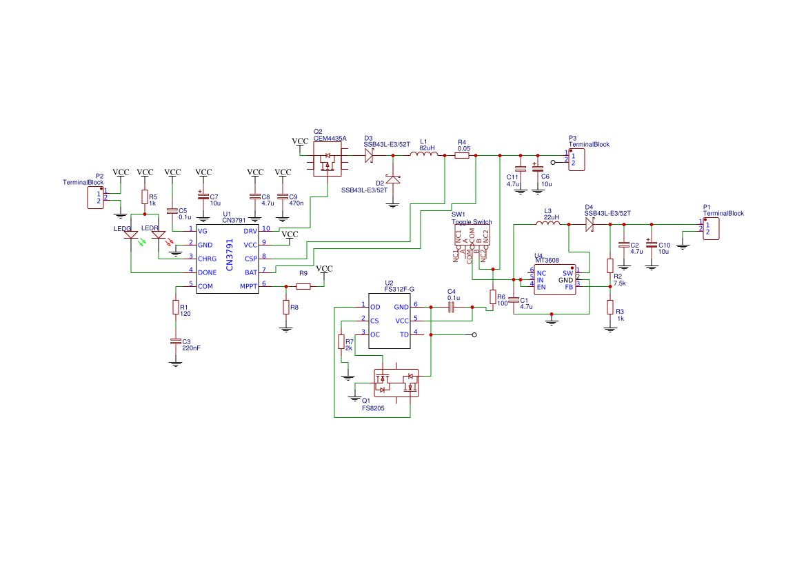

_Рисунок 3 — Узел питания с зарядным устройством. Источник: «Задание УП.docx», 2025, схема № 4; исходное изображение сохранено без изменений, включая имеющиеся подписи автора._

[К таблице вариантов](#sec-6)

<a id="v4"></a>
### Вариант 4 — Многоканальное устройство управления светодиодами

**Источник:** схема № 5, вторая таблица документа [«Задание УП», 2025](sources/Задание_УП_2025.docx). [Открыть рисунок в исходном разрешении](images/easyeda_v04.png).

**Задание:** вручную перерисовать электрическую схему на рисунке 4 в пустом проекте EasyEDA, проверить модели и номера выводов микросхем, назначить посадочные места, самостоятельно расставить компоненты и вручную развести плату. Показанные готовые модули переносите как модули или их разъёмы, сохраняя распиновку.

Перед трассировкой выделите питание и землю, входы и выходы, составьте перечень микросхем и таблицу соединений основной микросхемы. Укажите её модель и назначение в отчёте. Если подпись неоднозначна даже при открытии исходного PNG, согласуйте её с преподавателем до выбора компонента; номинал не угадывайте.

На рисунке 4 приведена схема № 5 исходного сборника. Сохраняйте все электрические связи, обозначения питания и авторские примечания; рамку и интерфейс редактора перерисовывать не требуется.

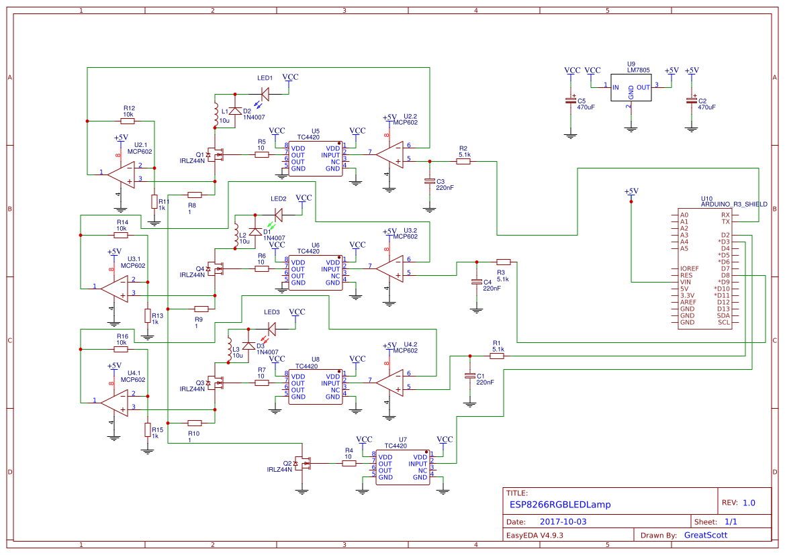

_Рисунок 4 — Многоканальное устройство управления светодиодами. Источник: «Задание УП.docx», 2025, схема № 5; исходное изображение сохранено без изменений, включая имеющиеся подписи автора._

[К таблице вариантов](#sec-6)

<a id="v5"></a>
### Вариант 5 — Программатор AVR на Arduino Nano

**Источник:** схема № 6, вторая таблица документа [«Задание УП», 2025](sources/Задание_УП_2025.docx). [Открыть рисунок в исходном разрешении](images/easyeda_v05.png).

**Задание:** вручную перерисовать электрическую схему на рисунке 5 в пустом проекте EasyEDA, проверить модели и номера выводов микросхем, назначить посадочные места, самостоятельно расставить компоненты и вручную развести плату. Показанные готовые модули переносите как модули или их разъёмы, сохраняя распиновку.

Перед трассировкой выделите питание и землю, входы и выходы, составьте перечень микросхем и таблицу соединений основной микросхемы. Укажите её модель и назначение в отчёте. Если подпись неоднозначна даже при открытии исходного PNG, согласуйте её с преподавателем до выбора компонента; номинал не угадывайте.

На рисунке 5 приведена схема № 6 исходного сборника. Сохраняйте все электрические связи, обозначения питания и авторские примечания; рамку и интерфейс редактора перерисовывать не требуется.

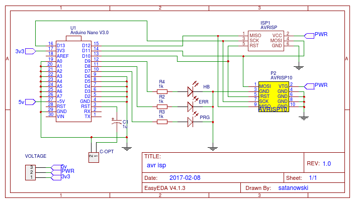

_Рисунок 5 — Программатор AVR на Arduino Nano. Источник: «Задание УП.docx», 2025, схема № 6; исходное изображение сохранено без изменений, включая имеющиеся подписи автора._

[К таблице вариантов](#sec-6)

<a id="v6"></a>
### Вариант 6 — Микроконтроллерный узел с разъёмами

**Источник:** схема № 8, вторая таблица документа [«Задание УП», 2025](sources/Задание_УП_2025.docx). [Открыть рисунок в исходном разрешении](images/easyeda_v06.png).

**Задание:** вручную перерисовать электрическую схему на рисунке 6 в пустом проекте EasyEDA, проверить модели и номера выводов микросхем, назначить посадочные места, самостоятельно расставить компоненты и вручную развести плату. Показанные готовые модули переносите как модули или их разъёмы, сохраняя распиновку.

Перед трассировкой выделите питание и землю, входы и выходы, составьте перечень микросхем и таблицу соединений основной микросхемы. Укажите её модель и назначение в отчёте. Если подпись неоднозначна даже при открытии исходного PNG, согласуйте её с преподавателем до выбора компонента; номинал не угадывайте.

На рисунке 6 приведена схема № 8 исходного сборника. Сохраняйте все электрические связи, обозначения питания и авторские примечания; рамку и интерфейс редактора перерисовывать не требуется.

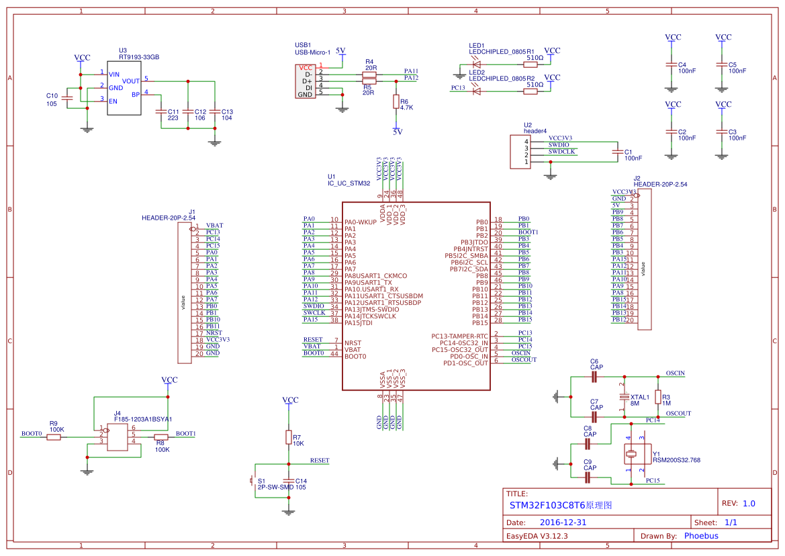

_Рисунок 6 — Микроконтроллерный узел с разъёмами. Источник: «Задание УП.docx», 2025, схема № 8; исходное изображение сохранено без изменений, включая имеющиеся подписи автора._

[К таблице вариантов](#sec-6)

<a id="v7"></a>
### Вариант 7 — Микроконтроллерный узел с интерфейсами

**Источник:** схема № 9, вторая таблица документа [«Задание УП», 2025](sources/Задание_УП_2025.docx). [Открыть рисунок в исходном разрешении](images/easyeda_v07.png).

**Задание:** вручную перерисовать электрическую схему на рисунке 7 в пустом проекте EasyEDA, проверить модели и номера выводов микросхем, назначить посадочные места, самостоятельно расставить компоненты и вручную развести плату. Показанные готовые модули переносите как модули или их разъёмы, сохраняя распиновку.

Перед трассировкой выделите питание и землю, входы и выходы, составьте перечень микросхем и таблицу соединений основной микросхемы. Укажите её модель и назначение в отчёте. Если подпись неоднозначна даже при открытии исходного PNG, согласуйте её с преподавателем до выбора компонента; номинал не угадывайте.

На рисунке 7 приведена схема № 9 исходного сборника. Сохраняйте все электрические связи, обозначения питания и авторские примечания; рамку и интерфейс редактора перерисовывать не требуется.

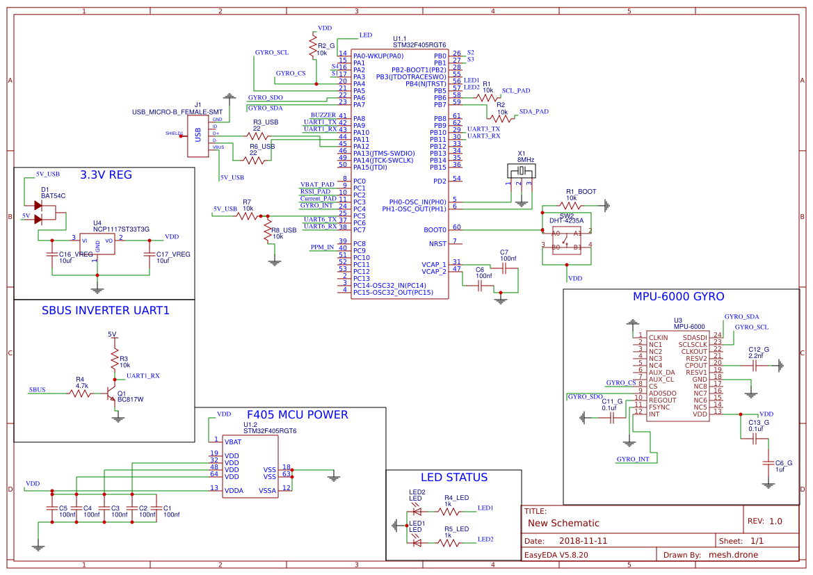

_Рисунок 7 — Микроконтроллерный узел с интерфейсами. Источник: «Задание УП.docx», 2025, схема № 9; исходное изображение сохранено без изменений, включая имеющиеся подписи автора._

[К таблице вариантов](#sec-6)

<a id="v8"></a>
### Вариант 8 — Устройство управления на микроконтроллере

**Источник:** схема № 10, вторая таблица документа [«Задание УП», 2025](sources/Задание_УП_2025.docx). [Открыть рисунок в исходном разрешении](images/easyeda_v08.png).

**Задание:** вручную перерисовать электрическую схему на рисунке 8 в пустом проекте EasyEDA, проверить модели и номера выводов микросхем, назначить посадочные места, самостоятельно расставить компоненты и вручную развести плату. Показанные готовые модули переносите как модули или их разъёмы, сохраняя распиновку.

Перед трассировкой выделите питание и землю, входы и выходы, составьте перечень микросхем и таблицу соединений основной микросхемы. Укажите её модель и назначение в отчёте. Если подпись неоднозначна даже при открытии исходного PNG, согласуйте её с преподавателем до выбора компонента; номинал не угадывайте.

На рисунке 8 приведена схема № 10 исходного сборника. Сохраняйте все электрические связи, обозначения питания и авторские примечания; рамку и интерфейс редактора перерисовывать не требуется.

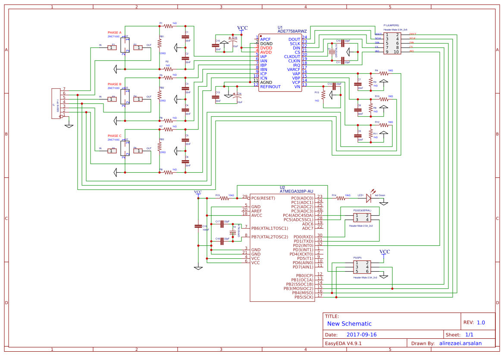

_Рисунок 8 — Устройство управления на микроконтроллере. Источник: «Задание УП.docx», 2025, схема № 10; исходное изображение сохранено без изменений, включая имеющиеся подписи автора._

[К таблице вариантов](#sec-6)

<a id="v9"></a>
### Вариант 9 — Микроконтроллерный узел с дисплеем

**Источник:** схема № 11, вторая таблица документа [«Задание УП», 2025](sources/Задание_УП_2025.docx). [Открыть рисунок в исходном разрешении](images/easyeda_v09.png).

**Задание:** вручную перерисовать электрическую схему на рисунке 9 в пустом проекте EasyEDA, проверить модели и номера выводов микросхем, назначить посадочные места, самостоятельно расставить компоненты и вручную развести плату. Показанные готовые модули переносите как модули или их разъёмы, сохраняя распиновку.

Перед трассировкой выделите питание и землю, входы и выходы, составьте перечень микросхем и таблицу соединений основной микросхемы. Укажите её модель и назначение в отчёте. Если подпись неоднозначна даже при открытии исходного PNG, согласуйте её с преподавателем до выбора компонента; номинал не угадывайте.

На рисунке 9 приведена схема № 11 исходного сборника. Сохраняйте все электрические связи, обозначения питания и авторские примечания; рамку и интерфейс редактора перерисовывать не требуется.

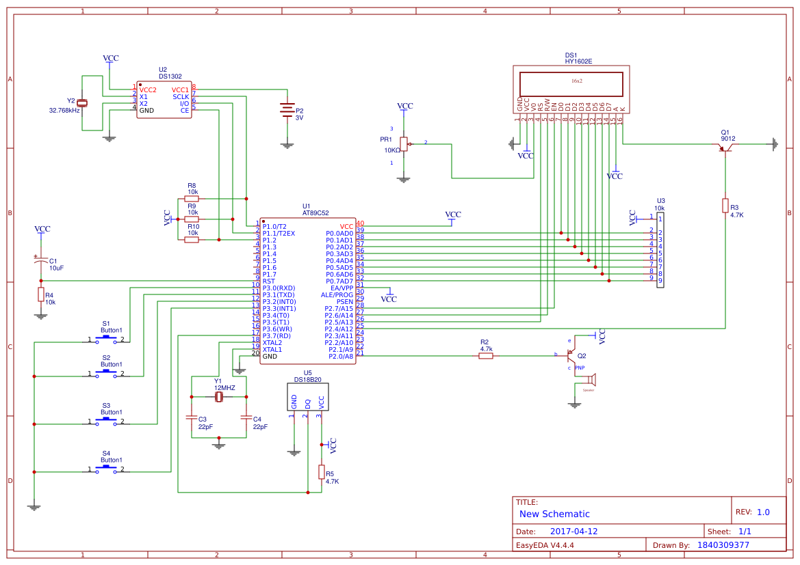

_Рисунок 9 — Микроконтроллерный узел с дисплеем. Источник: «Задание УП.docx», 2025, схема № 11; исходное изображение сохранено без изменений, включая имеющиеся подписи автора._

[К таблице вариантов](#sec-6)

<a id="v10"></a>
### Вариант 10 — Узел управления с датчиком

**Источник:** схема № 12, вторая таблица документа [«Задание УП», 2025](sources/Задание_УП_2025.docx). [Открыть рисунок в исходном разрешении](images/easyeda_v10.png).

**Задание:** вручную перерисовать электрическую схему на рисунке 10 в пустом проекте EasyEDA, проверить модели и номера выводов микросхем, назначить посадочные места, самостоятельно расставить компоненты и вручную развести плату. Показанные готовые модули переносите как модули или их разъёмы, сохраняя распиновку.

Перед трассировкой выделите питание и землю, входы и выходы, составьте перечень микросхем и таблицу соединений основной микросхемы. Укажите её модель и назначение в отчёте. Если подпись неоднозначна даже при открытии исходного PNG, согласуйте её с преподавателем до выбора компонента; номинал не угадывайте.

На рисунке 10 приведена схема № 12 исходного сборника. Сохраняйте все электрические связи, обозначения питания и авторские примечания; рамку и интерфейс редактора перерисовывать не требуется.

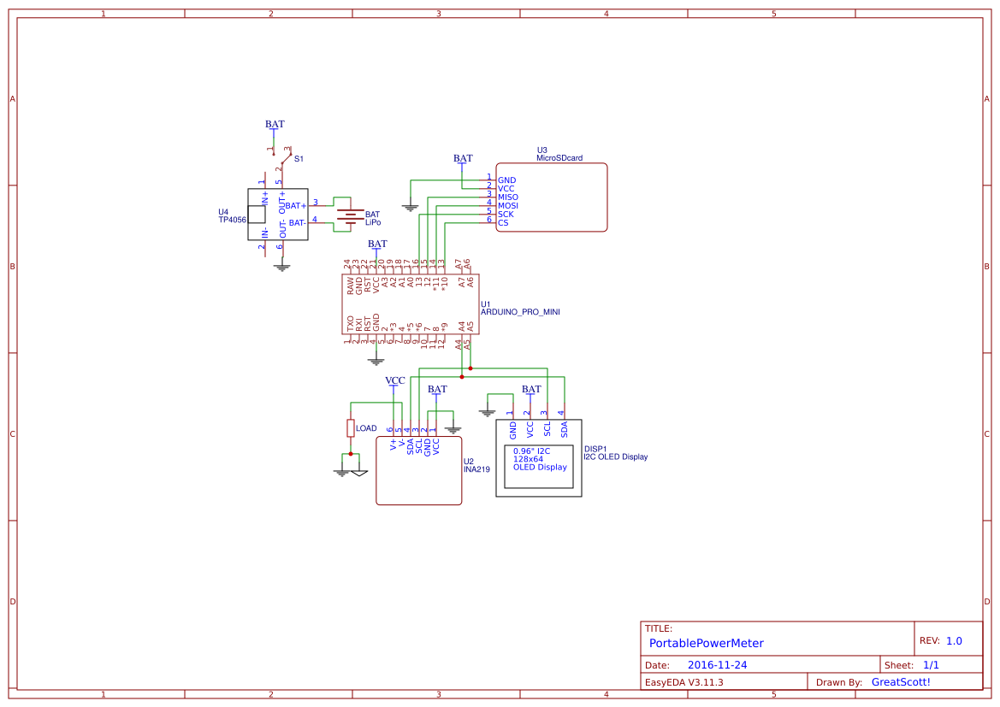

_Рисунок 10 — Узел управления с датчиком. Источник: «Задание УП.docx», 2025, схема № 12; исходное изображение сохранено без изменений, включая имеющиеся подписи автора._

[К таблице вариантов](#sec-6)

<a id="v11"></a>
### Вариант 11 — Светодиодные часы на Arduino Nano

**Источник:** схема № 14, вторая таблица документа [«Задание УП», 2025](sources/Задание_УП_2025.docx). [Открыть рисунок в исходном разрешении](images/easyeda_v11.png).

**Задание:** вручную перерисовать электрическую схему на рисунке 11 в пустом проекте EasyEDA, проверить модели и номера выводов микросхем, назначить посадочные места, самостоятельно расставить компоненты и вручную развести плату. Показанные готовые модули переносите как модули или их разъёмы, сохраняя распиновку.

Перед трассировкой выделите питание и землю, входы и выходы, составьте перечень микросхем и таблицу соединений основной микросхемы. Укажите её модель и назначение в отчёте. Если подпись неоднозначна даже при открытии исходного PNG, согласуйте её с преподавателем до выбора компонента; номинал не угадывайте.

На рисунке 11 приведена схема № 14 исходного сборника. Сохраняйте все электрические связи, обозначения питания и авторские примечания; рамку и интерфейс редактора перерисовывать не требуется.

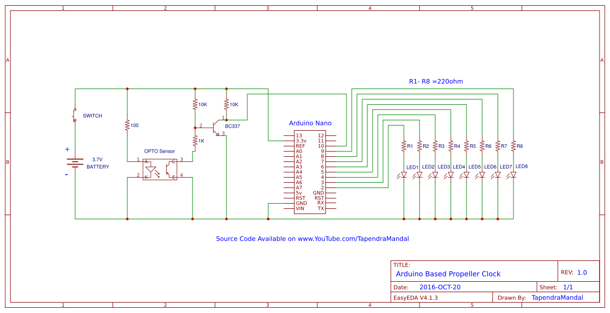

_Рисунок 11 — Светодиодные часы на Arduino Nano. Источник: «Задание УП.docx», 2025, схема № 14; исходное изображение сохранено без изменений, включая имеющиеся подписи автора._

[К таблице вариантов](#sec-6)

<a id="v12"></a>
### Вариант 12 — Плата расширения Arduino для датчика

**Источник:** схема № 15, вторая таблица документа [«Задание УП», 2025](sources/Задание_УП_2025.docx). [Открыть рисунок в исходном разрешении](images/easyeda_v12.png).

**Задание:** вручную перерисовать электрическую схему на рисунке 12 в пустом проекте EasyEDA, проверить модели и номера выводов микросхем, назначить посадочные места, самостоятельно расставить компоненты и вручную развести плату. Показанные готовые модули переносите как модули или их разъёмы, сохраняя распиновку.

Перед трассировкой выделите питание и землю, входы и выходы, составьте перечень микросхем и таблицу соединений основной микросхемы. Укажите её модель и назначение в отчёте. Если подпись неоднозначна даже при открытии исходного PNG, согласуйте её с преподавателем до выбора компонента; номинал не угадывайте.

На рисунке 12 приведена схема № 15 исходного сборника. Сохраняйте все электрические связи, обозначения питания и авторские примечания; рамку и интерфейс редактора перерисовывать не требуется.

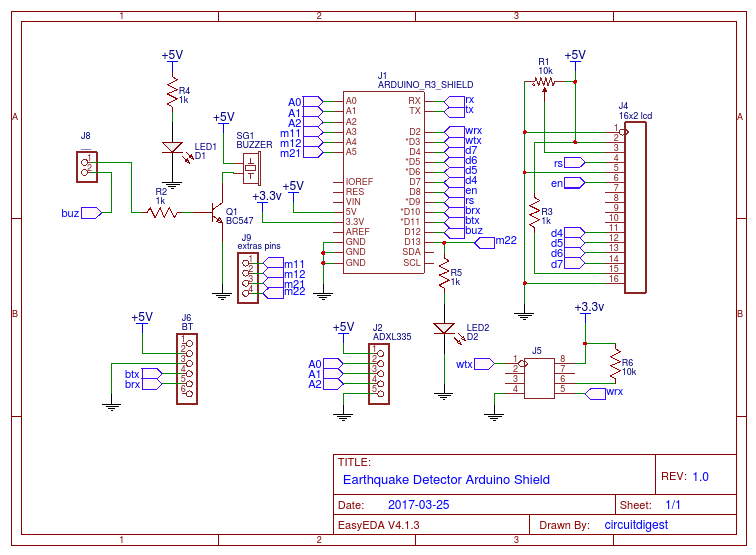

_Рисунок 12 — Плата расширения Arduino для датчика. Источник: «Задание УП.docx», 2025, схема № 15; исходное изображение сохранено без изменений, включая имеющиеся подписи автора._

[К таблице вариантов](#sec-6)

<a id="v13"></a>
### Вариант 13 — Радиоустройство на ESP32

**Источник:** схема № 16, вторая таблица документа [«Задание УП», 2025](sources/Задание_УП_2025.docx). [Открыть рисунок в исходном разрешении](images/easyeda_v13.png).

**Задание:** вручную перерисовать электрическую схему на рисунке 13 в пустом проекте EasyEDA, проверить модели и номера выводов микросхем, назначить посадочные места, самостоятельно расставить компоненты и вручную развести плату. Показанные готовые модули переносите как модули или их разъёмы, сохраняя распиновку.

Перед трассировкой выделите питание и землю, входы и выходы, составьте перечень микросхем и таблицу соединений основной микросхемы. Укажите её модель и назначение в отчёте. Если подпись неоднозначна даже при открытии исходного PNG, согласуйте её с преподавателем до выбора компонента; номинал не угадывайте.

На рисунке 13 приведена схема № 16 исходного сборника. Сохраняйте все электрические связи, обозначения питания и авторские примечания; рамку и интерфейс редактора перерисовывать не требуется.

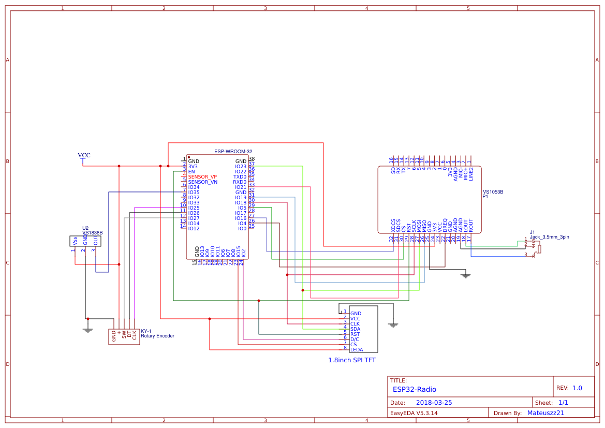

_Рисунок 13 — Радиоустройство на ESP32. Источник: «Задание УП.docx», 2025, схема № 16; исходное изображение сохранено без изменений, включая имеющиеся подписи автора._

[К таблице вариантов](#sec-6)

<a id="v14"></a>
### Вариант 14 — Усилитель звуковой частоты

**Источник:** схема № 17, вторая таблица документа [«Задание УП», 2025](sources/Задание_УП_2025.docx). [Открыть рисунок в исходном разрешении](images/easyeda_v14.png).

**Задание:** вручную перерисовать электрическую схему на рисунке 14 в пустом проекте EasyEDA, проверить модели и номера выводов микросхем, назначить посадочные места, самостоятельно расставить компоненты и вручную развести плату. Показанные готовые модули переносите как модули или их разъёмы, сохраняя распиновку.

Перед трассировкой выделите питание и землю, входы и выходы, составьте перечень микросхем и таблицу соединений основной микросхемы. Укажите её модель и назначение в отчёте. Если подпись неоднозначна даже при открытии исходного PNG, согласуйте её с преподавателем до выбора компонента; номинал не угадывайте.

На рисунке 14 приведена схема № 17 исходного сборника. Сохраняйте все электрические связи, обозначения питания и авторские примечания; рамку и интерфейс редактора перерисовывать не требуется.

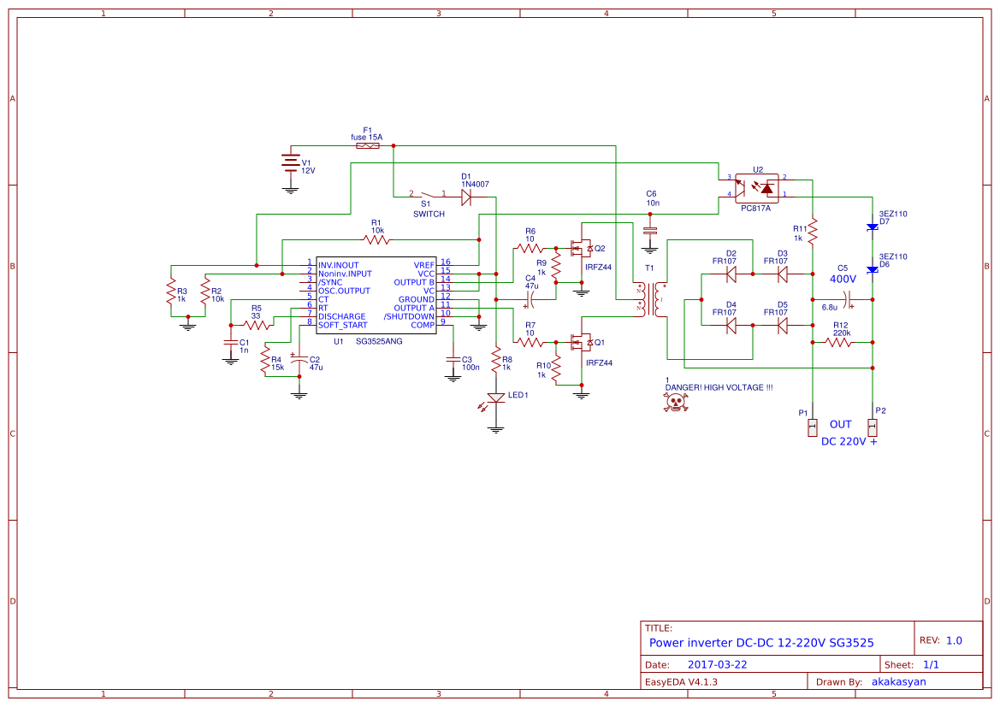

_Рисунок 14 — Усилитель звуковой частоты. Источник: «Задание УП.docx», 2025, схема № 17; исходное изображение сохранено без изменений, включая имеющиеся подписи автора._

[К таблице вариантов](#sec-6)

<a id="v15"></a>
### Вариант 15 — Управляющий узел с входными цепями

**Источник:** схема № 18, вторая таблица документа [«Задание УП», 2025](sources/Задание_УП_2025.docx). [Открыть рисунок в исходном разрешении](images/easyeda_v15.png).

**Задание:** вручную перерисовать электрическую схему на рисунке 15 в пустом проекте EasyEDA, проверить модели и номера выводов микросхем, назначить посадочные места, самостоятельно расставить компоненты и вручную развести плату. Показанные готовые модули переносите как модули или их разъёмы, сохраняя распиновку.

Перед трассировкой выделите питание и землю, входы и выходы, составьте перечень микросхем и таблицу соединений основной микросхемы. Укажите её модель и назначение в отчёте. Если подпись неоднозначна даже при открытии исходного PNG, согласуйте её с преподавателем до выбора компонента; номинал не угадывайте.

На рисунке 15 приведена схема № 18 исходного сборника. Сохраняйте все электрические связи, обозначения питания и авторские примечания; рамку и интерфейс редактора перерисовывать не требуется.

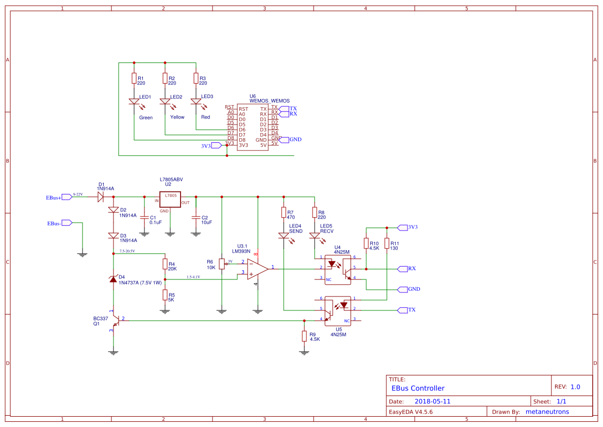

_Рисунок 15 — Управляющий узел с входными цепями. Источник: «Задание УП.docx», 2025, схема № 18; исходное изображение сохранено без изменений, включая имеющиеся подписи автора._

[К таблице вариантов](#sec-6)

<a id="v16"></a>
### Вариант 16 — Микроконтроллерный интерфейсный узел

**Источник:** схема № 19, вторая таблица документа [«Задание УП», 2025](sources/Задание_УП_2025.docx). [Открыть рисунок в исходном разрешении](images/easyeda_v16.png).

**Задание:** вручную перерисовать электрическую схему на рисунке 16 в пустом проекте EasyEDA, проверить модели и номера выводов микросхем, назначить посадочные места, самостоятельно расставить компоненты и вручную развести плату. Показанные готовые модули переносите как модули или их разъёмы, сохраняя распиновку.

Перед трассировкой выделите питание и землю, входы и выходы, составьте перечень микросхем и таблицу соединений основной микросхемы. Укажите её модель и назначение в отчёте. Если подпись неоднозначна даже при открытии исходного PNG, согласуйте её с преподавателем до выбора компонента; номинал не угадывайте.

На рисунке 16 приведена схема № 19 исходного сборника. Сохраняйте все электрические связи, обозначения питания и авторские примечания; рамку и интерфейс редактора перерисовывать не требуется.

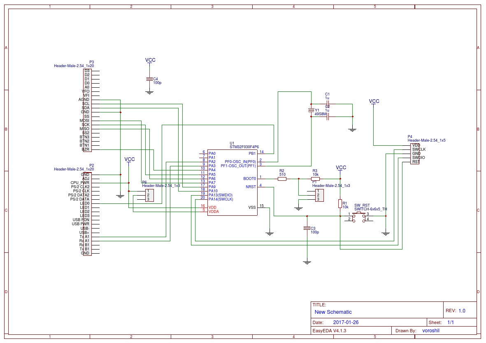

_Рисунок 16 — Микроконтроллерный интерфейсный узел. Источник: «Задание УП.docx», 2025, схема № 19; исходное изображение сохранено без изменений, включая имеющиеся подписи автора._

[К таблице вариантов](#sec-6)

<a id="v17"></a>
### Вариант 17 — Интерфейсный узел с несколькими микросхемами

**Источник:** схема № 20, вторая таблица документа [«Задание УП», 2025](sources/Задание_УП_2025.docx). [Открыть рисунок в исходном разрешении](images/easyeda_v17.png).

**Задание:** вручную перерисовать электрическую схему на рисунке 17 в пустом проекте EasyEDA, проверить модели и номера выводов микросхем, назначить посадочные места, самостоятельно расставить компоненты и вручную развести плату. Показанные готовые модули переносите как модули или их разъёмы, сохраняя распиновку.

Перед трассировкой выделите питание и землю, входы и выходы, составьте перечень микросхем и таблицу соединений основной микросхемы. Укажите её модель и назначение в отчёте. Если подпись неоднозначна даже при открытии исходного PNG, согласуйте её с преподавателем до выбора компонента; номинал не угадывайте.

На рисунке 17 приведена схема № 20 исходного сборника. Сохраняйте все электрические связи, обозначения питания и авторские примечания; рамку и интерфейс редактора перерисовывать не требуется.

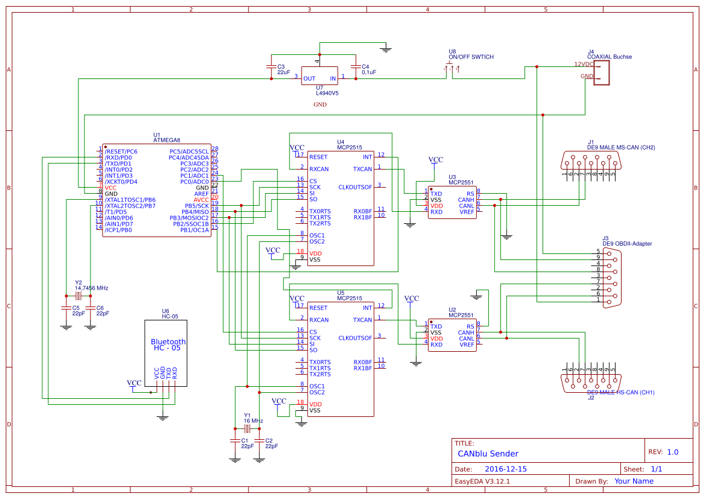

_Рисунок 17 — Интерфейсный узел с несколькими микросхемами. Источник: «Задание УП.docx», 2025, схема № 20; исходное изображение сохранено без изменений, включая имеющиеся подписи автора._

[К таблице вариантов](#sec-6)

<a id="v18"></a>
### Вариант 18 — Узел заряда и преобразования питания

**Источник:** схема № 21, вторая таблица документа [«Задание УП», 2025](sources/Задание_УП_2025.docx). [Открыть рисунок в исходном разрешении](images/easyeda_v18.png).

**Задание:** вручную перерисовать электрическую схему на рисунке 18 в пустом проекте EasyEDA, проверить модели и номера выводов микросхем, назначить посадочные места, самостоятельно расставить компоненты и вручную развести плату. Показанные готовые модули переносите как модули или их разъёмы, сохраняя распиновку.

Перед трассировкой выделите питание и землю, входы и выходы, составьте перечень микросхем и таблицу соединений основной микросхемы. Укажите её модель и назначение в отчёте. Если подпись неоднозначна даже при открытии исходного PNG, согласуйте её с преподавателем до выбора компонента; номинал не угадывайте.

На рисунке 18 приведена схема № 21 исходного сборника. Сохраняйте все электрические связи, обозначения питания и авторские примечания; рамку и интерфейс редактора перерисовывать не требуется.

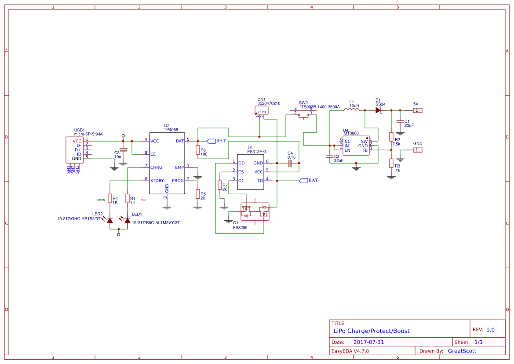

_Рисунок 18 — Узел заряда и преобразования питания. Источник: «Задание УП.docx», 2025, схема № 21; исходное изображение сохранено без изменений, включая имеющиеся подписи автора._

[К таблице вариантов](#sec-6)

<a id="v19"></a>
### Вариант 19 — Микроконтроллерный регулятор с оптосвязью

**Источник:** схема № 22, вторая таблица документа [«Задание УП», 2025](sources/Задание_УП_2025.docx). [Открыть рисунок в исходном разрешении](images/easyeda_v19.png).

**Задание:** вручную перерисовать электрическую схему на рисунке 19 в пустом проекте EasyEDA, проверить модели и номера выводов микросхем, назначить посадочные места, самостоятельно расставить компоненты и вручную развести плату. Показанные готовые модули переносите как модули или их разъёмы, сохраняя распиновку.

Перед трассировкой выделите питание и землю, входы и выходы, составьте перечень микросхем и таблицу соединений основной микросхемы. Укажите её модель и назначение в отчёте. Если подпись неоднозначна даже при открытии исходного PNG, согласуйте её с преподавателем до выбора компонента; номинал не угадывайте.

На рисунке 19 приведена схема № 22 исходного сборника. Сохраняйте все электрические связи, обозначения питания и авторские примечания; рамку и интерфейс редактора перерисовывать не требуется.

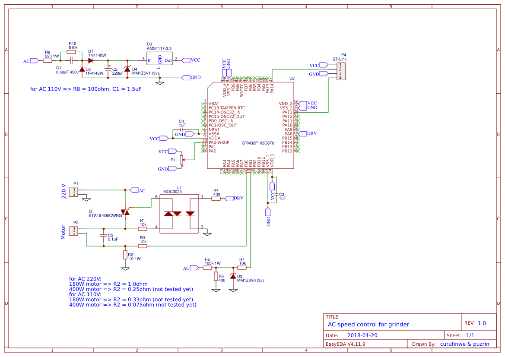

_Рисунок 19 — Микроконтроллерный регулятор с оптосвязью. Источник: «Задание УП.docx», 2025, схема № 22; исходное изображение сохранено без изменений, включая имеющиеся подписи автора._

[К таблице вариантов](#sec-6)

<a id="v20"></a>
### Вариант 20 — Микроконтроллерная плата с разъёмами

**Источник:** схема № 23, вторая таблица документа [«Задание УП», 2025](sources/Задание_УП_2025.docx). [Открыть рисунок в исходном разрешении](images/easyeda_v20.png).

**Задание:** вручную перерисовать электрическую схему на рисунке 20 в пустом проекте EasyEDA, проверить модели и номера выводов микросхем, назначить посадочные места, самостоятельно расставить компоненты и вручную развести плату. Показанные готовые модули переносите как модули или их разъёмы, сохраняя распиновку.

Перед трассировкой выделите питание и землю, входы и выходы, составьте перечень микросхем и таблицу соединений основной микросхемы. Укажите её модель и назначение в отчёте. Если подпись неоднозначна даже при открытии исходного PNG, согласуйте её с преподавателем до выбора компонента; номинал не угадывайте.

На рисунке 20 приведена схема № 23 исходного сборника. Сохраняйте все электрические связи, обозначения питания и авторские примечания; рамку и интерфейс редактора перерисовывать не требуется.

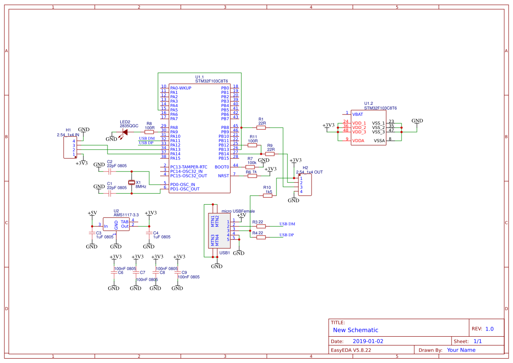

_Рисунок 20 — Микроконтроллерная плата с разъёмами. Источник: «Задание УП.docx», 2025, схема № 23; исходное изображение сохранено без изменений, включая имеющиеся подписи автора._

[К таблице вариантов](#sec-6)

<a id="v21"></a>
### Вариант 21 — Контроллер с выходными каналами

**Источник:** схема № 24, вторая таблица документа [«Задание УП», 2025](sources/Задание_УП_2025.docx). [Открыть рисунок в исходном разрешении](images/easyeda_v21.png).

**Задание:** вручную перерисовать электрическую схему на рисунке 21 в пустом проекте EasyEDA, проверить модели и номера выводов микросхем, назначить посадочные места, самостоятельно расставить компоненты и вручную развести плату. Показанные готовые модули переносите как модули или их разъёмы, сохраняя распиновку.

Перед трассировкой выделите питание и землю, входы и выходы, составьте перечень микросхем и таблицу соединений основной микросхемы. Укажите её модель и назначение в отчёте. Если подпись неоднозначна даже при открытии исходного PNG, согласуйте её с преподавателем до выбора компонента; номинал не угадывайте.

На рисунке 21 приведена схема № 24 исходного сборника. Сохраняйте все электрические связи, обозначения питания и авторские примечания; рамку и интерфейс редактора перерисовывать не требуется.

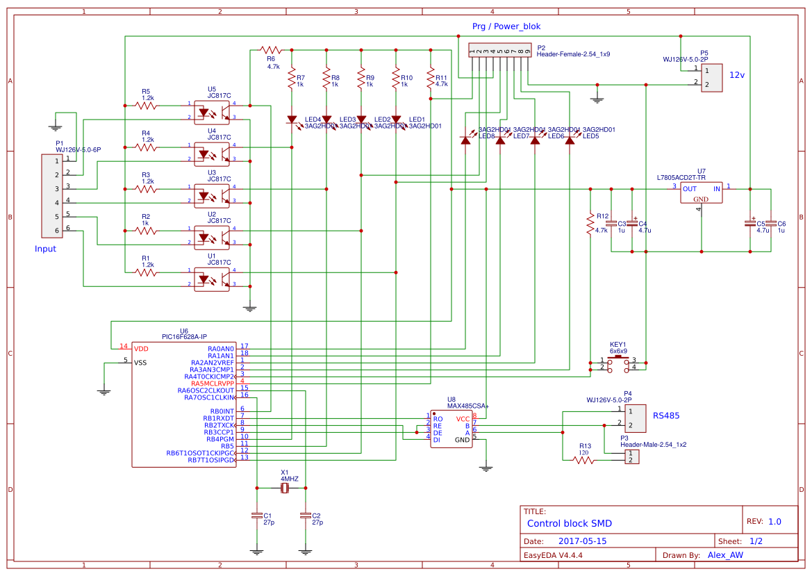

_Рисунок 21 — Контроллер с выходными каналами. Источник: «Задание УП.docx», 2025, схема № 24; исходное изображение сохранено без изменений, включая имеющиеся подписи автора._

[К таблице вариантов](#sec-6)

<a id="v22"></a>
### Вариант 22 — Микроконтроллерный узел обмена данными

**Источник:** схема № 25, вторая таблица документа [«Задание УП», 2025](sources/Задание_УП_2025.docx). [Открыть рисунок в исходном разрешении](images/easyeda_v22.png).

**Задание:** вручную перерисовать электрическую схему на рисунке 22 в пустом проекте EasyEDA, проверить модели и номера выводов микросхем, назначить посадочные места, самостоятельно расставить компоненты и вручную развести плату. Показанные готовые модули переносите как модули или их разъёмы, сохраняя распиновку.

Перед трассировкой выделите питание и землю, входы и выходы, составьте перечень микросхем и таблицу соединений основной микросхемы. Укажите её модель и назначение в отчёте. Если подпись неоднозначна даже при открытии исходного PNG, согласуйте её с преподавателем до выбора компонента; номинал не угадывайте.

На рисунке 22 приведена схема № 25 исходного сборника. Сохраняйте все электрические связи, обозначения питания и авторские примечания; рамку и интерфейс редактора перерисовывать не требуется.

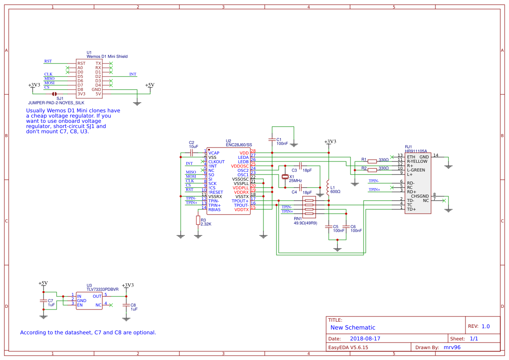

_Рисунок 22 — Микроконтроллерный узел обмена данными. Источник: «Задание УП.docx», 2025, схема № 25; исходное изображение сохранено без изменений, включая имеющиеся подписи автора._

[К таблице вариантов](#sec-6)

<a id="v23"></a>
### Вариант 23 — Светодиодный автомат на 555 и CD4017

**Источник:** схема № 26, вторая таблица документа [«Задание УП», 2025](sources/Задание_УП_2025.docx). [Открыть рисунок в исходном разрешении](images/easyeda_v23.png).

**Задание:** вручную перерисовать электрическую схему на рисунке 23 в пустом проекте EasyEDA, проверить модели и номера выводов микросхем, назначить посадочные места, самостоятельно расставить компоненты и вручную развести плату. Показанные готовые модули переносите как модули или их разъёмы, сохраняя распиновку.

Перед трассировкой выделите питание и землю, входы и выходы, составьте перечень микросхем и таблицу соединений основной микросхемы. Укажите её модель и назначение в отчёте. Если подпись неоднозначна даже при открытии исходного PNG, согласуйте её с преподавателем до выбора компонента; номинал не угадывайте.

На рисунке 23 приведена схема № 26 исходного сборника. Сохраняйте все электрические связи, обозначения питания и авторские примечания; рамку и интерфейс редактора перерисовывать не требуется.

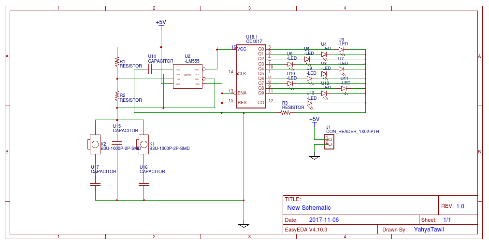

_Рисунок 23 — Светодиодный автомат на 555 и CD4017. Источник: «Задание УП.docx», 2025, схема № 26; исходное изображение сохранено без изменений, включая имеющиеся подписи автора._

[К таблице вариантов](#sec-6)

<a id="v24"></a>
### Вариант 24 — Устройство с матрицей светодиодов 6 × 6

**Источник:** схема № 27, вторая таблица документа [«Задание УП», 2025](sources/Задание_УП_2025.docx). [Открыть рисунок в исходном разрешении](images/easyeda_v24.png).

**Задание:** вручную перерисовать электрическую схему на рисунке 24 в пустом проекте EasyEDA, проверить модели и номера выводов микросхем, назначить посадочные места, самостоятельно расставить компоненты и вручную развести плату. Показанные готовые модули переносите как модули или их разъёмы, сохраняя распиновку.

Перед трассировкой выделите питание и землю, входы и выходы, составьте перечень микросхем и таблицу соединений основной микросхемы. Укажите её модель и назначение в отчёте. Если подпись неоднозначна даже при открытии исходного PNG, согласуйте её с преподавателем до выбора компонента; номинал не угадывайте.

На рисунке 24 приведена схема № 27 исходного сборника. Сохраняйте все электрические связи, обозначения питания и авторские примечания; рамку и интерфейс редактора перерисовывать не требуется.

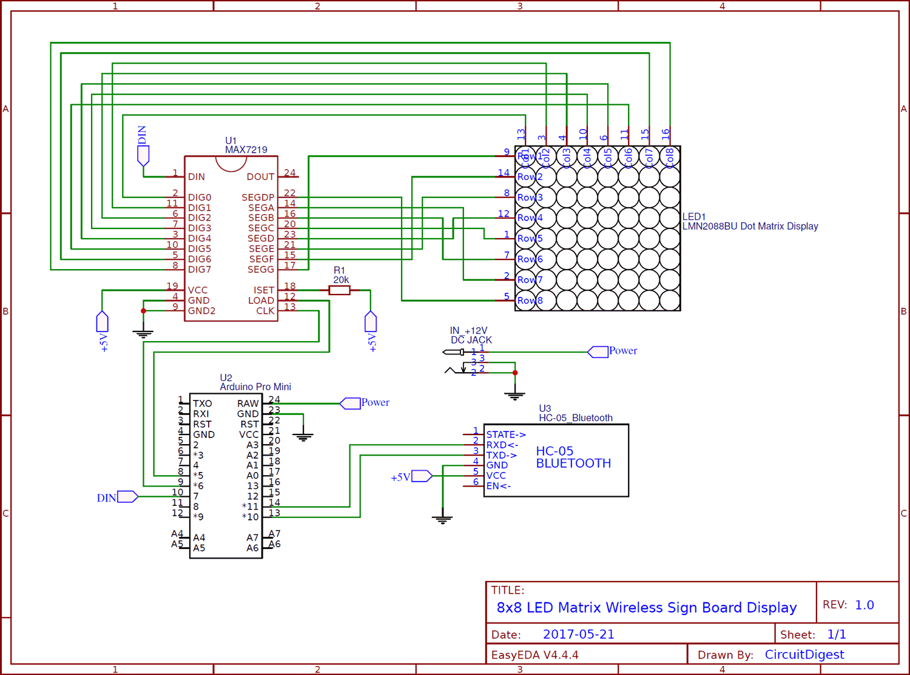

_Рисунок 24 — Устройство с матрицей светодиодов 6 × 6. Источник: «Задание УП.docx», 2025, схема № 27; исходное изображение сохранено без изменений, включая имеющиеся подписи автора._

[К таблице вариантов](#sec-6)

<a id="v25"></a>
### Вариант 25 — Микроконтроллерный узел с зарядным устройством

**Источник:** схема № 28, вторая таблица документа [«Задание УП», 2025](sources/Задание_УП_2025.docx). [Открыть рисунок в исходном разрешении](images/easyeda_v25.png).

**Задание:** вручную перерисовать электрическую схему на рисунке 25 в пустом проекте EasyEDA, проверить модели и номера выводов микросхем, назначить посадочные места, самостоятельно расставить компоненты и вручную развести плату. Показанные готовые модули переносите как модули или их разъёмы, сохраняя распиновку.

Перед трассировкой выделите питание и землю, входы и выходы, составьте перечень микросхем и таблицу соединений основной микросхемы. Укажите её модель и назначение в отчёте. Если подпись неоднозначна даже при открытии исходного PNG, согласуйте её с преподавателем до выбора компонента; номинал не угадывайте.

На рисунке 25 приведена схема № 28 исходного сборника. Сохраняйте все электрические связи, обозначения питания и авторские примечания; рамку и интерфейс редактора перерисовывать не требуется.

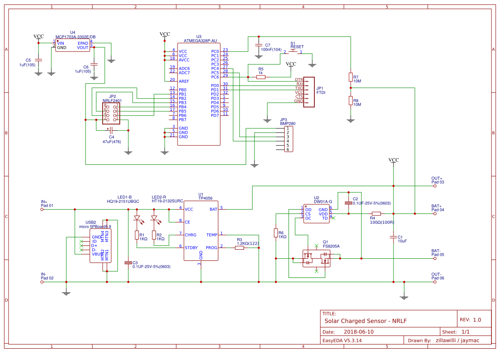

_Рисунок 25 — Микроконтроллерный узел с зарядным устройством. Источник: «Задание УП.docx», 2025, схема № 28; исходное изображение сохранено без изменений, включая имеющиеся подписи автора._

[К таблице вариантов](#sec-6)

<a id="sec-7"></a>
## 7. Результаты и отчёт

Ожидаемые результаты: новая схема, вручную нарисованная по образцу; самостоятельно разработанная и разведённая плата; редактируемые исходники; результаты проверок и экспорты. Рабочая электрическая схема должна совпадать с вариантом и явно заданными доработками. Плата может отличаться от платы автора.

Отчёт оформите в PDF или DOCX:

1. Титульный лист: учебное заведение, дисциплина, работа № 11, группа, Ф. И. О., вариант, дата.
2. Название работы, цель и задачи.
3. Номер и полное условие варианта: устройство, основные микросхемы, номер схемы в исходном сборнике и ссылка на локальный рисунок, особенности подключения.
4. Состав устройства и назначение основных узлов; таблица выводов основной микросхемы.
5. Собственная схема и таблица «обозначение автора — обозначение в моём проекте — номинал/модель — корпус».
6. Ход выполнения: назначение корпусов, правила, расстановка, промежуточная и окончательная ручная разводка.
7. Результаты: размеры платы, ширины дорожек, зазор, число переходных отверстий, число неразведённых соединений, результат DRC. Поясните исключения для коротких выходов из узких площадок, если они есть.
8. Скриншоты этапов, проверок и 3D-вида. Под каждым укажите, какой результат он подтверждает.
9. Выводы: чему научились, какие решения приняли при размещении, как проверили совпадение схемы с образцом. Не объявляйте устройство испытанным электрически.
10. Ответы на контрольные вопросы.

Сдайте папку или ZIP:

```text
ПР11_Группа_Фамилия_VNN/
  Отчёт.pdf (или .docx)
  project/      собственная схема и PCB, копии placement/routing_half/final
  export/       схема PDF, изображения платы, BOM, Gerber и сверление
  screenshots/  этапы выполнения, DRC, ноль неразведённых цепей, 3D
```

Готовая картинка автора не заменяет собственную схему. Облачная ссылка без редактируемого экспорта не заменяет комплект проекта.

<a id="sec-8"></a>
## 8. Контрольные вопросы

1. Каково назначение устройства вашего варианта и какие микросхемы в нём используются?
2. Как определить по схеме питание, землю, входы и выходы?
3. Как связаны участки схемы с одинаковыми метками? Чем различаются метки питания VIN, VOUT и VCC?
4. Как проверить полярность диода, конденсатора и светодиода при перерисовке?
5. Чем символ компонента отличается от посадочного места? Какие номера должны совпадать?
6. Что означает NC и чем он отличается от случайно неподключённого вывода?
7. Почему размещение деталей на плате не повторяет расположение символов на схеме?
8. Какие цепи вашего устройства важно сделать короткими и почему?
9. Как проверить, что все линии связей превращены в дорожки?
10. Какие ошибки обнаруживает DRC? Почему DRC не заменяет сравнение с исходной схемой?
11. Как подтвердить, что разводка выполнена вручную?
12. Какие файлы нужны для редактирования проекта, а какие — для изготовления платы?

<a id="sec-9"></a>
## 9. Оценивание

Критерии приведены в таблице 3. Главные проверяемые действия — самостоятельная перерисовка, выбор корпусов, расстановка и ручная трассировка.

**Таблица 3 — Критерии оценивания**

| Оценка | Условия |
|---|---|
| **5** | Своя схема правильно воспроизводит все узлы варианта; корпуса и подключения проверены; плата полностью разведена вручную; соблюдены правила, ноль неразведённых соединений и неисправленных нарушений DRC; есть промежуточные копии, исходники, экспорты и полный отчёт; студент объясняет подключение и повторяет ручную трассировку на защите. |
| **4** | Схема и полностью разведённая вручную плата правильны, DRC пройден, исходники и обязательные доказательства есть; небольшие недочёты относятся к маркировке, отчёту или отдельным ответам. |
| **3** | Собственная схема в основном верна, получена значительная часть ручной разводки; студент объясняет питание и основные подключения и умеет вручную провести дорожку; остаются перечисленные в отчёте отдельные ошибки, незавершённые соединения или неполный комплект экспортов. Плата требует доработки. |
| **2** | Нет собственной схемы или оцениваемой платы; допущены принципиальные ошибки питания/распиновки; использованы импорт готовой схемы, копирование готовой платы или автотрассировка; отсутствуют редактируемые исходники либо студент не подтверждает самостоятельное выполнение. |

<a id="sec-10"></a>
## 10. Источники и локальные материалы

1. [РПД МДК.02.01 «Микропроцессорные системы», редакция 2026](../../../../РПД/2026/РП_МДК0201_МПС_КСК_2026.md) — номер работы и объём 4 часа. Тема расширена преподавателем до разных устройств на микросхемах.
2. [«Задание УП», учебная практика ПМ.02, 3КСК, 2025](sources/Задание_УП_2025.docx) — предоставленный преподавателем сборник; рисунки взяты из второй таблицы «№ варианта — схема». Отобраны исходные схемы № 1, 3–6, 8–12, 14–28. Исходные № 2, 7 и 13 имеют плохо читаемые подписи; № 29 и 30 оформлены без рамки и отметки EasyEDA и в набор не включены.
3. [Реестр соответствия вариантов и изображений](sources/manifest.json) — номера исходных схем, имена изображений, разрешение и контрольные суммы SHA-256.
4. [EasyEDA Standard — ручная трассировка](https://docs.easyeda.com/en/PCB/Route/index.html).
5. [EasyEDA Standard — DRC](https://docs.easyeda.com/en/PCB/Design-Rule-Check/).

В комплект входят 25 локальных PNG и копия исходного DOCX. Рисунки извлечены без перекодирования, обрезки и изменения электрических соединений. Подписи авторов в самих схемах сохранены. В исходном сборнике нет полного перечня первичных интернет-источников и лицензий каждой схемы; авторство и разрешение на распространение не приписываются составителю задания.

Дата подготовки комплекта: 16 октября 2026 года. Для выполнения задания достаточно локальных рисунков; интернет-ссылки являются дополнительными справочными материалами.
