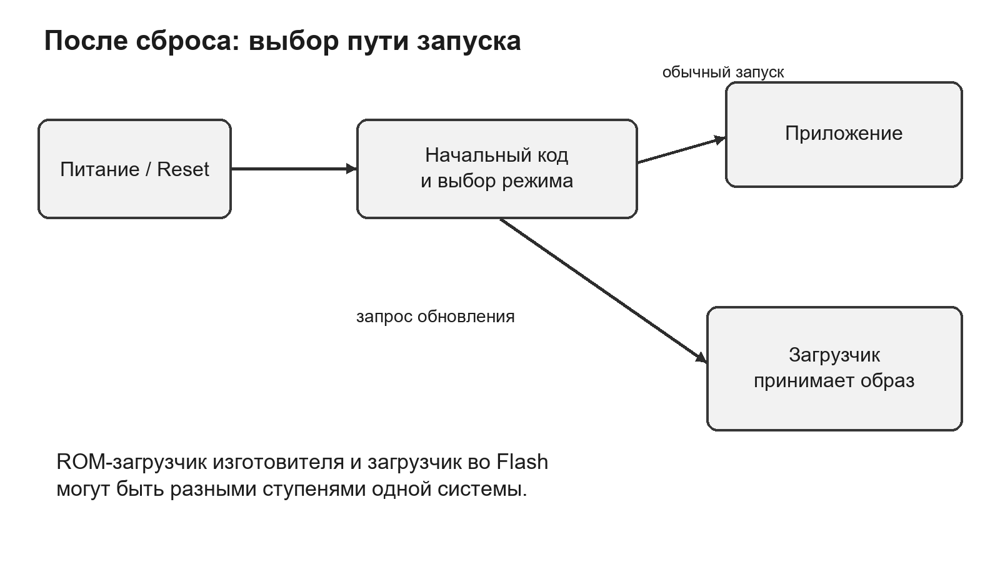
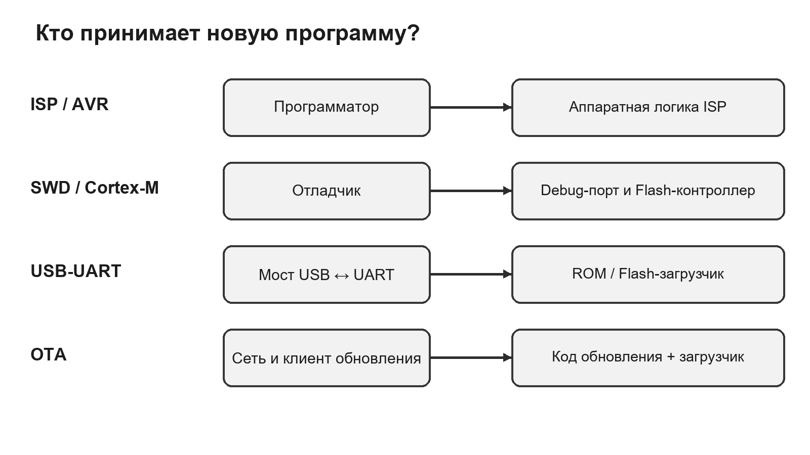
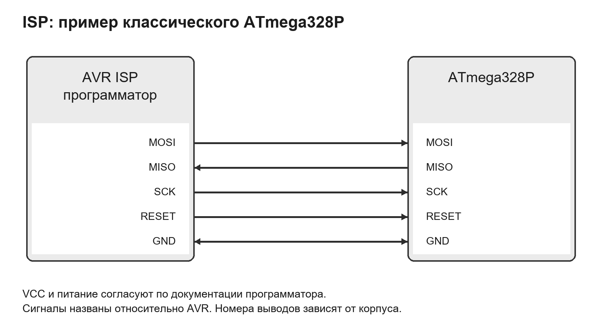
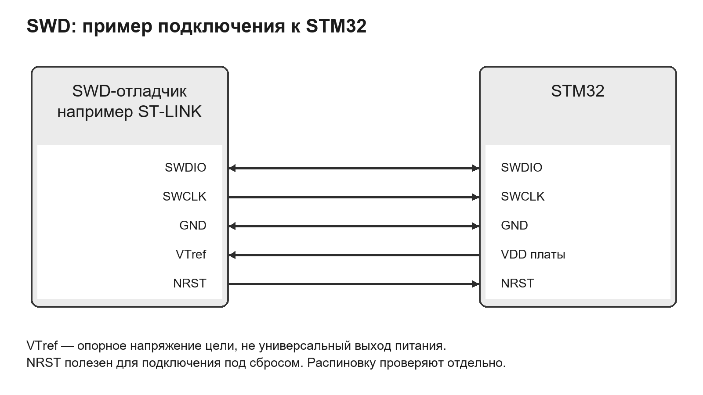
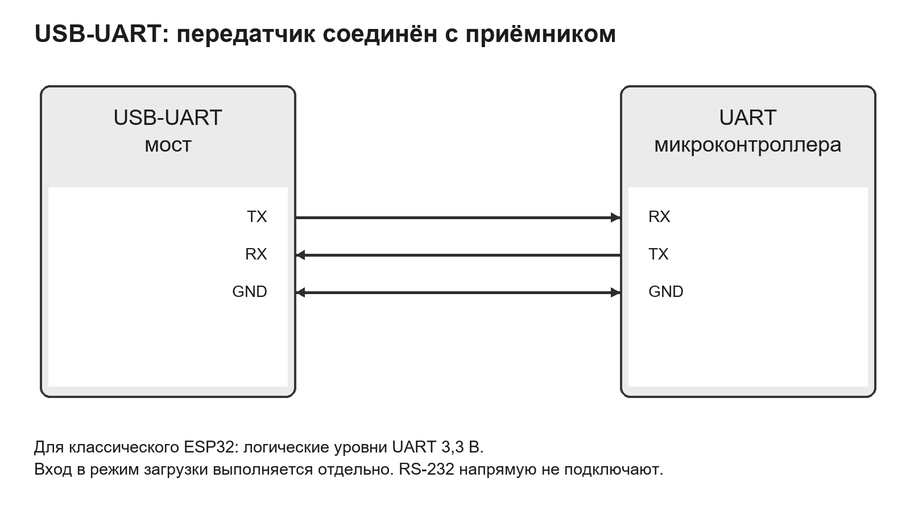
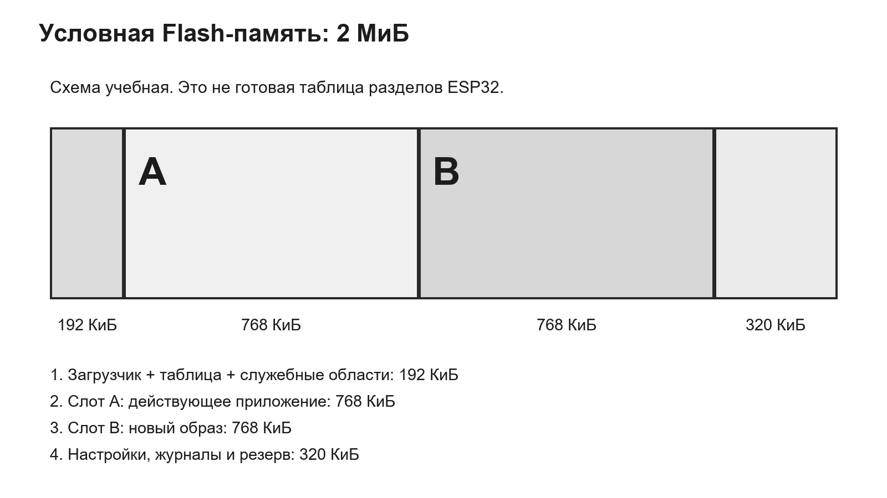
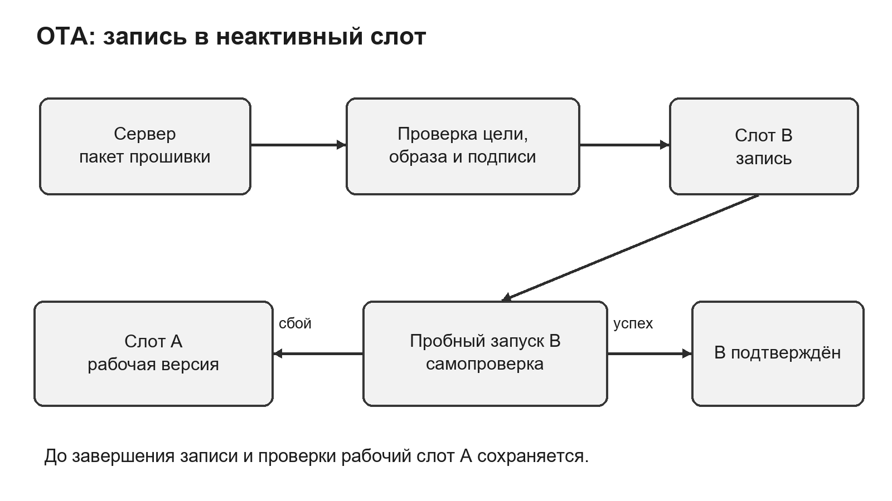
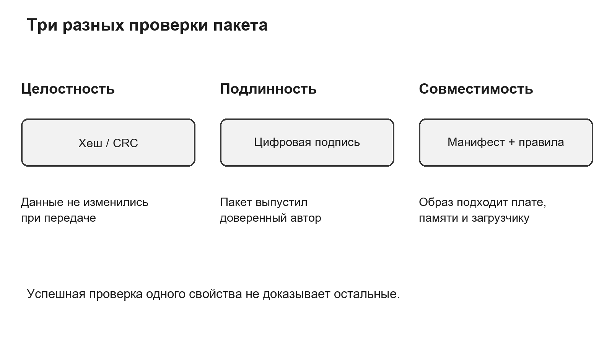
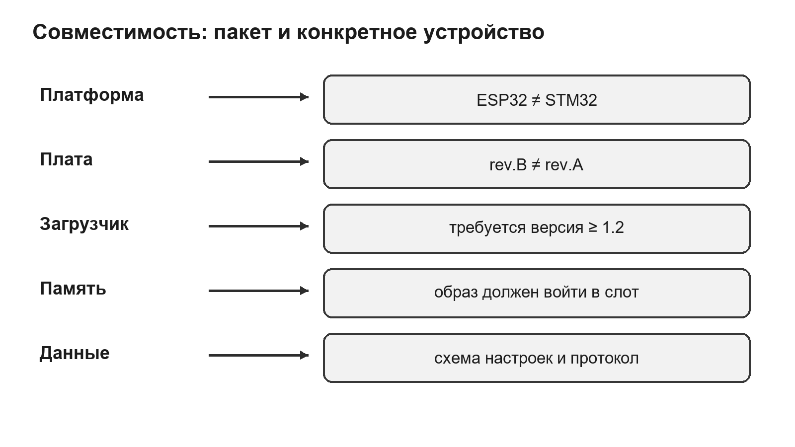

# Тема 5.5. Загрузчики и обновление встроенного программного обеспечения

МДК.02.02 «Программирование микроконтроллеров». Специальность 09.02.01 «Компьютерные системы и комплексы». 4 курс, 7 семестр.

**Продолжительность:** 2 академических часа (90 минут). **Форма по РПД:** лекция-дискуссия.

**Цель:** объяснить пути установки прошивки, выбор загрузчика и интерфейса, проверку совместимости и восстановление после неудачного обновления. Тема продолжает изучение сборки проекта (5.4) и связана с диагностикой платы и последовательного соединения в практической работе № 11.

## Оглавление

- [1. Прошивка и жизненный цикл устройства](#s1)
- [2. Загрузчик и запуск после сброса](#s2)
- [3. ISP, SWD, USB-UART и OTA: разные уровни](#s3)
- [4. ISP на примере классического AVR](#s4)
- [5. SWD: программирование и аппаратная отладка](#s5)
- [6. USB-UART и вход в режим загрузки](#s6)
- [7. Образ, адреса и размещение во Flash](#s7)
- [8. OTA, пробный запуск и восстановление](#s8)
- [9. Целостность, подлинность и безопасное обновление](#s9)
- [10. Версии прошивки и совместимость](#s10)
- [11. Порядок обновления и проверка результата](#s11)
- [12. Итоги и вопросы для самоконтроля](#s12)
- [Основные сокращения](#terms)
- [Источники](#sources)

<a id="s1"></a>

## 1. Прошивка и жизненный цикл устройства

Встроенное программное обеспечение, или прошивка, определяет поведение микроконтроллерного устройства: какие сигналы оно считывает, как управляет выходами и что передаёт по интерфейсам. После компиляции и компоновки проекта получается машинный код. Чтобы микроконтроллер начал выполнять этот код после отключения питания, программу помещают в энергонезависимую память. В разных платформах это внутренняя Flash или внешняя Flash, подключённая к микроконтроллеру.

Обновление прошивки требуется не только при добавлении функций. Разработчик исправляет ошибку измерения, поддерживает новую ревизию платы, устраняет уязвимость или меняет протокол связи. При этом устройство уже может хранить пользовательские настройки и управлять реальной нагрузкой. Поэтому обновление включает выбор подходящего выпуска, передачу образа, запись, проверку, запуск и подтверждение работоспособности. Сообщение «запись завершена» подтверждает лишь часть этой цепочки.

Простой пример — контроллер вентиляции. Версия 1.3.0 неправильно обрабатывает обрыв датчика, а версия 1.3.1 исправляет проверку. Обновление полезно, только если после него контроллер по-прежнему понимает установленный датчик, сохраняет правильные пороги и переводит вентилятор в предусмотренное безопасное состояние при неисправности. Красивый номер версии сам по себе этого не гарантирует.

Различают первоначальное программирование, обновление и восстановление. Первоначальная запись выполняется на новой плате, где приложения ещё нет. Обновление заменяет рабочую программу. Восстановление возвращает возможность запуска после повреждения образа или ошибочных настроек. Для этих случаев могут использоваться разные средства. Наличие рабочего приложения не всегда обязательно для аппаратного программирования, но обычно необходимо для сетевого клиента OTA.

<a id="s2"></a>

## 2. Загрузчик и запуск после сброса

Загрузчик (bootloader) — небольшая программа, которая участвует в выборе и запуске приложения и может обеспечивать приём нового образа. Он не является компилятором: преобразование исходного текста в машинный код выполняет инструментальная среда на компьютере. Загрузчик получает уже подготовленные данные и действует по заранее определённому протоколу.

После сброса микроконтроллер начинает выполнение по правилам своей архитектуры и конфигурации загрузки. В одном устройстве управление сразу получает приложение во Flash. В другом сначала выполняется заводской код в ROM, затем дополнительный загрузчик и только после него приложение. ROM (Read-Only Memory) — память с кодом изготовителя; такой код обычно не заменяют обычной прошивкой приложения. Пользовательский загрузчик во Flash можно обновлять только предусмотренным для него способом. Его повреждение особенно опасно, потому что исчезает один из путей восстановления.

Условный выбор между запуском приложения и приёмом обновления показан на рисунке 1. Причиной входа в загрузчик могут быть состояние загрузочного вывода при сбросе, кнопка, служебная запись в памяти или отсутствие допустимого приложения. Конкретное правило зависит от модели микроконтроллера и реализации платы. Нельзя переносить комбинацию кнопок одной платы на всё семейство.

Для STM32 изготовитель описывает поддерживаемые интерфейсы системного загрузчика и условия входа в AN2606 [3]. Поддержка USART или USB DFU определяется конкретной моделью. USB DFU (Device Firmware Upgrade) использует собственный USB-интерфейс устройства и не равен USB-UART.

На Cortex-M при передаче управления приложению недостаточно просто вызвать произвольный адрес. Должны быть согласованы таблица векторов, начальный указатель стека, обработчики прерываний и состояние периферии. Здесь важен общий вывод: загрузчик и приложение заранее договариваются о расположении образа и условиях запуска. Подробный код перехода выбирают по документации конкретного ядра и проекта.



*Рисунок 1 — Выбор пути запуска после сброса*

<a id="s3"></a>

## 3. ISP, SWD, USB-UART и OTA: разные уровни

ISP, SWD, USB-UART и OTA часто перечисляют как «способы прошивки», хотя эти названия описывают разные части процесса. ISP (In-System Programming) означает программирование микроконтроллера в составе устройства, без извлечения микросхемы. В учебном примере классического AVR под ISP обычно понимают последовательное программирование через определённые сигналы SPI и RESET. У других семейств аппаратный интерфейс может отличаться.

SWD (Serial Wire Debug) — интерфейс аппаратной отладки, используемый многими микроконтроллерами на ARM Cortex-M. Через него отладчик получает доступ к отладочным ресурсам, а программная утилита организует запись Flash. USB-UART — мост между USB компьютера и последовательным UART платы. Сам мост не определяет, какие страницы Flash стереть: команды должен понимать загрузчик или другой принимающий код. OTA (Over The Air) — обновление по беспроводному каналу, например Wi-Fi. Оно описывает доставку без кабеля, но требует программного механизма установки.

На рисунке 2 показано, какой узел принимает данные в каждом случае. Поэтому вопрос «есть ли USB?» недостаточен. Разъём может вести к USB-UART, собственному USB микроконтроллера, отдельному отладчику или вообще использоваться только для питания. Чтобы выбрать способ обновления, изучают схему платы и её руководство.

Таблица 1 позволяет сопоставить типичные варианты. Наличие аппаратного пути полезно для первоначальной записи и восстановления. Сетевой путь удобен для обслуживания устройства, к которому трудно физически подойти.

Таблица 1 — Сопоставление способов загрузки

| Способ | Что требуется | Сильная сторона | Существенное ограничение |
|---|---|---|---|
| ISP классического AVR | Программатор и доступ к сигналам ISP | Первичная запись и восстановление загрузчика | Зависит от тактирования и конфигурации доступа |
| SWD | Совместимый отладчик и отладочные выводы | Запись и аппаратная отладка | Защита доступа может ограничивать операции |
| USB-UART | Мост, драйвер и подходящий загрузчик | Удобная последовательная загрузка | Один COM-порт не доказывает готовность загрузчика |
| OTA | Сеть, принимающий код и место для образа | Удалённое обслуживание | Нужны проверка пакета и сценарий восстановления |



*Рисунок 2 — Участники передачи и установки прошивки*

<a id="s4"></a>

## 4. ISP на примере классического AVR

Для ATmega328P последовательное ISP использует MOSI, MISO, SCK и RESET, а также общую землю и согласованное питание. MOSI передаёт данные от программатора к микроконтроллеру, MISO — обратно, SCK задаёт синхронизацию. Активный RESET переводит AVR в соответствующий режим программирования. Это пример конкретного классического AVR, а не универсальная распиновка всех современных AVR: в других сериях встречаются UPDI, PDI и иные интерфейсы.

Соединения по именам сигналов приведены на рисунке 3. Номер ножки нельзя определить только по названию ATmega: необходимо учитывать корпус и разводку платы. Если линии SPI одновременно подключены к датчикам или дисплею, периферия не должна мешать программатору управлять шиной. Важны также корректный сброс и действующее тактирование микроконтроллера.

Документация Microchip для рассмотренного ISP указывает ограничение частоты SCK относительно тактирования цели [1]. Поэтому при отказе связи полезно проверить частоту программирования и источник тактового сигнала. Изменение fuse-битов, то есть конфигурационных битов, может изменить выбор генератора или доступность интерфейса. Fuse-биты не следует записывать «заодно» с приложением по случайному примеру из интернета.

При восстановлении загрузчика сначала проверяют модель контроллера, схему платы, требуемый образ и параметры памяти. Затем записывают нужную область и проверяют результат. Наличие ISP не означает, что можно без последствий стирать всё устройство: процедура стирания и сохранность EEPROM зависят от настроек и команды. Главная мысль — аппаратный программатор способен помочь при неработающем приложении, но требует точного знания цели.



*Рисунок 3 — Сигналы ISP классического ATmega328P*

<a id="s5"></a>

## 5. SWD: программирование и аппаратная отладка

SWD использует двунаправленную линию данных SWDIO и тактовую линию SWCLK. К ним добавляют общую землю. Отладчик может требовать опорное напряжение цели VTref для согласования уровней, а подключение NRST помогает управлять сбросом. Название Serial Wire Debug не означает, что плату подключают только двумя любыми проводами: питание и электрическая опора тоже необходимы.

На рисунке 4 приведён пример связей ST-LINK и STM32 по именам сигналов. VTref не следует принимать за универсальный выход питания. Способ питания платы, назначение контактов и возможность подачи питания от отладчика определяют по руководству конкретного устройства [2]. Два независимых источника питания без проверки схемы могут создавать нежелательное соединение.

Среда разработки через SWD способна не только записывать программу, но и останавливать ядро, ставить точки останова и читать доступные регистры. Поэтому SWD полезен, когда прошивка запускается, но работает неверно. При записи Flash утилита обычно использует специальный алгоритм для выбранного микроконтроллера; произвольная запись байтов по адресу памяти не заменяет правильное управление Flash-контроллером.

Если программа рано перенастраивает отладочные выводы или переводит устройство в особый режим, может помочь подключение под сбросом при наличии соответствующей поддержки. Однако этот приём не отменяет аппаратную защиту. Снятие некоторых уровней защиты сопровождается стиранием, а отдельные конфигурации бывают необратимыми. Перед любой такой операцией читают описание точной модели и сохраняют доступные данные.

Разобранный случай: новая программа сразу уходит в сон, и обычное подключение перестало работать. Проверка питания, земли и NRST предшествует изменению защиты. Если отладчик поддерживает подключение под сбросом, он может остановить ядро до выполнения проблемного участка. После записи исправленного приложения снова проверяют обычный запуск без отладчика.



*Рисунок 4 — Пример связей SWD-отладчика и STM32*

<a id="s6"></a>

## 6. USB-UART и вход в режим загрузки

UART (Universal Asynchronous Receiver/Transmitter) — универсальный асинхронный приёмопередатчик. USB-UART преобразует USB-обмен компьютера в последовательные сигналы TX и RX. Передатчик одной стороны соединяют с приёмником другой; земля у устройств общая. Эту связь показывает рисунок 5. Одноимённые TX–TX обычно не образуют рабочую пару для обычного UART-подключения.

Электрические уровни проверяют до соединения. Для UART классического ESP32 документация описывает уровни 3,3 В [4]. Подавать на такой вход 5 В без подтверждённой допустимости нельзя. Промышленный RS-232 использует другие электрические уровни, поэтому его разъём не подключают напрямую к логическому UART микроконтроллера. Также важно отличать напряжение питания модуля от уровня его выходного TX.

Появление COM-порта говорит лишь о том, что компьютер видит мост и драйвер. Чтобы прошивальщик получил ответ, микроконтроллер должен войти в нужный режим, а параметры обмена должны соответствовать протоколу. Открытый Serial Monitor может занимать порт и мешать утилите загрузки. Кабель только для зарядки не обеспечивает передачу данных.

У классического ESP32 загрузочный режим выбирается при сбросе; GPIO0 участвует в выборе режима, а на многих отладочных платах схема автоматического сброса использует DTR и RTS моста [5]. На конкретной плате нужно знать устройство цепей BOOT и EN. Это описание не распространяется автоматически на все ESP32-C/S/H и платы с собственным USB.

Разобранный случай: COM-порт есть, но утилита ждёт синхронизации. Последовательно проверяют, закрыт ли монитор порта, правильный ли порт выбран, есть ли питание и общая земля, совпадают ли TX/RX и выполнен ли вход в загрузчик. Успешное чтение идентификатора чипа доказывает связь с целью лучше, чем само появление порта. Стирание всей Flash на этом этапе не устраняет ошибку соединения.



*Рисунок 5 — Подключение USB-UART по логическим сигналам*

<a id="s7"></a>

## 7. Образ, адреса и размещение во Flash

Исходный файл C/C++ и файл прошивки решают разные задачи. ELF хранит машинный код вместе с описанием секций, адресами и, при соответствующей сборке, отладочной информацией. Intel HEX представляет данные текстовыми записями, которые содержат адресную информацию и контрольные суммы. BIN содержит последовательность байтов; место записи для него задают отдельно либо определяют правилами пакета. Поэтому один и тот же файл BIN при записи не по тому адресу может оказаться непригоден для запуска.

Адрес приложения согласуют с линкерным скриптом, загрузчиком и таблицей разделов. Иногда пакет включает несколько образов: загрузчик, таблицу разделов и приложение. У каждого свой адрес и назначение. Команда из примера для другой платы может записать корректные байты в неправильную область. Число в имени файла не заменяет карту памяти.

Flash стирается и программируется порциями, размер и правила которых определяет изготовитель. Нельзя считать её обычной оперативной памятью: повторное изменение данных может требовать стирания целого сектора, а число циклов ограничено. Во время записи важны стабильное питание и соблюдение алгоритма программирования. При стирании области приложения расположенные рядом настройки могут потеряться, если проект не выделил им самостоятельную область.

На рисунке 6 приведена условная память размером 2 МиБ. Служебные области занимают 192 КиБ, два слота приложений — по 768 КиБ, настройки и резерв — 320 КиБ. Сумма равна 2048 КиБ. Это учебная схема без привязки к адресам конкретного чипа. Размеры реальных разделов дополнительно согласуют с требованиями выравнивания и платформы.

Образ размером 700 КиБ помещается в слот 768 КиБ с запасом 68 КиБ. Образ размером 800 КиБ в такой слот не помещается, хотя общий объём Flash составляет 2 МиБ. При оценке учитывают весь формат образа, включая обязательные заголовки и подпись. Увеличение приложения может потребовать новой таблицы разделов; это отдельное изменение совместимости, которое нельзя считать обычной заменой приложения.



*Рисунок 6 — Учебное распределение Flash между двумя слотами и данными*

<a id="s8"></a>

## 8. OTA, пробный запуск и восстановление

OTA переносит образ по беспроводному каналу и позволяет обслуживать устройство без кабеля. Но доставка и установка — разные этапы. Сетевой клиент принимает данные, проверяет ограничения и записывает подготовленный раздел; загрузчик затем выбирает приложение для запуска. Первоначально эти возможности должны быть установлены и настроены доступным способом.

Схема на рисунке 7 показывает идею двух слотов. Пока устройство работает из A, новый образ записывают в B. До окончания записи и проверки A остаётся доступным. Только после проверки служебные данные указывают на новый кандидат для загрузки. После перезапуска кандидат проходит самопроверку и либо подтверждается, либо система возвращается к предыдущему допустимому образу. Такая схема требует корректной обработки служебных записей и состояний загрузки.

В ESP-IDF v5.3 для ESP32 документированы OTA-разделы и раздел otadata, а также механизм отката при соответствующей конфигурации [6]. Проверку новой программы проектируют до подтверждения её работоспособности. Раннее подтверждение сразу после старта делает защиту малоэффективной: ошибка может проявиться позже. Наличие двух слотов само по себе не включает откат.

Самопроверка контроллера вентиляции может подтвердить чтение настроек, связь с датчиком и правильное начальное состояние выходов. Доступность внешнего облачного сервиса не всегда разумно делать обязательным условием: временная неисправность сети не обязательно означает дефект новой программы. Критерии подтверждения должны быть выполнимыми и проверять критичные для данного устройства функции.

Таблица 2 показывает ожидаемое поведение учебной схемы. Реальное устройство должно реализовать эти переходы; они не возникают автоматически из самого слова OTA.

Таблица 2 — Сбои и ожидаемые действия при обновлении с двумя слотами

| Момент сбоя | Что сохраняют | Ожидаемое действие |
|---|---|---|
| Пропала сеть при загрузке B | Действующий образ A | Отменить или повторить приём по правилам клиента |
| Питание пропало при записи B | Образ A и допустимые служебные данные | Запустить A, незавершённый B не выбирать |
| Проверка пакета завершилась ошибкой | Текущий рабочий выпуск | Отклонить пакет и зарегистрировать причину |
| B запустился, но не подтвердился | Совместимый предыдущий образ | Выполнить предусмотренный откат |
| Повреждён сам загрузчик | Независимый путь восстановления, если доступен | Восстановление через аппаратный или ROM-интерфейс |

Откат к старому коду не равен откату всех данных. Если новая версия уже изменила формат настроек, старая может перестать их понимать. Поэтому миграцию проектируют с резервной копией, версией схемы или периодом обратной совместимости. Обновление загрузчика и таблицы разделов требует отдельной процедуры: обычная двухслотовая замена приложения не гарантирует их сохранность.



*Рисунок 7 — Приём нового образа и выбор результата пробного запуска*

<a id="s9"></a>

## 9. Целостность, подлинность и безопасное обновление

Целостность отвечает на вопрос, изменились ли данные. CRC (Cyclic Redundancy Check) хорошо обнаруживает многие случайные ошибки, но не доказывает авторство. Криптографический хеш, например SHA-256, позволяет сравнить образ с ожидаемым значением. Однако если злоумышленник подменит одновременно файл и опубликованный рядом хеш, совпадение не докажет доверенность файла. Эталонное значение тоже должно поступать из доверенного источника.

Подлинность отвечает на другой вопрос: разрешил ли доверенный автор установку именно этих данных? Цифровую подпись проверяют открытым ключом, которому доверяет устройство. Ключ подписи и ключ проверки выполняют разные роли. Подпись должна охватывать сам образ и значимые метаданные либо связывать их защищённым способом, чтобы нельзя было подставить подходящее название платы к чужому содержимому.

HTTPS защищает канал связи при корректной проверке сертификата, но не заменяет локальную проверку допустимости образа. Совместимость также проверяется отдельно. Связь этих свойств показана на рисунке 8. Исправный, подлинный файл может предназначаться для другой ревизии платы.

Secure Boot — механизм проверки допустимого кода при запуске в предусмотренной платформой цепочке доверия. Защита от понижения версии, или anti-rollback, запрещает возврат к выпускам ниже заданного уровня безопасности. Это отличается от обычного отката после неудачного пробного запуска. Предыдущий исправный выпуск может оказаться запрещён политикой защиты, поэтому план восстановления согласуют с ней заранее.

Для учебного контроллера безопасное обновление включает ещё и физическое состояние выходов. До перезапуска нагрузку переводят в предусмотренный режим, исключают неожиданный запуск двигателя и сохраняют параметры, необходимые для восстановления. Программная проверка подписи не заменяет эти меры: она подтверждает доверенность кода, но не отсутствие ошибки управления механизмом.



*Рисунок 8 — Различие целостности, подлинности и совместимости*

<a id="s10"></a>

## 10. Версии прошивки и совместимость

Номер версии помогает отличать выпуски, обсуждать ошибки и воспроизводить результаты. В схеме Semantic Versioning MAJOR.MINOR.PATCH изменение MAJOR обозначает несовместимое изменение объявленного программного интерфейса, MINOR — совместимое расширение, PATCH — совместимое исправление [7]. Для встроенного проекта сначала определяют, что именно считается публичным интерфейсом: команды UART, протокол обмена, формат настроек или API модулей. Без этого одинаковое понимание чисел не возникает.

Пример: 1.4.2 исправляет ошибку фильтра по сравнению с 1.4.1, 1.5.0 добавляет совместимую команду диагностики, а 2.0.0 меняет формат команд так, что прежняя управляющая программа требует доработки. Это условная политика учебного проекта. Она не доказывает, что все три выпуска работают на любой плате. Версия 1.10.0 также старше 1.9.0 при сравнении числовых компонентов, хотя простое строковое сравнение может дать неправильный результат.

На рисунке 9 перечислены независимые измерения совместимости. Совпасть должны семейство и конкретная модель чипа, ревизия платы, назначение выводов, объём и разметка памяти, требования к загрузчику, формат постоянных данных и протокол связи. Например, плата rev.B использует другой вывод реле: подходящий для неё бинарный код на rev.A может запуститься, но управлять неверным выходом.

Манифест — описание выпуска, которое сопровождает образ. Ниже приведён учебный формат, а не стандарт ESP-IDF или STM32. Проверяющая программа использует эти поля согласно политике проекта. Строка с именем алгоритма не означает, что проверка уже выполнена.

```json
{
  "product": "vent-controller",
  "mcu": "ESP32",
  "board_rev": ["B"],
  "firmware": "1.5.0",
  "build_id": "2026-10-15-demo-01",
  "min_bootloader": "1.2.0",
  "partition_layout": "dual-app-v1",
  "image_size_bytes": 716800,
  "settings_schema": 2,
  "protocol_major": 1,
  "digest_algorithm": "SHA-256"
}
```

Реальный подписанный пакет дополнительно содержит вычисленный дайджест, подпись и необходимые идентификаторы ключа или формата. Здесь они не подменены фиктивными значениями. Build ID позволяет различать сборки, которые по ошибке могли получить одинаковую строку версии. Полезно также сохранять идентификатор исходной ревизии и параметры сборки в журнале выпуска.

Разобранный пример: устройство имеет плату B, загрузчик 1.1.0 и слот 768 КиБ. Образ 700 КиБ проходит ограничение размера, а ревизия платы подходит, но минимальная версия загрузчика в манифесте равна 1.2.0. Такой пакет отклоняют до записи. Отдельно рассматривают предусмотренное обновление загрузчика; обход проверки превращает известную несовместимость в риск отказа.

Другой пример: загрузчик подходит, но прошивка использует схему настроек 2 вместо 1. Возможность обновления зависит от миграции. Если миграция необратима и старая версия понимает только схему 1, обычный возврат к прежнему образу уже недостаточен. Пакет выпуска должен объяснять допустимый переход и условия восстановления.



*Рисунок 9 — Условия совместимости прошивки с устройством*

<a id="s11"></a>

## 11. Порядок обновления и проверка результата

Надёжное обновление начинается с идентификации. Фиксируют точную плату, микроконтроллер, ревизию, текущую прошивку, загрузчик и параметры памяти. Затем выбирают пакет из доверенного источника и проверяют его назначение. Для обслуживаемого устройства также определяют допустимое время остановки и безопасное состояние исполнительных механизмов.

До записи сохраняют доступные настройки и калибровки, если процедура обновления может их затронуть. При этом не следует обещать полную копию закрытого устройства: аппаратная защита может не разрешать чтение. Резервное копирование — это не только наличие файла, но и знание его формата, версии и способа восстановления.

Далее устанавливают связь выбранным способом и читают доступный идентификатор цели. Утилита программирования должна соответствовать платформе. Проверяют список областей, подлежащих стиранию и записи: загрузчик, таблица разделов и настройки не должны попадать туда случайно. Стабильное питание и отсутствие конфликтов на сигнальных линиях нужны на протяжении всей операции.

После записи проверяют предусмотренный утилитой результат: сравнение, контрольную сумму или другое подтверждение. Затем выполняют обычный запуск, читают фактическую версию и проверяют функции устройства. Отдельно проверяют запуск после полного снятия и подачи питания, потому что работа под подключённым отладчиком может скрывать ошибку начальной настройки.

Таблица 3 связывает симптомы с проверками. Диагностика должна сужать причину, а не сразу переходить к полному стиранию или отключению защиты.

Таблица 3 — Типичные симптомы при загрузке

| Симптом | Вероятная область причины | Что подтверждает проверка |
|---|---|---|
| Компьютер не видит порт | Кабель, драйвер, выбранный USB-разъём | Обнаружение правильного интерфейса |
| Порт есть, загрузчик не отвечает | Режим старта, TX/RX, занятый порт | Обмен с конкретной целью |
| SWD не обнаруживает цель | Питание, земля, разводка, сброс, защита | Доступ к отладочному порту |
| Запись успешна, приложение не запускается | Адрес, таблица векторов, несовместимый образ | Корректность образа и пути запуска |
| Новая версия теряет настройки | Стирание области данных или ошибка миграции | Сохранность и формат постоянных данных |
| После OTA происходит откат | Самопроверка или подтверждение не завершены | Состояние кандидата и причина возврата |

Разобранный пример проверки выпуска: после обновления контроллер сообщает 1.5.0, читает сохранённый порог температуры и обнаруживает обрыв датчика. Затем питание снимают и подают снова; версия и порог сохраняются, а выход устанавливается в предусмотренное состояние. Это сильнее одного сообщения «Download complete», потому что проверяет поведение после самостоятельного старта. Для партии устройств сохраняют журнал: идентификатор платы, старую и новую версии, результат записи и функциональных проверок.

<a id="s12"></a>

## 12. Итоги и вопросы для самоконтроля

Загрузчик связывает начальный запуск с выбором приложения и его обновлением. Аппаратные интерфейсы ISP и SWD полезны для первоначального программирования и восстановления; USB-UART обеспечивает последовательный канал к принимающему коду; OTA позволяет доставлять образ без кабеля. Для каждого пути важны собственные электрические и программные условия.

Рабочее обновление сохраняет управляемость устройства при сбоях. Два слота помогают удержать предыдущий образ, а пробный запуск позволяет обнаружить часть ошибок до окончательного подтверждения. Но совместимость данных, защита от понижения и повреждение загрузчика требуют отдельных решений. Успех оценивают по запуску и функциям конкретного устройства.

1. Чем загрузчик отличается от компилятора и приложения?
2. Чем ROM-загрузчик отличается от загрузчика во Flash?
3. Почему ISP, SWD, USB-UART и OTA описывают разные уровни процесса?
4. Какие сигналы нужны для ISP классического AVR и какую роль играет RESET?
5. Для чего SWD-отладчику нужны общая земля и VTref?
6. Почему наличие COM-порта не доказывает связь с загрузчиком?
7. Как соединяют TX и RX и почему проверяют логические уровни?
8. Чем USB DFU отличается от USB-UART?
9. Чем BIN отличается от HEX с точки зрения адресной информации?
10. Почему образ может не помещаться при достаточном общем объёме Flash?
11. Что даёт запись OTA в неактивный слот?
12. Почему двух слотов недостаточно для автоматического отката?
13. Когда следует подтверждать новую прошивку после пробного запуска?
14. Чем целостность отличается от подлинности?
15. Почему номер версии не доказывает совместимость с платой?
16. Как миграция настроек может помешать возврату к старому коду?
17. Чем откат отличается от защиты от понижения версии?
18. Какие проверки нужны после сообщения об успешной записи?

<a id="terms"></a>

## Основные сокращения

ISP — программирование в составе устройства. SWD — последовательный интерфейс аппаратной отладки. UART — универсальный асинхронный приёмопередатчик. OTA — обновление по беспроводному каналу. ROM — память с заводским кодом. Flash — электрически стираемая энергонезависимая память. DFU — обновление прошивки через соответствующий USB-протокол. CRC — циклическая контрольная сумма. GPIO — вывод общего назначения. VTref — опорное напряжение целевой платы.

<a id="sources"></a>

## Источники

Локальная основа: «РП_МДК0202_ПМК_КСК_2026.docx», раздел 5, тема 5.5, 2 часа; каталог «РПД и ФОС/2026-2027». Технические сведения проверены по следующим официальным источникам 15.10.2026. Условия конкретных подключений определяются руководством платы и микроконтроллера.

1. [Microchip. ISP Programming](https://onlinedocs.microchip.com/oxy/GUID-EE00BF20-2F37-4A8A-B685-B91173F8915D-en-US-14/GUID-27F0E9E7-8C1A-4512-9AF8-28BCBDCC86DF.html).
2. [STMicroelectronics. ST-LINK/V2, UM1075](https://www.st.com/resource/en/user_manual/DM00026748-.pdf).
3. [STMicroelectronics. AN2606, system memory boot mode](https://www.st.com/resource/en/application_note/an2606-stm32-microcontroller-system-memory-boot-mode-stmicroelectronics.pdf).
4. [Espressif. esptool: Serial Connection](https://github.com/espressif/esptool/blob/master/docs/en/esptool/serial-connection.rst).
5. [Espressif. esptool: Boot Mode Selection, ESP32](https://docs.espressif.com/projects/esptool/en/latest/esp32/advanced-topics/boot-mode-selection.html).
6. [Espressif. ESP-IDF v5.3: Over The Air Updates, ESP32](https://docs.espressif.com/projects/esp-idf/en/v5.3/esp32/api-reference/system/ota.html).
7. [Semantic Versioning 2.0.0](https://semver.org/).

Схемы 1–9 — авторские учебные иллюстрации. Схемы соединений показывают имена сигналов, а не универсальные номера контактов.
