# Лекция № 6. ESP32: обзор, подключение и программирование

**МДК.02.02 «Программирование микроконтроллеров».** 4-й курс колледжа, 09.02.01 «Компьютерные системы и комплексы». 2 академических часа, 90 минут.

В лекции рассматриваются устройство ESP32, характеристики и выбор платы, чтение распиновки, подключение к ПК, сборка и загрузка программ. Разобраны законченные устройства с BME680, BMP180, DS18B20 и HC-SR04, локальная индикация, веб-сервер и MQTT. Базовые Arduino-примеры рассчитаны на классическую ESP32-WROOM и пакет **Arduino-ESP32 3.3.7**. Материал ESP-IDF выделен отдельно. Иллюстрации из предоставленных статей сохранены в цвете с указанием источников.

## Оглавление

1. [Знакомство с ESP32: микроконтроллер с беспроводной связью](#s1)
2. [Характеристики, архитектура и память](#s2)
3. [Семейство, модули и платы разработки](#s3)
4. [Распиновка: питание, GPIO и альтернативные функции](#s4)
5. [Среды разработки, подключение к ПК и прошивка](#s5)
6. [Первые программы: выход, время, кнопка и ШИМ](#s6)
7. [Устройство 1: измеритель среды ESP32 + BME680](#s7)
8. [Устройство 2: барометр BMP180 и OLED-дисплей](#s8)
9. [Устройство 3: цифровой термометр DS18B20](#s9)
10. [Устройство 4: ультразвуковой дальномер HC-SR04](#s10)
11. [Wi-Fi и законченные сетевые устройства](#s11)
12. [ESP-IDF: путь из статей к компонентному проекту](#s12)
13. [Диагностика, энергосбережение и выводы](#s13)
14. [Вопросы для самоконтроля](#s14)

<a id="s1"></a>
## 1. Знакомство с ESP32: микроконтроллер с беспроводной связью

Представим комнатную метеостанцию: она измеряет температуру, влажность и давление, показывает их на дисплее, а при подключении телефона открывает страницу с текущими показаниями. Для такого устройства нужны вычислитель, входы для датчиков, память программы и сетевой интерфейс. ESP32 объединяет большую часть этих возможностей и позволяет построить компактный узел без отдельного Wi-Fi-модема.

ESP32 — платформа микроконтроллеров компании Espressif Systems. Первые массовые модули семейства стали развитием ESP8266. Оба решения применяют в Интернете вещей, или **IoT** (Internet of Things), но ESP32 предлагает более богатую периферию, больше оперативной памяти и, в зависимости от модели, дополнительные средства связи. ESP32 выполняет записанную во Flash программу самостоятельно. Компьютер нужен для разработки и загрузки прошивки, а после запуска плата может питаться от другого подходящего источника.

В подборке 3DIY показаны модуль ESP-WROOM-32 и платы на его основе. На рисунке ниже видны металлический экран и свободная от экрана область печатной антенны. Экран закрывает чувствительную электронную часть, а антенна должна иметь предусмотренное изготовителем свободное пространство. Если прижать её к металлической стенке корпуса, связь может ухудшиться.


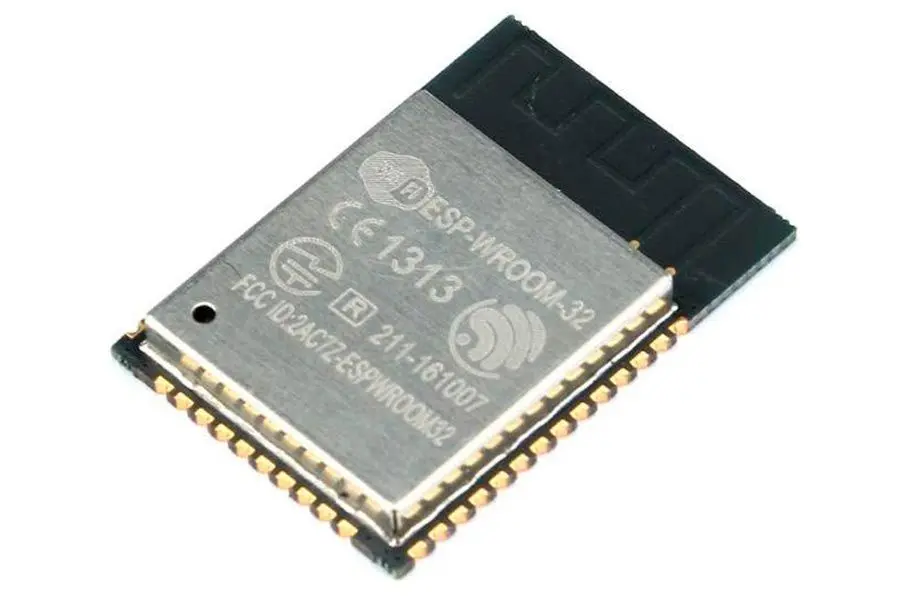

*Рисунок 1 — Модуль ESP-WROOM-32 с экраном и печатной антенной. Источник: [3DIY](https://3d-diy.ru/blog/wi-fi-module-esp-32/).*


Важно различать три уровня устройства. **Микросхема ESP32**, или SoC (System-on-Chip, система на кристалле), содержит процессор, память и контроллеры периферии. **Модуль WROOM** добавляет Flash, кварцевый резонатор и радиочастотную часть с антенной. **Плата разработки DevKit** устанавливает модуль на удобную плату и добавляет питание, USB-UART, кнопки и штыревые контакты. Именно плату разработки удобно подключать к ПК и макетной плате.

Следующий рисунок из документации Espressif показывает реальную ESP32-DevKitC V4. На ней подписаны модуль, USB-разъём, преобразователь USB-UART, контакты ввода-вывода и кнопки. При работе полезно уметь найти эти узлы на собственной плате: внешний вид разных DevKit отличается, но функции узнаваемы.


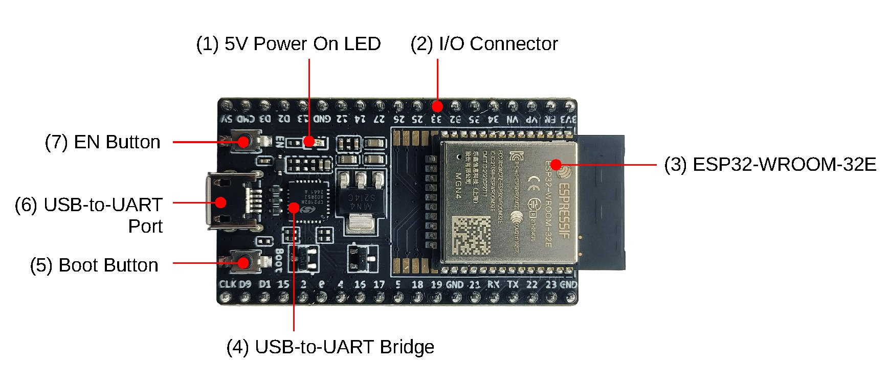

*Рисунок 2 — Компоненты ESP32-DevKitC V4 по документации Espressif. Источник: [Espressif](https://docs.espressif.com/projects/esp-dev-kits/en/latest/esp32/esp32-devkitc/user_guide.html).*


Светодиод питания сообщает о наличии напряжения, однако не обязательно управляется программой. Кнопка EN сбрасывает микроконтроллер. BOOT участвует в выборе режима загрузки прошивки. USB-UART обеспечивает последовательную связь компьютера с классическим ESP32, у которого нет такого же встроенного USB-интерфейса, как у ряда новых моделей. Разъёмы по краям платы выводят питание и сигналы модуля.

Микроконтроллер удобно применять в регистраторах температуры, датчиках протечки, контроллерах освещения, простых измерителях расстояния, беспроводных пультах и шлюзах для периферии. При этом сеть остаётся частью устройства. Например, сигнализатор протечки должен включить местный звуковой сигнал даже тогда, когда роутер недоступен.

<a id="s2"></a>
## 2. Характеристики, архитектура и память

В основе распространённого классического ESP32-WROOM находится 32-разрядный процессор Xtensa LX6. В выбранном двухъядерном исполнении он имеет два основных ядра с частотой до 240 МГц. Разрядность определяет, с какими данными и адресами работает процессорная архитектура, а частота задаёт число тактов. Она не равна скорости выполнения любого алгоритма: ожидание датчика или сети может занимать гораздо больше времени, чем вычисление.

В таблице 1 приведены параметры базовой платформы лекции. Они относятся к классическому ESP32 и типичным WROOM-платам; параметры C3, S3 и других вариантов рассматриваются отдельно.

Таблица 1 — Характеристики базовой ESP32-WROOM-платформы

| Параметр | Значение и смысл для программы |
|---|---|
| Процессор | Обычно два 32-разрядных ядра Xtensa LX6 до 240 МГц; у классической серии существуют и одноядерные исполнения |
| Внутренняя SRAM | 520 Кбайт физической оперативной памяти, часть занята системой и имеет ограничения использования |
| Внутренняя ROM | 448 Кбайт постоянной памяти с заводским кодом |
| Flash модуля | Часто 4 Мбайт у учебных WROOM-плат; реальный объём проверяется по маркировке и настройкам |
| Wi-Fi | IEEE 802.11 b/g/n, диапазон 2,4 ГГц |
| Bluetooth | Bluetooth 4.2 BR/EDR (Classic) и BLE у классической ESP32 |
| Логика GPIO | 3,3 В; прямое подключение 5-вольтовых сигналов недопустимо |
| Физические GPIO SoC | 34; на модуле и плате доступны не все, часть занята или ограничена |
| Аналоговые входы | АЦП с типичной 12-разрядной выдачей, блоки ADC1 и ADC2 |
| Аналоговые выходы | Два 8-разрядных ЦАП: GPIO25 и GPIO26 у классической ESP32 |
| Интерфейсы | UART, I²C, SPI, I²S и другая аппаратная периферия |
| Управление сигналами | Таймеры, внешние прерывания, аппаратная ШИМ LEDC и другие специализированные блоки |

На функциональной схеме из статьи EPAM хорошо видно, что микроконтроллер состоит не только из процессора. Слева перечислены контроллеры периферии, справа радиотракт и криптографические блоки, внизу узлы питания и низкого энергопотребления. Процессор настраивает эти блоки и использует их результаты.


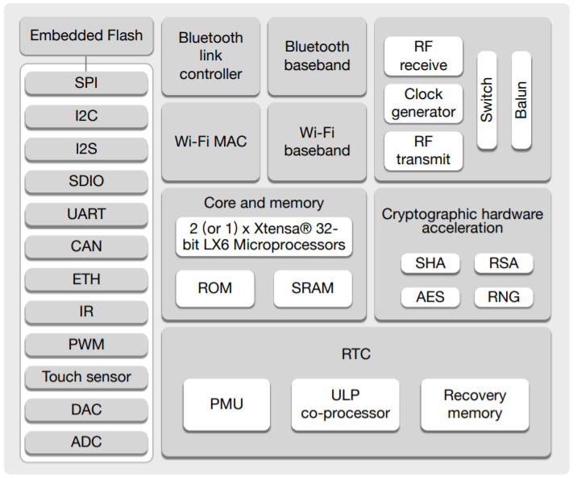

*Рисунок 3 — Функциональная архитектура ESP32: процессоры, память, радиочасть и периферия. Источник: [Хабр / EPAM](https://habr.com/ru/companies/epam_systems/articles/522730/).*


**SRAM** — оперативная память: переменные, буферы, стеки задач и служебные структуры. После отключения питания обычные данные SRAM исчезают. **ROM** содержит начальный заводской код и не служит местом, куда Arduino IDE записывает скетч. **Flash** хранит прошивку и постоянные данные. У типичного WROOM она размещена на модуле рядом с SoC. **PSRAM** — дополнительная внешняя оперативная память, которая есть только в соответствующих исполнениях.

Допустим, проект хранит HTML-страницу во Flash, а при обработке запроса создаёт строку в SRAM. Увеличение Flash не увеличит автоматически размер кучи, куда создаётся эта строка. Аналогично 4 Мбайт Flash не означают 4 Мбайт для одного приложения: загрузчик, настройки, файловая система и разделы OTA используют часть адресного пространства. Слишком большая программа может не помещаться в выбранный раздел, хотя в микросхеме Flash остаётся другое свободное место.

Радиоблок обеспечивает физическую передачу данных, а программный стек — подключение к сети и обработку протоколов. Для Wi-Fi и Bluetooth используется общая радиочастотная среда, поэтому фактическая пропускная способность зависит от условий и режима работы. Паспортная скорость радиоинтерфейса не равна скорости получения показаний датчика в браузере.

Два ядра полезны, если программа и система действительно могут распределять работу. Многозадачность также возможна на одном ядре: планировщик переключает задачи. Наличие второго ядра не устраняет ошибки доступа к общим переменным и не делает произвольную программу вдвое быстрее.

<a id="s3"></a>
## 3. Семейство, модули и платы разработки

Название ESP32 охватывает несколько архитектур. В обзоре ESP32-C3 на Хабре показан переход от Xtensa к RISC-V. Это не просто другая форма платы: меняются машинные команды, контроллеры периферии и набор доступных выводов. Исходник на C++ нередко удаётся адаптировать, но готовый бинарный образ необходимо собирать под конкретную микросхему.

Таблица 2 — Несколько представителей семейства ESP32

| Модель | Основные ядра | Радиосвязь | На что обратить внимание |
|---|---|---|---|
| ESP32 | Обычно 2 × Xtensa LX6, до 240 МГц | Wi-Fi 2,4 ГГц, Classic и BLE | Базовая платформа примеров |
| ESP32-S2 | 1 × Xtensa LX7, до 240 МГц | Wi-Fi 2,4 ГГц | Есть USB OTG, Bluetooth отсутствует |
| ESP32-S3 | 2 × Xtensa LX7, до 240 МГц | Wi-Fi 2,4 ГГц и BLE | USB, векторные инструкции, нет Classic |
| ESP32-C3 | 1 × RISC-V, до 160 МГц | Wi-Fi 2,4 ГГц и BLE | Другая распиновка и архитектура |
| ESP32-C6 | 1 основное ядро RISC-V, до 160 МГц | Wi-Fi 6 2,4 ГГц, BLE, IEEE 802.15.4 | Thread/Zigbee с соответствующим стеком |
| ESP32-H2 | 1 × RISC-V | BLE и IEEE 802.15.4 | Встроенного Wi-Fi нет |

BLE означает Bluetooth Low Energy. Это отдельные механизмы и профили связи. Поэтому пример последовательного Bluetooth-порта на `BluetoothSerial`, рассчитанный на Classic, не подходит для C3 или S3 простым изменением названия платы. На фотографии ниже — ESP32-C3-DevKitM-1 из предоставленного обзора: внешне это узнаваемая отладочная плата, но её возможности отличаются от классической WROOM.


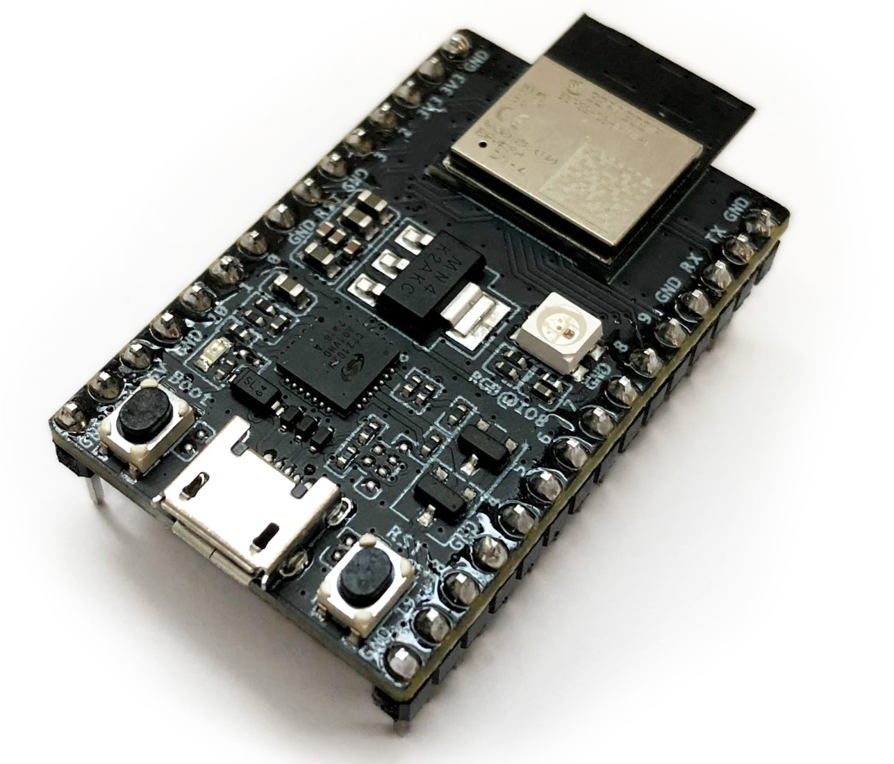

*Рисунок 4 — Плата ESP32-C3-DevKitM-1 из обзора на Хабре. Источник: [Хабр / nochkin](https://habr.com/ru/articles/541874/).*


При выборе модуля WROOM или WROVER смотрят не только на название серии. Существенны объём Flash, наличие PSRAM, вариант антенны и занятость контактов. Некоторые выводы, удобные на WROOM-плате, могут использоваться для памяти у другого исполнения. Точную комбинацию определяет полная маркировка модуля.

У платы ESP32-DevKitC V4 и DOIT DevKit V1 разное число контактов и различная компоновка. Далее приведена карта DOIT из статьи о BME680, поскольку монтажные рисунки в статьях выполнены именно с близкой по форме платой. Числа на разъёме и положение контактов нужно читать по собственной плате. Программный GPIO21 не означает «двадцать первый контакт слева».


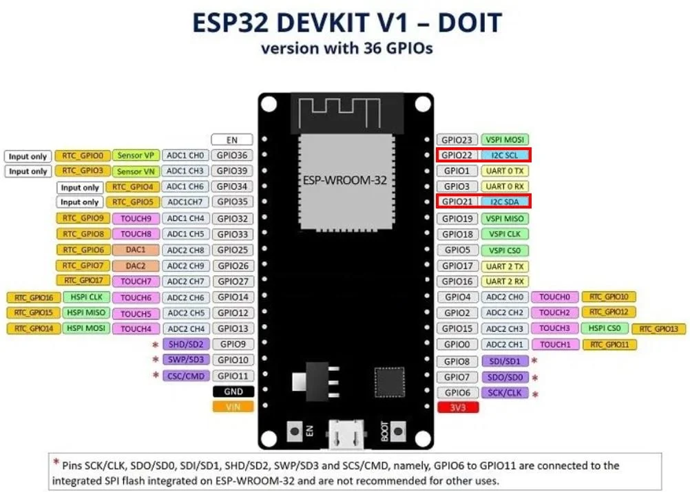

*Рисунок 5 — Карта выводов DOIT DevKit V1 из статьи. Надпись «36 GPIOs» в оригинале означает вариант с 36 контактами, а не 36 свободных GPIO. Источник: [Microkontroller.ru](https://microkontroller.ru/esp32-projects/podklyuchenie-datchika-bme680-k-esp32-s-pomoshhyu-esp-idf/).*


Подпись оригинального изображения «version with 36 GPIOs» нельзя воспринимать как число свободных универсальных выходов. Контакты питания, земли, EN и сигналы Flash тоже занимают места в разъёме. На практике ориентируются на имена сигналов: 3V3, GND, GPIO21, GPIO22 и т. д. Для занятий удобно заранее записать название платы, маркировку модуля и его характеристики.

<a id="s4"></a>
## 4. Распиновка: питание, GPIO и альтернативные функции

Карта выводов показывает, какие функции могут быть назначены одному физическому контакту. Цвета группируют аналоговые входы, цифровые функции, интерфейсы, память и питание. Сначала на карте находят нужный GPIO, затем проверяют ограничения, и только после этого подключают устройство. Полная карта ESP32-DevKitC от изготовителя приведена ниже.


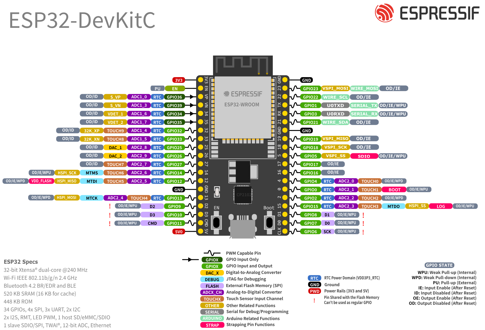

*Рисунок 6 — Полная цветная карта выводов ESP32-DevKitC. Обозначения относятся к этой плате. Источник: [Espressif](https://docs.espressif.com/projects/esp-dev-kits/en/latest/esp32/esp32-devkitc/user_guide.html).*


Один вывод может поддерживать несколько функций, но его нельзя одновременно отдать двум несовместимым устройствам. Например, GPIO23 можно использовать для отдельного светодиода или для сигнала MOSI интерфейса SPI. Если один проект уже использует GPIO23 как MOSI, подключение светодиода требует оценки влияния на шину и назначения выводов.

На увеличенном левом фрагменте видны GPIO36, GPIO39, GPIO34 и GPIO35. Они являются только входами. Для аналогового датчика это может быть удобно, а для светодиода, линии 1-Wire или выхода тактирования они не подходят. Обозначения ADC1_CH6 и GPIO34 описывают разные уровни одного контакта: номер канала АЦП и номер общего цифрового вывода.


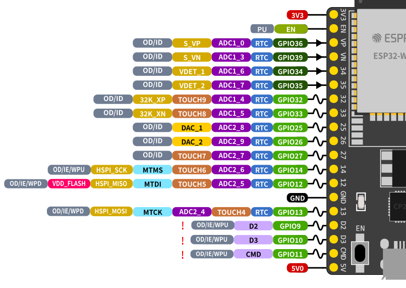

*Рисунок 7 — Левая группа выводов ESP32-DevKitC: ADC1, входы, GPIO и питание. Фрагмент схемы Espressif. Источник: [Espressif](https://docs.espressif.com/projects/esp-dev-kits/en/latest/esp32/esp32-devkitc/user_guide.html).*


На правом фрагменте находятся часто используемые GPIO21 и GPIO22 для I²C, GPIO18/19/23 для SPI, а также TX0 и RX0 последовательного порта. Эти функции помогают читать монтажные схемы из статей. Матрица GPIO позволяет переназначать многие сигналы, но для начальных примеров лучше зафиксировать одну понятную конфигурацию и явно указать её в коде.


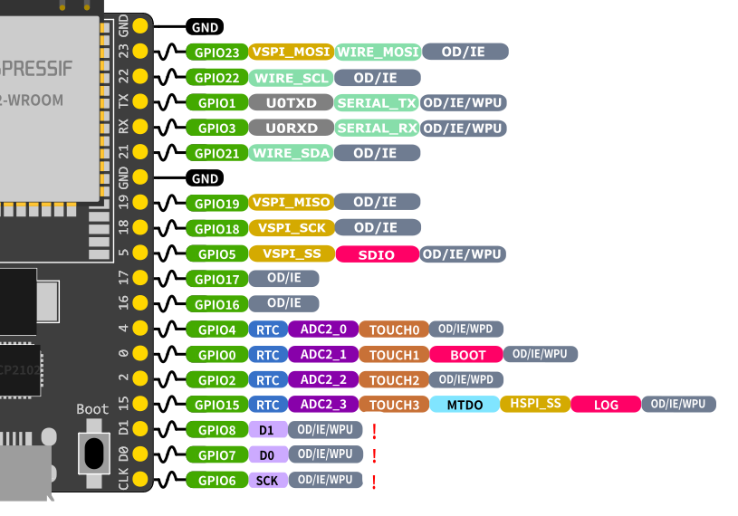

*Рисунок 8 — Правая группа выводов ESP32-DevKitC: UART0, I²C, SPI и GPIO. Фрагмент схемы Espressif. Источник: [Espressif](https://docs.espressif.com/projects/esp-dev-kits/en/latest/esp32/esp32-devkitc/user_guide.html).*


Основные ограничения собраны в таблице 3. Таблица относится к классической ESP32; применять её к C3 без проверки нельзя.

Таблица 3 — Группы выводов и их назначение

| Контакты | Назначение и ограничение |
|---|---|
| 3V3, GND | Питание 3,3 В и общий провод |
| 5V / VIN | Цепь питания платы; допустимость подключения определяется её схемой |
| EN | Разрешение работы и сброс при низком уровне |
| GPIO0, 2, 5, 12, 15 | Strapping: уровни при сбросе влияют на запуск |
| GPIO6–11 | Обычно подключены к Flash; не использовать для внешних устройств |
| GPIO34–39 | Только входы, встроенных программных подтяжек нет; часть выводов не выведена на модуле |
| GPIO1 / GPIO3 | UART0 TX / RX для загрузки и диагностики |
| GPIO16 / GPIO17 | В отдельных модулях могут быть заняты PSRAM |
| GPIO21 / GPIO22 | SDA / SCL в примерах лекции |
| GPIO25 / GPIO26 | Выходы встроенного ЦАП классической ESP32 |
| ADC1 | Предпочтительный блок для аналогового измерения одновременно с Wi-Fi |

ESP32 использует логические уровни **3,3 В**. Питание платы от USB 5 В безопасно благодаря предусмотренному стабилизатору, но не превращает входы GPIO в пятивольтовые. Для обычных датчиков 3,3 В линии соединяют напрямую, для ECHO модуля HC-SR04 требуется согласование уровня. Соединяемые устройства должны иметь общий GND, если интерфейс специально не развязан.

При включении Wi-Fi ток меняется скачками. Недостаточное питание, длинный кабель или плохой контакт могут вызвать сброс. Двигатель, реле и мощную ленту подключают через драйвер и рассчитанную цепь питания, а не непосредственно к GPIO. Strapping-контакты стараются не нагружать произвольно: неправильный уровень на GPIO0 или GPIO12 в момент сброса может помешать запуску.

<a id="s5"></a>
## 5. Среды разработки, подключение к ПК и прошивка

Среда разработки помогает редактировать исходник, вызвать компилятор, загрузить образ и увидеть сообщения программы. Она не заменяет аппаратную документацию платы. В статье Kotyara12 рассмотрены Arduino IDE, VS Code с PlatformIO и сочетания с ESP-IDF. Для первого проекта выбран Arduino IDE 2.x с пакетом Arduino-ESP32 3.3.7, а путь ESP-IDF показан отдельно.

**Arduino-ESP32** — программный framework поверх компонентов ESP-IDF. Он предоставляет знакомые `setup()`, `loop()`, `pinMode()` и `Serial`. **PlatformIO** организует проекты с явной конфигурацией, зависимостями и каталогами. **ESP-IDF** (Espressif IoT Development Framework) — официальный набор инструментов и компонентов. VS Code при этом является редактором: программную модель определяет выбранный framework.

На следующем рисунке из статьи показан Arduino IDE 2. Слева редактор и дерево инструментов, снизу сообщения сборки. Это полезно связать с реальными действиями: компиляция проверяет исходник и библиотеки, загрузка записывает образ на устройство, монитор показывает то, что выполняющаяся программа отправляет по последовательному порту.


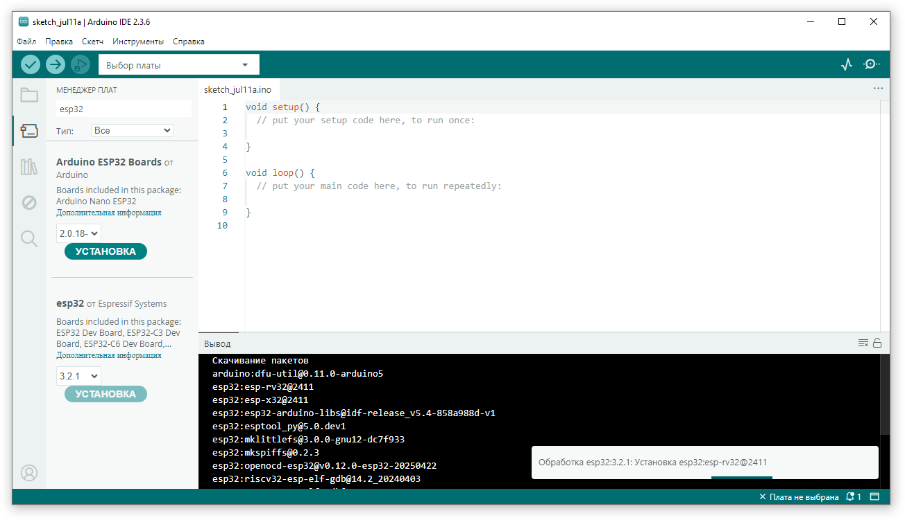

*Рисунок 9 — Пример Arduino IDE 2 из статьи Kotyara12. Источник: [Kotyara12](https://kotyara12.ru/iot/esp32mqtt-arduino/).*


Подготовка и первая прошивка проходят последовательно.

1. Плату подключают к USB **кабелем передачи данных**. Кабель только для зарядки может питать светодиод, но не создать COM-порт.
2. В системе проверяют появление последовательного порта. Для USB-UART при необходимости устанавливают драйвер его реальной модели, например CP210x или CH340. Номер COM назначает ОС.
3. В настройках Arduino IDE в список дополнительных URL менеджера плат добавляют официальный адрес Espressif, приведённый ниже.
4. В Boards Manager устанавливают `esp32 by Espressif Systems`. Для примеров зафиксирована версия **3.3.7**.
5. Выбирают реальную плату и порт. Для распространённой классической WROOM-платы часто подходит `ESP32 Dev Module`. Для ESP32-C3 выбирают C3, а не обычную ESP32.
6. Проверяют объём Flash, наличие PSRAM и схему разделов. Не включают PSRAM только потому, что такой пункт есть в меню.
7. Открывают полный скетч, выполняют Verify/Compile, затем Upload. После записи открывают Serial Monitor на 115200 бод и наблюдают результат.

```text
https://espressif.github.io/arduino-esp32/package_esp32_index.json
```

Скриншот выбора платы из статьи показан ниже. Состав меню меняется между версиями IDE, поэтому важен смысл выбора: плата должна соответствовать SoC, а порт — подключённому устройству.


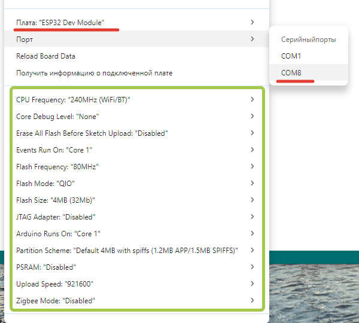

*Рисунок 10 — Выбор платы ESP32 Dev Module, COM-порта и параметров памяти в Arduino IDE. Фрагмент меню из статьи Kotyara12; номер COM относится к примеру автора. Источник: [Kotyara12](https://kotyara12.ru/iot/esp32mqtt-arduino/).*


У классической ESP32 BOOT обычно связан с GPIO0, EN вызывает сброс. Большинство DevKit автоматически входит в режим загрузки. Если загрузчик долго остаётся на `Connecting...`, проверяют порт, освобождают его от других программ и при необходимости удерживают BOOT в начале соединения, отпуская после начала записи. Процедура определяется конкретной платой. BOOT сам по себе не стирает Flash.

После компиляции формируется машинный образ. Затем утилита загрузки через USB-UART связывается с ROM-загрузчиком и записывает данные во Flash. После сброса выбирается и запускается приложение. Успешный Verify не доказывает правильность монтажа, а успешный Upload не доказывает, что выбран правильный I²C-адрес датчика. Эти этапы подтверждают разные части работы.

PlatformIO создаёт проект с конфигурацией `platformio.ini`. В окне создания проекта выбираются плата и framework. Фотография интерфейса ниже взята из статьи Kotyara12. Пример имени платы относится к выбранной классической ESP32.


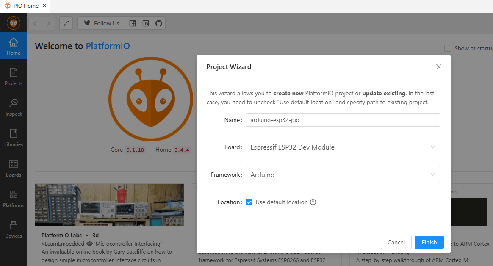

*Рисунок 11 — Создание проекта в PlatformIO. Вид интерфейса относится к версии из статьи. Источник: [Kotyara12](https://kotyara12.ru/iot/esp32mqtt-arduino/).*


```ini
[env:esp32dev]
platform = espressif32
board = esp32dev
framework = arduino
monitor_speed = 115200
```

Это пример структуры конфигурации, а не гарантия установки Arduino-ESP32 3.3.7: версия framework определяется платформой PlatformIO. Для одинаковой работы API нужно проверить и зафиксировать установленные зависимости. Новые функции ядра 3.x могут отсутствовать у проекта с ядром 2.x. Исходники Arduino в PlatformIO обычно находятся в `src/main.cpp`, где явно подключают `Arduino.h`.


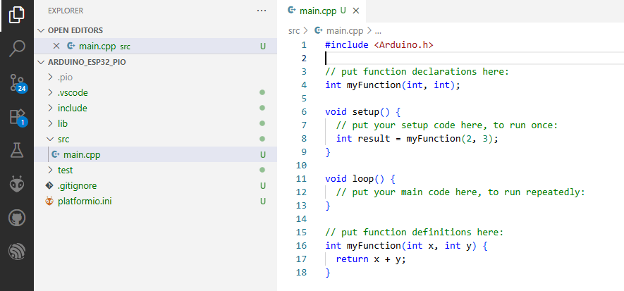

*Рисунок 12 — Структура Arduino-проекта в PlatformIO: исходник main.cpp и конфигурация. Источник: [Kotyara12](https://kotyara12.ru/iot/esp32mqtt-arduino/).*


В Arduino-ESP32 3.x изменился интерфейс LEDC: `ledcAttach(pin, freq, resolution)` заменил старые `ledcSetup()` и `ledcAttachPin()`. При разборе старых статей нужно отделять устойчивый принцип работы от конкретной версии API. Копирование прежнего названия функции не является доказательством ошибки платы.

<a id="s6"></a>
## 6. Первые программы: выход, время, кнопка и ШИМ

Первая программа должна иметь наблюдаемый результат и минимум зависимостей. Поэтому используется отдельный светодиод: GPIO23 соединён с резистором 330 Ом, резистор — с анодом светодиода, катод — с GND. Для красного LED с приблизительным падением 2 В ток оценивается как `(3,3 − 2,0) / 330 ≈ 4 мА`. Полный скетч приведён ниже и сохранён отдельно в каталоге примеров.


```cpp
#include <Arduino.h>
constexpr uint8_t LED_PIN = 23;
bool ledState = false;
uint32_t lastToggle = 0;

void setup() {
  Serial.begin(115200);
  pinMode(LED_PIN, OUTPUT);
  digitalWrite(LED_PIN, LOW);
}

void loop() {
  const uint32_t now = millis();
  if (uint32_t(now - lastToggle) >= 500) {
    lastToggle = now;
    ledState = !ledState;
    digitalWrite(LED_PIN, ledState);
    Serial.println(ledState ? "LED ON" : "LED OFF");
  }
}
```


`setup()` выполняется один раз после запуска и задаёт режим GPIO. В `loop()` проверяется время, прошедшее после последнего переключения. Каждые 500 мс состояние меняется, полный цикл включения и выключения занимает 1 с. `Serial.println()` даёт второе подтверждение работы: светодиод виден на плате, сообщения — в мониторе.

Выражение `uint32_t(now - lastToggle) >= 500` сравнивает интервал с учётом беззнакового переполнения счётчика при регулярной проверке коротких интервалов. В отличие от `delay(500)`, такая проверка оставляет основной цикл свободным для других действий. Это не гарантирует неблокирующую работу всех библиотек: отдельный вызов чтения датчика всё ещё может ждать измерения.

Для кнопки подходит GPIO27 в режиме `INPUT_PULLUP`; второй контакт кнопки соединяется с землёй. Нажатая кнопка даёт LOW. Рисунок из статьи EPAM показывает этот принцип подключения. У кнопки с четырьмя ножками две пары часто постоянно соединены внутри корпуса, поэтому сначала определяют реальную коммутацию.


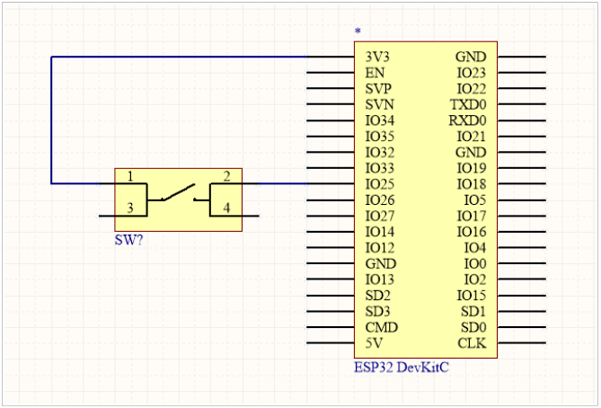

*Рисунок 13 — Подключение кнопки к ESP32 из статьи на Хабре. Источник: [Хабр / EPAM](https://habr.com/ru/companies/epam_systems/articles/522730/).*


Дребезг контактов даёт несколько переходов вместо одного. На диаграмме видно, что после механического нажатия сигнал не сразу устанавливается. Программа принимает новое состояние после устойчивого интервала, например порядка 20–30 мс для типичной кнопки. Внешнее прерывание удобно для фиксации события, но долгую обработку, печать и сетевой обмен выполняют вне обработчика. `volatile` не заменяет синхронизацию общих данных между задачами.


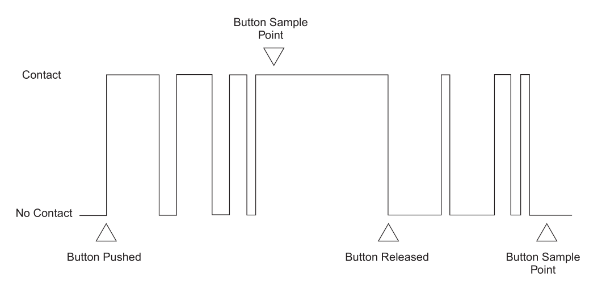

*Рисунок 14 — Дребезг кнопки и момент выборки сигнала. Источник: [Хабр / EPAM](https://habr.com/ru/companies/epam_systems/articles/522730/).*


Для управления яркостью используется **ШИМ**, широтно-импульсная модуляция. Контакт быстро переключается между низким и высоким уровнем, а коэффициент заполнения определяет долю времени включения нагрузки. На рисунке из статьи показаны 10, 50 и 90 %. Частота у сигналов может быть одинаковой, тогда различается длительность высокого уровня.


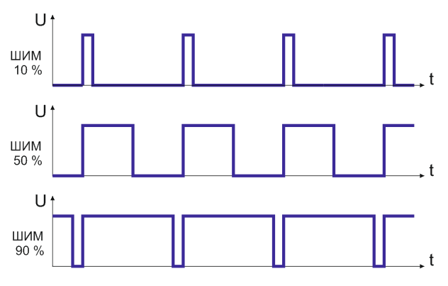

*Рисунок 15 — ШИМ с различным заполнением из статьи на Хабре. Источник: [Хабр / EPAM](https://habr.com/ru/companies/epam_systems/articles/522730/).*


В полном примере для Arduino-ESP32 3.3.7 аппаратный блок LEDC формирует 5 кГц при разрядности 8 бит:


```cpp
#include <Arduino.h>
constexpr uint8_t LED_PIN = 23;
bool pwmReady = false;

void setup() {
  Serial.begin(115200);
  pwmReady = ledcAttach(LED_PIN, 5000, 8);
  if (!pwmReady) {
    Serial.println("LEDC init failed");
    return;
  }
  ledcWrite(LED_PIN, 128);
}

void loop() {
  delay(10);
}
```


Значение 128 соответствует приблизительно половине диапазона 0…255. Аппаратная ШИМ продолжает работать, даже когда `loop()` выполняет другую задачу. Однако на GPIO остаётся импульсный сигнал; постоянное аналоговое напряжение требует фильтра или ЦАП. Частота и разрядность связаны ограничениями аппаратного таймера, поэтому результат `ledcAttach()` проверяется.

Для аналоговых измерений `analogRead()` обычно возвращает 0…4095 при 12-битной выдаче. Из этого не следует универсальная точная формула `raw × 3,3 / 4095`: диапазон зависит от ослабления входа и модели SoC. `analogReadMilliVolts(34)` даёт калиброванную оценку в милливольтах. На классической ESP32 при работающем Wi-Fi предпочтителен ADC1, например GPIO34, потому что ADC2 имеет конфликт с Wi-Fi. Напряжение на контакте должно оставаться допустимым независимо от программных настроек.

<a id="s7"></a>
## 7. Устройство 1: измеритель среды ESP32 + BME680

Первый законченный измерительный узел строится по статьям о BME680. Он получает температуру, влажность, давление и сопротивление газового элемента. Сначала данные выводятся в последовательный порт; затем тот же датчик используется в веб-метеостанции. Такой порядок помогает отделить ошибку датчика от сетевой ошибки.

Модуль BME680 на рисунке имеет VCC, GND, SCL/SCK, SDA/SDI, SDO и CS. Совмещённые надписи показывают поддержку I²C и SPI. В I²C используются SDA и SCL, CSB должен иметь высокий уровень, а SDO выбирает адрес 0x76 или 0x77. Поэтому SDO имеет значение и при I²C, хотя в некоторых пересказах его называют только выходом SPI. У готового модуля необходимые подтяжки могут быть уже установлены.


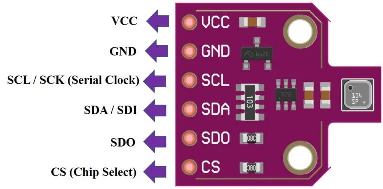

*Рисунок 16 — Выводы модуля BME680: питание, I²C/SPI, выбор интерфейса и адреса. Источник: [Microkontroller.ru](https://microkontroller.ru/esp32-projects/podklyuchenie-datchika-bme680-k-esp32-s-pomoshhyu-esp-idf/).*


I²C (Inter-Integrated Circuit) — последовательная шина с линией данных SDA и линией тактирования SCL. На линиях нужны подтяжки к допустимому напряжению, в данном случае к 3,3 В. Контроллер адресует устройство, а датчик отвечает подтверждением. Несколько устройств могут работать на общей шине при разных адресах.

Таблица 4 — Подключение BME680 в учебном примере

| BME680 | ESP32 | Назначение |
|---|---|---|
| VCC | 3V3 | Питание модуля с логикой 3,3 В |
| GND | GND | Общая земля |
| SDA | GPIO21 | Данные I²C |
| SCL | GPIO22 | Тактирование I²C |
| CSB, SDO | По схеме модуля | Режим I²C и выбор адреса |

Монтажная иллюстрация из статьи показывает именно физические провода между платами. Цвет провода помогает проследить цепь, но назначение определяют надписи контактов. Программа использует номера GPIO, а не порядковое место контакта в гребёнке.


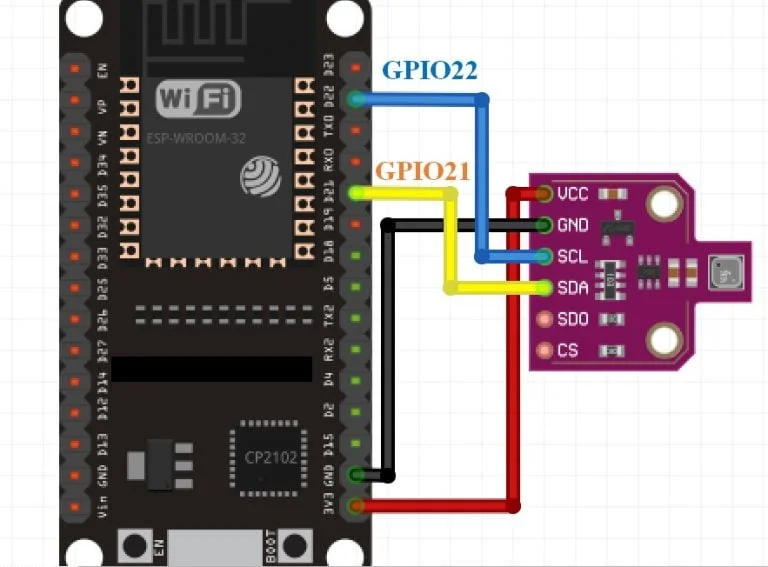

*Рисунок 17 — Монтажное соединение ESP32 и BME680 по I²C из статьи. Источник: [Microkontroller.ru](https://microkontroller.ru/esp32-projects/podklyuchenie-datchika-bme680-k-esp32-s-pomoshhyu-esp-idf/).*


Рядом полезно увидеть реальный макет автора. Макетная плата соединяет отверстия группами; внешне близкие отверстия не обязательно электрически связаны. При первом подключении сверяют четыре цепи с таблицей, а не только общий вид фотографии.


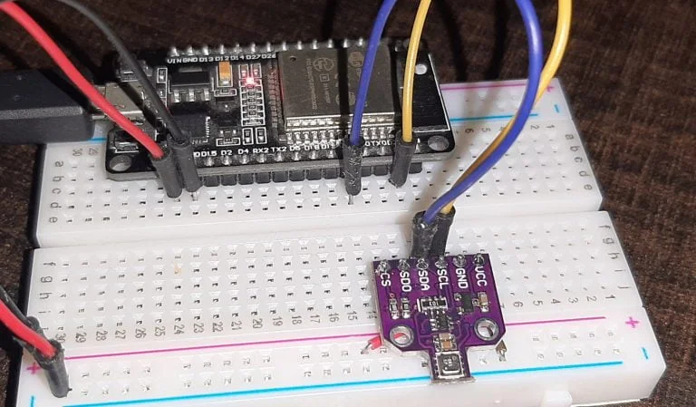

*Рисунок 18 — Реальный макет ESP32 с BME680 из статьи. Источник: [Microkontroller.ru](https://microkontroller.ru/esp32-projects/podklyuchenie-datchika-bme680-k-esp32-s-pomoshhyu-esp-idf/).*


Перед запуском драйвера удобно выполнить сканер шины. Полный `03_i2c_scan` перебирает обычные адреса 0x08…0x77 и печатает устройства, подтвердившие адрес:


```cpp
#include <Arduino.h>
#include <Wire.h>

void setup() {
  Serial.begin(115200);
  if (!Wire.begin(21, 22, 100000)) {
    Serial.println("I2C init failed");
    return;
  }
  for (uint8_t addr = 0x08; addr <= 0x77; ++addr) {
    Wire.beginTransmission(addr);
    if (Wire.endTransmission() == 0) {
      Serial.printf("Found 0x%02X\n", addr);
    }
  }
  Serial.println("Scan complete");
}

void loop() { delay(10); }
```


Если BME680 ответил на 0x77, в следующем примере заменяют 0x76 на 0x77. Сам ответ ещё не подтверждает корректность измерения. Для получения физических величин драйвер читает регистры и использует калибровочные данные.

Для Arduino устанавливаются **Adafruit BME680 Library**, **Adafruit Unified Sensor** и **Adafruit BusIO**. Полная программа измерительного узла:


```cpp
#include <Arduino.h>
#include <Wire.h>
#include <Adafruit_BME680.h>
Adafruit_BME680 bme;
bool ready = false;
uint32_t lastRead = 0;

void setup() {
  Serial.begin(115200);
  if (!Wire.begin(21, 22, 100000)) return;
  ready = bme.begin(0x76);  // Use 0x77 if found by the scanner.
  if (!ready) {
    Serial.println("BME680 not found");
    return;
  }
  bme.setTemperatureOversampling(BME680_OS_8X);
  bme.setHumidityOversampling(BME680_OS_2X);
  bme.setPressureOversampling(BME680_OS_4X);
  bme.setIIRFilterSize(BME680_FILTER_SIZE_3);
  bme.setGasHeater(320, 150);
}

void loop() {
  if (!ready) { delay(10); return; }
  if (uint32_t(millis() - lastRead) < 2000) return;
  lastRead = millis();
  if (!bme.performReading()) {
    Serial.println("Read failed");
    return;
  }
  Serial.printf("T=%.2f C RH=%.1f %% p=%.2f hPa Rgas=%.2f kOhm\n",
      bme.temperature, bme.humidity,
      bme.pressure / 100.0f, bme.gas_resistance / 1000.0f);
}
```


Настройка передискретизации и фильтра меняет обработку измерений. Газовый канал использует нагреватель; `setGasHeater(320, 150)` задаёт параметры одного выбранного режима. `performReading()` выполняет измерение и может ждать его окончания. При неудаче программа сообщает об ошибке, сохраняя различие между «нет результата» и настоящим нулевым значением.

Давление библиотека возвращает в Па; деление на 100 переводит его в гПа. Газовое сопротивление выводится в кОм. Оно зависит от смеси газов и условий, но не является напрямую концентрацией CO₂ в ppm. Оценки качества воздуха IAQ требуют соответствующего алгоритма, например BSEC, и соблюдения его условий. На следующем скриншоте из статьи показаны реальные строки терминала проекта ESP-IDF, а не результат исполнения наших скетчей.


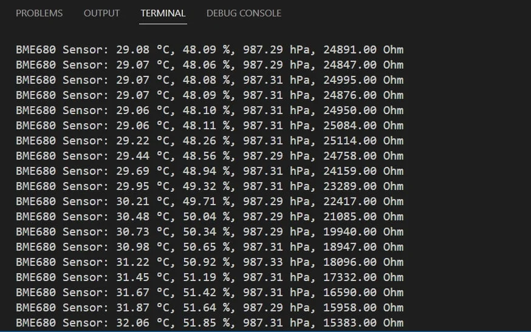

*Рисунок 19 — Показания BME680 в терминале ESP-IDF. Это результат автора статьи. Источник: [Microkontroller.ru](https://microkontroller.ru/esp32-projects/podklyuchenie-datchika-bme680-k-esp32-s-pomoshhyu-esp-idf/).*


Ожидаемый результат учебного узла — новые строки с температурой, влажностью, давлением и газовым сопротивлением примерно раз в две секунды. Изменение показаний при воздействии должно быть правдоподобным, но показанная числом точность не означает такую же метрологическую точность всего устройства. Для контроля используют техническую документацию и при необходимости сравнение с эталоном.

<a id="s8"></a>
## 8. Устройство 2: барометр BMP180 и OLED-дисплей

Следующее устройство демонстрирует автономную индикацию. BMP180 передаёт температуру и давление по I²C, а ESP32 выводит их в Serial и на OLED SSD1306 128×64. Связь с Интернетом не требуется. В статье о BMP180 сначала показан вывод в терминал; добавление локального дисплея развивает тот же принцип и позволяет увидеть работу системы без компьютера.

На фотографии модуля видны всего четыре вывода. BMP180 не имеет канала влажности. Высоту получают расчётом из давления и выбранной опоры, поэтому неверное опорное давление даст смещённую оценку высоты даже при исправном датчике.


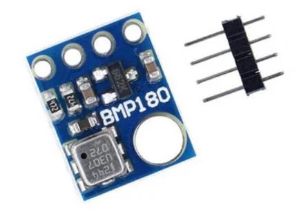

*Рисунок 20 — Модуль BMP180: датчик атмосферного давления. Источник: [Microkontroller.ru](https://microkontroller.ru/esp32-projects/podklyuchenie-datchika-bmp180-k-esp32-s-pomoshhyu-esp-idf/).*


Рисунок подключения из статьи использует GPIO21 для SDA и GPIO22 для SCL. Питание датчика в учебной схеме берётся от 3,3 В. У конкретного модуля надпись VIN и наличие стабилизатора требуют отдельной проверки: подтяжки шины тоже должны быть безопасны для ESP32.


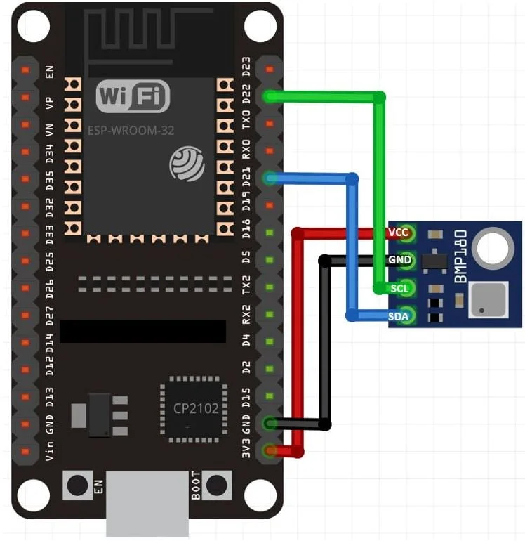

*Рисунок 21 — Подключение BMP180 к ESP32 по I²C из статьи. Источник: [Microkontroller.ru](https://microkontroller.ru/esp32-projects/podklyuchenie-datchika-bmp180-k-esp32-s-pomoshhyu-esp-idf/).*


OLED подключается параллельно к тем же четырём цепям. Типичный адрес BMP180 — 0x77, типичный адрес OLED — 0x3C, поэтому адресного конфликта здесь нет. У части дисплеев адрес 0x3D или другой контроллер, и это проверяют сканером и описанием модуля.

Таблица 5 — Общая I²C-шина BMP180 и OLED

| Цепь | ESP32 | BMP180 | OLED SSD1306 |
|---|---|---|---|
| Питание | 3V3 | VCC | VCC допустимого 3,3-вольтового модуля |
| Земля | GND | GND | GND |
| Данные | GPIO21 | SDA | SDA |
| Тактирование | GPIO22 | SCL | SCL |
| Адрес | — | 0x77 | 0x3C в примере |

На увеличенном фрагменте исходной иллюстрации видны контакты OLED. У этого модуля они расположены в порядке GND, VCC, SCL, SDA. У другого дисплея порядок может отличаться, поэтому нельзя соединять гребёнки только по порядковым местам. Названия цепей в таблице остаются главным ориентиром.


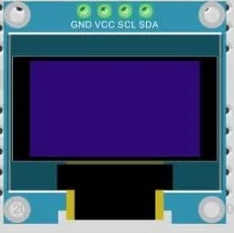

*Рисунок 22 — Модуль OLED SSD1306: контакты GND, VCC, SCL и SDA. Фрагмент иллюстрации из статьи. Источник: [Microkontroller.ru](https://microkontroller.ru/esp32-projects/podklyuchenie-ultrazvukovogo-datchika-hc-sr04-k-esp32-s-pomoshhyu-esp-idf/).*


Нужны библиотеки **Adafruit BMP085 Library** (поддерживает BMP180), **Adafruit SSD1306**, **Adafruit GFX Library**, а также их зависимости. Полная программа:


```cpp
#include <Arduino.h>
#include <Wire.h>
#include <Adafruit_BMP085.h>
#include <Adafruit_GFX.h>
#include <Adafruit_SSD1306.h>

Adafruit_BMP085 bmp;
Adafruit_SSD1306 display(128, 64, &Wire, -1);
bool sensorOK = false;
bool displayOK = false;
uint32_t lastRead = 0;

void setup() {
  Serial.begin(115200);
  if (!Wire.begin(21, 22, 100000)) return;
  sensorOK = bmp.begin(BMP085_ULTRAHIGHRES, &Wire);
  displayOK = display.begin(SSD1306_SWITCHCAPVCC, 0x3C);
  if (!sensorOK) Serial.println("BMP180 not found at 0x77");
  if (!displayOK) Serial.println("OLED unavailable; use Serial output");
}

void loop() {
  if (!sensorOK) { delay(10); return; }
  if (uint32_t(millis() - lastRead) < 2000) return;
  lastRead = millis();
  const float t = bmp.readTemperature();
  const int32_t pressurePa = bmp.readPressure();
  if (!isfinite(t) || pressurePa <= 0) {
    Serial.println("Invalid measurement");
    return;
  }
  const float pressureHpa = pressurePa / 100.0f;
  Serial.printf("T=%.1f C, p=%.1f hPa\n", t, pressureHpa);
  if (displayOK) {
    display.clearDisplay();
    display.setTextColor(SSD1306_WHITE);
    display.setTextSize(1);
    display.setCursor(0, 0);
    display.println("ESP32 + BMP180");
    display.setTextSize(2);
    display.setCursor(0, 18);
    display.print(t, 1); display.println(" C");
    display.setCursor(0, 42);
    display.print(pressureHpa, 0); display.println(" hPa");
    display.display();
  }
}
```


Сначала программа инициализирует общую шину, затем каждый адресуемый модуль. `readTemperature()` и `readPressure()` возвращают обработанные драйвером величины. `clearDisplay()` очищает буфер изображения, `print()` формирует текст в этом буфере, а `display()` передаёт его экрану. Если OLED не инициализировался, данные остаются доступны в Serial. Это помогает различать ошибку датчика и ошибку индикации.

Скриншот терминала исходного проекта ESP-IDF приведён ниже для сравнения формата измерений. В учебном скетче высота намеренно не выдаётся без заданного опорного давления; давление и температура остаются основными результатами.


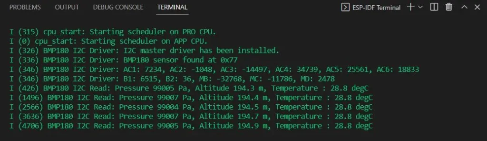

*Рисунок 23 — Вывод температуры, давления и расчётной высоты BMP180 в терминал ESP-IDF. Источник: [Microkontroller.ru](https://microkontroller.ru/esp32-projects/podklyuchenie-datchika-bmp180-k-esp32-s-pomoshhyu-esp-idf/).*


Если показания в Serial есть, а экран пуст, проверяют адрес OLED, питание, геометрию 128×64 и соответствие контроллера SSD1306. Замена датчика в программе на другой класс не исправляет неправильный драйвер дисплея. Общая шина работает только при согласованных уровнях и отсутствии адресных конфликтов.

<a id="s9"></a>
## 9. Устройство 3: цифровой термометр DS18B20

DS18B20 отличается от I²C-датчиков: он использует **1-Wire** с одной сигнальной линией DQ. В обычном режиме отдельного питания всё равно нужны три провода — VDD, DQ и GND. Датчики имеют уникальные адреса, поэтому на одной линии могут работать несколько зондов. В примере используется один датчик и питание 3,3 В, без паразитного режима.

Монтаж на рисунке из статьи показывает GPIO4, подтяжку DQ резистором 4,7 кОм к 3,3 В и общий GND. По фотографии корпуса TO-92 нельзя автоматически назначать ножки любому герметичному зонду: распиновку и цвета проводов уточняют по его документации.


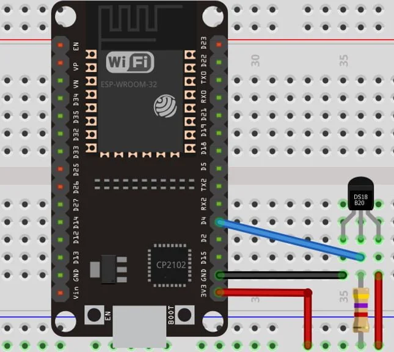

*Рисунок 24 — Монтаж ESP32 и DS18B20 с резистором подтяжки из статьи. Источник: [Microkontroller.ru](https://microkontroller.ru/esp32-projects/veb-server-na-esp32-i-datchike-ds18b20-s-pomoshhyu-esp-idf/).*


Таблица 6 — Подключение термометра

| DS18B20 | Соединение |
|---|---|
| VDD | 3V3 ESP32 |
| GND | Общий GND |
| DQ | GPIO4 |
| Подтяжка | 4,7 кОм между DQ и 3V3 |

Программа использует библиотеки **OneWire** и **DallasTemperature**. GPIO4 должен и считывать линию, и формировать низкий уровень. Входы только для чтения GPIO34–GPIO39 для этой задачи не подходят.


```cpp
#include <Arduino.h>
#include <OneWire.h>
#include <DallasTemperature.h>
OneWire oneWire(4);
DallasTemperature sensors(&oneWire);

void setup() {
  Serial.begin(115200);
  sensors.begin();
  sensors.setResolution(12);
}

void loop() {
  sensors.requestTemperatures(); // Waits for conversion by default.
  const float t = sensors.getTempCByIndex(0);
  if (t == DEVICE_DISCONNECTED_C) {
    Serial.println("Sensor disconnected");
  } else {
    Serial.printf("T=%.2f C\n", t);
  }
  delay(1000);
}
```


Вызов `requestTemperatures()` по умолчанию ждёт завершения преобразования. В 12-разрядном режиме оно может занимать до 750 мс. Затем `getTempCByIndex(0)` читает первый обнаруженный датчик. Значение `DEVICE_DISCONNECTED_C` означает ошибку связи, а не настоящую отрицательную температуру. При нескольких датчиках назначение помещения или зоны лучше связывать с уникальным адресом, а не с порядком поиска.

Показание 85 °C сразу после включения может быть начальным содержимым регистра до первого завершённого измерения. Показание около −127 °C часто связано с признаком отключения в используемой библиотеке. Программа обязана отличать такой служебный результат от физической величины.

<a id="s10"></a>
## 10. Устройство 4: ультразвуковой дальномер HC-SR04

HC-SR04 содержит излучатель и приёмник ультразвука. ESP32 формирует пусковой импульс TRIG, модуль отправляет звуковую посылку и выдаёт ECHO. Длительность ECHO связана со временем распространения сигнала до объекта и обратно. На первом рисунке из статьи подписаны четыре контакта модуля.


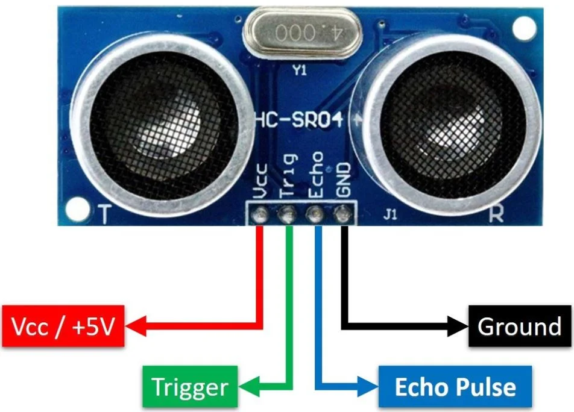

*Рисунок 25 — Выводы HC-SR04: VCC, TRIG, ECHO и GND. Источник: [Microkontroller.ru](https://microkontroller.ru/esp32-projects/podklyuchenie-ultrazvukovogo-datchika-hc-sr04-k-esp32-s-pomoshhyu-esp-idf/).*


Следующая иллюстрация показывает отражение звука. Хороший результат зависит от отражающей поверхности, угла и размеров объекта. Мягкая ткань может поглощать звук, а наклонная поверхность уводит отражение от приёмника. Дальномер не является камерой и не распознаёт форму препятствия.


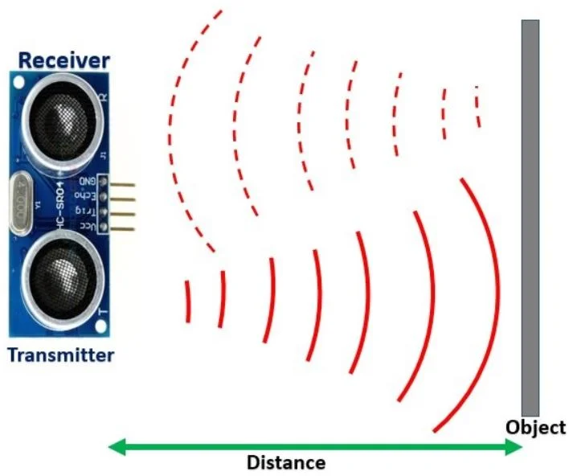

*Рисунок 26 — Принцип измерения расстояния отражённым ультразвуком. Источник: [Microkontroller.ru](https://microkontroller.ru/esp32-projects/podklyuchenie-ultrazvukovogo-datchika-hc-sr04-k-esp32-s-pomoshhyu-esp-idf/).*


При скорости звука приблизительно 343 м/с расстояние вычисляется так:

```text
d_см = t_мкс × 0,0343 / 2
```

Деление на два связано с двойным путём. Для ECHO 1000 мкс получается около 17,15 см. Скорость звука зависит от температуры, поэтому константа является приближением. Диаграмма из статьи помогает связать команду TRIG, акустическую посылку и измеряемый интервал.


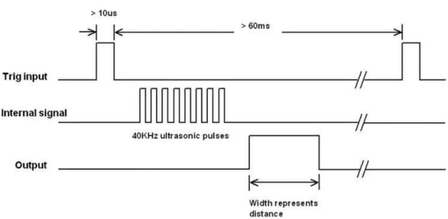

*Рисунок 27 — Временная диаграмма запуска HC-SR04 и эхо-импульса. Источник: [Microkontroller.ru](https://microkontroller.ru/esp32-projects/podklyuchenie-ultrazvukovogo-datchika-hc-sr04-k-esp32-s-pomoshhyu-esp-idf/).*


Обычный HC-SR04 питается от 5 В. Его ECHO нельзя подавать прямо на GPIO ESP32. В учебном подключении TRIG соединён с GPIO18, а ECHO идёт на GPIO19 через делитель: **2,2 кОм сверху**, между ECHO и узлом GPIO19, **3,3 кОм снизу**, от узла к GND. При 5 В на ECHO узел получает `5 × 3,3 / (2,2 + 3,3) = 3,0 В`.

Таблица 7 — Безопасное подключение HC-SR04

| Контакт модуля | Подключение |
|---|---|
| VCC | Предусмотренный источник 5 В |
| GND | Общий GND с ESP32 |
| TRIG | GPIO18; порог входа проверяют для конкретного модуля |
| ECHO | Через верхний резистор 2,2 кОм к узлу GPIO19 |
| Узел GPIO19 | Через нижний резистор 3,3 кОм к GND |

В следующей схеме показано именно это согласование. Назначения GPIO отличаются от исходной монтажной картинки статьи и совпадают с приведённой программой.


*Рисунок 28 — Учебная схема HC-SR04 с делителем ECHO 2,2/3,3 кОм. Авторская техническая схема.*


```cpp
#include <Arduino.h>
constexpr uint8_t TRIG_PIN = 18;
constexpr uint8_t ECHO_PIN = 19;

void setup() {
  Serial.begin(115200);
  pinMode(TRIG_PIN, OUTPUT);
  digitalWrite(TRIG_PIN, LOW);
  pinMode(ECHO_PIN, INPUT);
}

void loop() {
  digitalWrite(TRIG_PIN, LOW);
  delayMicroseconds(2);
  digitalWrite(TRIG_PIN, HIGH);
  delayMicroseconds(10);
  digitalWrite(TRIG_PIN, LOW);
  const unsigned long us = pulseIn(ECHO_PIN, HIGH, 30000UL);
  if (us == 0) {
    Serial.println("No echo: timeout");
  } else {
    const float cm = us * 0.0343f / 2.0f;
    Serial.printf("Distance=%.1f cm\n", cm);
  }
  delay(100);
}
```


`pulseIn(..., 30000UL)` ограничивает ожидание приблизительно 30 мс. Ноль по тайм-ауту означает отсутствие подходящего импульса, а не расстояние 0 см. Между измерениями сделана пауза 100 мс. Простое ожидание удобно для первого разбора, а при более строгих требованиях к отклику используют захват длительности периферией или обработку фронтов.

Фотография из статьи показывает собранный макет дальномера. Она иллюстрирует внешний вид устройства; электрическое подключение в этой лекции определяется безопасной таблицей выше, включая делитель ECHO.


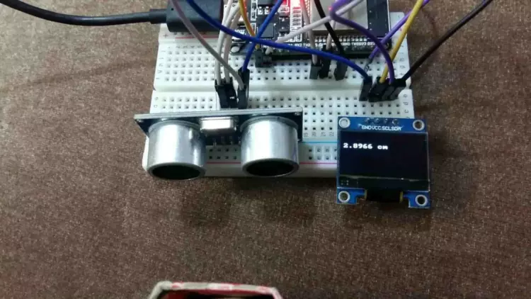

*Рисунок 29 — Макет ультразвукового измерителя из статьи. Источник: [Microkontroller.ru](https://microkontroller.ru/esp32-projects/podklyuchenie-ultrazvukovogo-datchika-hc-sr04-k-esp32-s-pomoshhyu-esp-idf/).*

<a id="s11"></a>
## 11. Wi-Fi и законченные сетевые устройства

Когда локальное измерение работает, к нему добавляют сетевое представление. В режиме **STA** (station) ESP32 подключается к существующей точке доступа. В режиме **AP** (access point) создаёт свою сеть. Для классической ESP32 нужна сеть 2,4 ГГц. Наличие локального Wi-Fi не означает обязательный доступ в Интернет: браузер может обращаться к плате в одной доступной сети.

Схема из статьи Kotyara12 показывает несколько станций ESP32 и общую точку доступа. IP-адрес обычно выдаёт DHCP роутера. Программа печатает фактический адрес через `WiFi.localIP()`; адрес из скриншота автора нельзя переносить в свою сеть. Изоляция клиентов в гостевой сети может запрещать обмен даже при одном имени Wi-Fi.


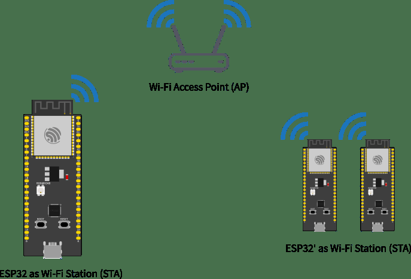

*Рисунок 30 — Несколько ESP32 в режиме STA и общая точка доступа. Источник: [Kotyara12](https://kotyara12.ru/iot/esp32mqtt-arduino/).*


### 11.1. Веб-метеостанция BME680

В статье о веб-сервере BME680 разделены две связи: I²C между ESP32 и датчиком, HTTP между браузером и ESP32. Браузер делает запрос, программа формирует ответ с измерениями. Изображение показывает роли клиента и сервера.


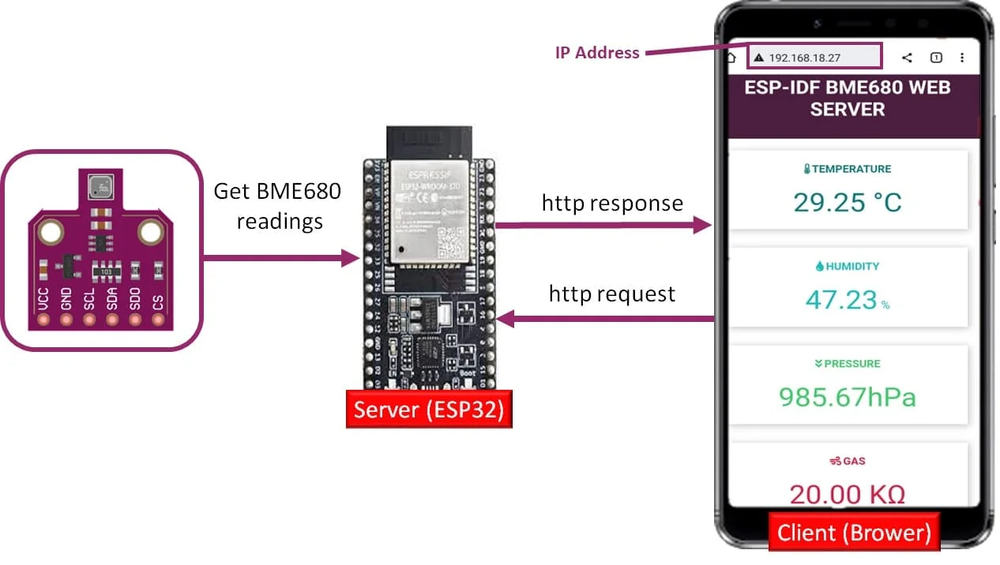

*Рисунок 31 — Схема запросов браузера к веб-серверу ESP32 с BME680. Источник: [Microkontroller.ru](https://microkontroller.ru/esp32-projects/veb-server-na-esp32-i-datchike-bme680-s-pomoshhyu-esp-idf/).*


Скриншот готовой страницы полезен тем, что переводит абстрактные переменные в результат устройства: четыре величины с единицами, доступные с компьютера или телефона. Газовый канал показан как сопротивление, а не как прямое измерение CO₂.


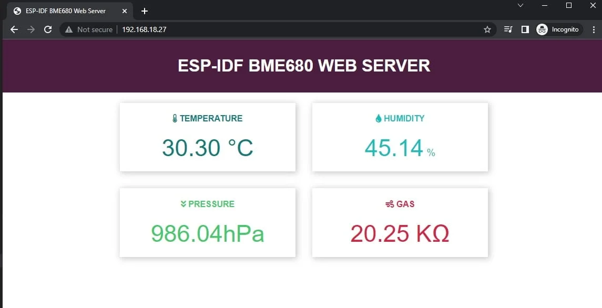

*Рисунок 32 — Веб-страница метеостанции BME680 из статьи. Газовый канал показан в кОм. Источник: [Microkontroller.ru](https://microkontroller.ru/esp32-projects/veb-server-na-esp32-i-datchike-bme680-s-pomoshhyu-esp-idf/).*


В учебной реализации на Arduino применяется стандартная библиотека `WebServer`. Скетч `07_bme680_web` отдаёт HTML по `/` и JSON по `/api/temperature`. Страница опрашивает API каждые две секунды. Основные поля — `temperature_c` и `age_ms`, то есть температура и возраст результата.

```json
{"temperature_c":23.45,"age_ms":120}
```

Это пример формата, а не показание испытанного нами устройства. Полный код находится в [07_bme680_web.ino](examples/07_bme680_web/07_bme680_web.ino). В начале задаются SSID и пароль своей сети, а также проверяется адрес BME680. Чтение измерения выполняется отдельно от обработчика HTTP; при недоступном датчике или возрасте данных больше 5 секунд сервер возвращает **HTTP 503**, сохраняя различие между ошибкой и нулём.

Длительное ожидание сети ограничено 15 секундами. `performReading()` остаётся блокирующим и может кратко задержать ответ. Для более отзывчивой системы измерение разделяют на запуск и получение результата либо переносят в задачу с безопасной передачей данных. Учебный сервер предназначен для локальной доверенной сети.

### 11.2. Веб-термометр DS18B20 с разделённым измерением

Веб-термометр из статьи использует тот же клиент-серверный принцип, но другой датчик. Рисунок позволяет увидеть, что браузеру не требуется знать протокол 1-Wire: электрический и сетевой уровни связывает программа ESP32.


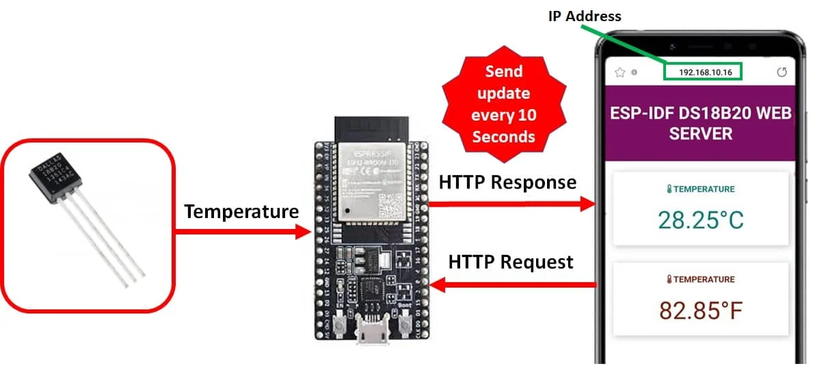

*Рисунок 33 — Схема веб-термометра ESP32 и DS18B20. Источник: [Microkontroller.ru](https://microkontroller.ru/esp32-projects/veb-server-na-esp32-i-datchike-ds18b20-s-pomoshhyu-esp-idf/).*


Оригинальная страница автора показывает температуру в °C и °F. Для перевода применяют `F = C × 1,8 + 32`, поэтому 28,25 °C соответствует 82,85 °F. Это пример обработки одной измеренной величины, а не два независимых датчика.


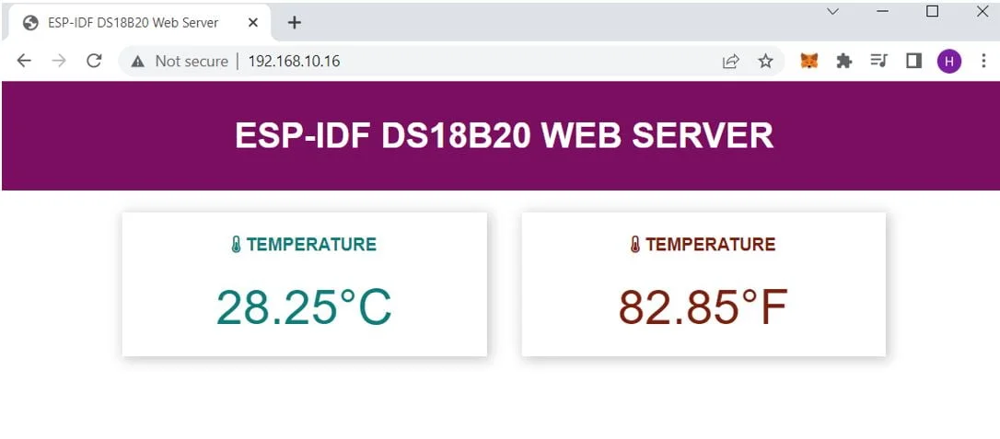

*Рисунок 34 — Результат веб-термометра DS18B20 из статьи. Источник: [Microkontroller.ru](https://microkontroller.ru/esp32-projects/veb-server-na-esp32-i-datchike-ds18b20-s-pomoshhyu-esp-idf/).*


В полном скетче ниже ожидание преобразования DS18B20 разделено на две стадии. `setWaitForConversion(false)` запускает преобразование без длительного ожидания в этой функции. Основной цикл продолжает обслуживать HTTP, а через 750 мс получает результат.


```cpp
#include <Arduino.h>
#include <WiFi.h>
#include <WebServer.h>
#include <OneWire.h>
#include <DallasTemperature.h>
#include <math.h>

const char* SSID = "YOUR_WIFI_2G4";
const char* PASS = "YOUR_WIFI_PASSWORD";
OneWire wire(4);
DallasTemperature sensors(&wire);
WebServer server(80);
bool sensorPresent = false, valid = false, serverStarted = false;
bool converting = false;
uint32_t requestedAt = 0, measuredAt = 0;
float temperatureC = NAN;

void serviceSensor() {
  if (!sensorPresent) return;
  if (converting && uint32_t(millis() - requestedAt) >= 750) {
    temperatureC = sensors.getTempCByIndex(0);
    valid = temperatureC != DEVICE_DISCONNECTED_C && isfinite(temperatureC);
    if (valid) measuredAt = millis();
    converting = false;
  }
  if (!converting && uint32_t(millis() - requestedAt) >= 2000) {
    sensors.requestTemperatures();
    requestedAt = millis();
    converting = true;
  }
}

void setup() {
  Serial.begin(115200);
  sensors.begin();
  sensorPresent = sensors.getDeviceCount() > 0;
  sensors.setResolution(12);
  sensors.setWaitForConversion(false);
  if (sensorPresent) {
    sensors.requestTemperatures(); requestedAt = millis(); converting = true;
  }
  WiFi.mode(WIFI_STA); WiFi.begin(SSID, PASS);
  const uint32_t start = millis();
  while (WiFi.status() != WL_CONNECTED && uint32_t(millis() - start) < 15000) {
    serviceSensor(); delay(10);
  }
  if (WiFi.status() != WL_CONNECTED) {
    Serial.println("Wi-Fi timeout"); return;
  }
  Serial.print("Open http://"); Serial.println(WiFi.localIP());
  server.on("/", HTTP_GET, []() {
    server.send(200, "text/html; charset=utf-8",
      "<!doctype html><meta charset='utf-8'><title>DS18B20</title>"
      "<h1>ESP32 + DS18B20</h1><p id='t'>Waiting...</p>"
      "<script>async function update(){try{const r=await fetch('/temperature');"
      "if(!r.ok)throw 1;const d=await r.json();"
      "document.getElementById('t').textContent=d.c.toFixed(2)+' C';"
      "}catch(e){document.getElementById('t').textContent='Sensor unavailable';}}"
      "update();setInterval(update,2000);</script>");
  });
  server.on("/temperature", HTTP_GET, []() {
    server.sendHeader("Cache-Control", "no-store");
    if (!valid || uint32_t(millis() - measuredAt) > 5000) {
      server.send(503, "application/json", "{\"error\":\"no_measurement\"}"); return;
    }
    char text[64]; snprintf(text, sizeof(text), "{\"c\":%.2f}", temperatureC);
    server.send(200, "application/json", text);
  });
  server.begin(); serverStarted = true;
}

void loop() {
  serviceSensor();
  if (serverStarted) server.handleClient();
  delay(2);
}
```


Функция `serviceSensor()` обслуживает небольшой автомат состояний: «преобразование идёт» и «можно запросить следующее». Обработчик `/temperature` отдаёт только готовое свежее значение. В браузере JavaScript повторяет запрос каждые две секунды. На этом примере видна причина применять время и состояния вместо длинной задержки внутри одного сетевого обработчика.

### 11.3. Телеметрия и удалённый светодиод по MQTT

**MQTT** (Message Queuing Telemetry Transport) связывает клиентов через брокер. ESP32 публикует сообщение в topic, а приложение подписывается на интересующий topic. В статье Kotyara12 рассмотрены публичный и локальный брокеры. Следующий рисунок показывает расширенный вариант с локальным брокером. Сетевые связи следует читать как архитектуру обмена; конкретный способ соединения брокеров зависит от настройки системы.


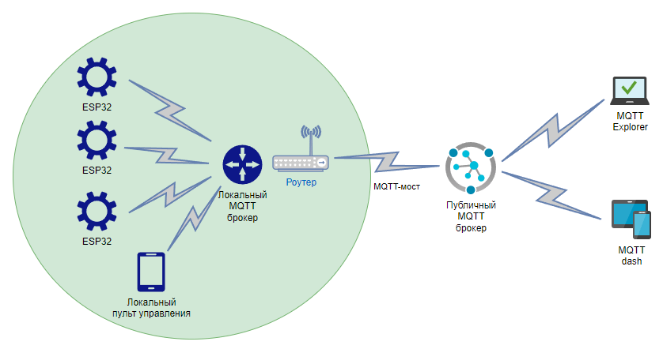

*Рисунок 35 — Вариант телеметрии с локальным MQTT-брокером из статьи Kotyara12. Источник: [Kotyara12](https://kotyara12.ru/iot/esp32mqtt-arduino/).*


В учебном узле DS18B20 подключён к GPIO4, а светодиод через 330 Ом — к GPIO23. ESP32 публикует JSON в `college/room1/temperature`, принимает `ON` и `OFF` из `college/room1/led/set`, сообщает `online` и `offline` в `college/room1/status`. Нужна дополнительная библиотека **PubSubClient**.


```cpp
#include <Arduino.h>
#include <WiFi.h>
#include <PubSubClient.h>
#include <OneWire.h>
#include <DallasTemperature.h>
#include <math.h>
#include <string.h>

const char* SSID = "YOUR_WIFI_2G4";
const char* PASS = "YOUR_WIFI_PASSWORD";
const char* BROKER = "YOUR_LOCAL_BROKER_IP";
const char* TEMP_TOPIC = "college/room1/temperature";
const char* LED_TOPIC = "college/room1/led/set";
const char* STATUS_TOPIC = "college/room1/status";
WiFiClient network;
PubSubClient mqtt(network);
OneWire wire(4);
DallasTemperature sensors(&wire);
String clientID;
bool present = false, converting = false;
uint32_t requestedAt = 0, lastWiFiTry = 0, lastMqttTry = 0;

void onMessage(char* topic, byte* payload, unsigned int length) {
  if (strcmp(topic, LED_TOPIC) != 0) return;
  if (length == 2 && memcmp(payload, "ON", 2) == 0) digitalWrite(23, HIGH);
  if (length == 3 && memcmp(payload, "OFF", 3) == 0) digitalWrite(23, LOW);
}

void setup() {
  Serial.begin(115200); pinMode(23, OUTPUT); digitalWrite(23, LOW);
  sensors.begin(); present = sensors.getDeviceCount() > 0;
  sensors.setResolution(12); sensors.setWaitForConversion(false);
  WiFi.mode(WIFI_STA); WiFi.begin(SSID, PASS);
  mqtt.setServer(BROKER, 1883); mqtt.setCallback(onMessage);
  mqtt.setSocketTimeout(2);
  clientID = "esp32-" + String(uint32_t(ESP.getEfuseMac()), HEX);
}

void loop() {
  const uint32_t now = millis();
  if (WiFi.status() != WL_CONNECTED) {
    if (uint32_t(now - lastWiFiTry) >= 15000) {
      lastWiFiTry = now; WiFi.begin(SSID, PASS);
    }
  } else if (!mqtt.connected() && uint32_t(now - lastMqttTry) >= 5000) {
    lastMqttTry = now;
    if (mqtt.connect(clientID.c_str(), STATUS_TOPIC, 1, true, "offline")) {
      mqtt.publish(STATUS_TOPIC, "online", true);
      mqtt.subscribe(LED_TOPIC);
    }
  }
  if (mqtt.connected()) mqtt.loop();
  if (present && !converting && uint32_t(now - requestedAt) >= 5000) {
    sensors.requestTemperatures(); requestedAt = now; converting = true;
  }
  if (converting && uint32_t(now - requestedAt) >= 750) {
    const float t = sensors.getTempCByIndex(0); converting = false;
    if (t != DEVICE_DISCONNECTED_C && isfinite(t) && mqtt.connected()) {
      char body[80]; snprintf(body, sizeof(body), "{\"temperature_c\":%.2f}", t);
      mqtt.publish(TEMP_TOPIC, body, false);
      Serial.println(body);
    }
  }
  delay(2);
}
```


`mqtt.loop()` обслуживает обмен и должен вызываться регулярно. Callback проверяет длину полезной нагрузки: полученный массив байтов не обязан завершаться нулём как C-строка. После подключения программа заново подписывается на командный topic. Last Will позволяет брокеру опубликовать `offline`, если клиент неожиданно пропал. Идентификатор клиента формируется с добавлением идентификатора микросхемы, чтобы разные платы не вытесняли друг друга одинаковым именем.

Скетч рассчитан на **локальный доверенный брокер**, порт 1883, без аутентификации и TLS. `BROKER` заменяется его реальным адресом; это не готовая настройка публичной службы. Для эксплуатации добавляют учётные данные и TLS с проверкой сервера. Вызов подключения MQTT может кратко блокировать выполнение; заданное ограничение сокета и интервалы повторов не превращают библиотеку в полностью асинхронную.

QoS задаёт протокольные гарантии доставки. Retain сохраняет последнее сообщение у брокера, но сохранённое измерение может устареть. В примере измерение публикуется без retain, а статус с retain. Даже успешная доставка команды не подтверждает физический результат исполнительного устройства: для этого публикуют обратное состояние. Значение температуры отправляется только после успешного преобразования.

<a id="s12"></a>
## 12. ESP-IDF: путь из статей к компонентному проекту

Большинство предоставленных статей о датчиках используют ESP-IDF. В этом подходе приложение начинается с `app_main()`, конфигурация задаётся через проект, а драйверы подключаются как компоненты. Arduino-пример и ESP-IDF-пример могут реализовать одно устройство, но вызовы библиотек и организация сборки отличаются.

Скриншот из статьи показывает создание проекта командой `ESP-IDF: New Project` в VS Code. Выбирают каталог, целевую микросхему ESP32 и шаблон. Это действие выполняется в настроенной среде ESP-IDF, где доступны компилятор и вспомогательные программы.


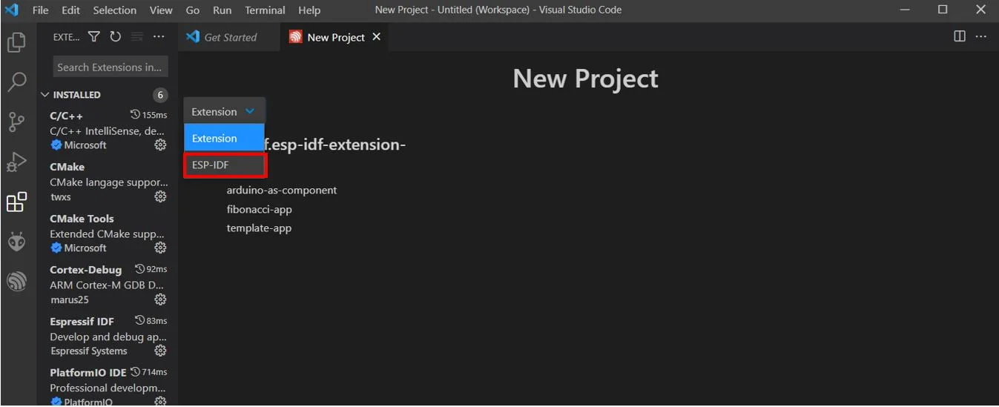

*Рисунок 36 — Создание проекта в VS Code с расширением ESP-IDF. Источник: [Microkontroller.ru](https://microkontroller.ru/esp32-projects/podklyuchenie-datchika-bme680-k-esp32-s-pomoshhyu-esp-idf/).*


Выбор стартового шаблона позволяет получить корректный каркас проекта. Полезно сразу проверить сборку минимального примера, а после этого добавлять датчик. Иначе сообщение компилятора трудно связать с настройкой среды или с новым компонентом.


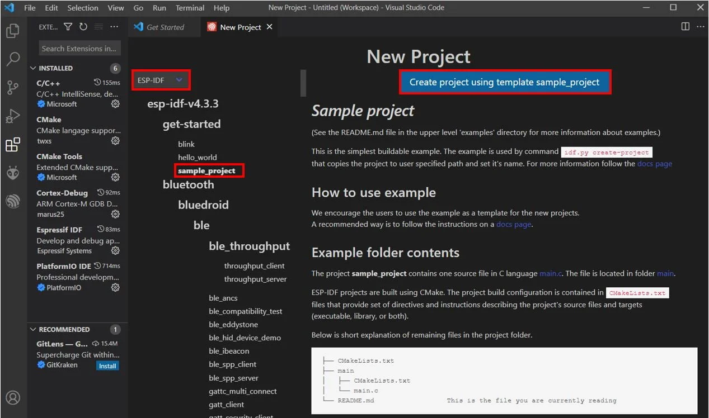

*Рисунок 37 — Выбор шаблона проекта ESP-IDF. Источник: [Microkontroller.ru](https://microkontroller.ru/esp32-projects/podklyuchenie-datchika-bme680-k-esp32-s-pomoshhyu-esp-idf/).*


В статье BME680 используются компоненты `bme680`, `i2cdev` и `esp_idf_lib_helpers` из библиотеки esp-idf-lib. Они обеспечивают драйвер датчика и общие функции шины. Структура каталогов показана ниже. Используемую версию библиотеки нужно согласовать с ESP-IDF; старый проект не всегда переносится на новый API одной командой.


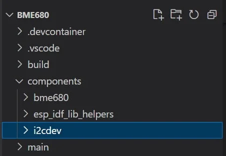

*Рисунок 38 — Компоненты драйвера BME680 в проекте ESP-IDF. Источник: [Microkontroller.ru](https://microkontroller.ru/esp32-projects/podklyuchenie-datchika-bme680-k-esp32-s-pomoshhyu-esp-idf/).*


Смысл типового цикла датчика тот же: инициализация шины и дескриптора, настройка режима, запуск принудительного измерения, ожидание готовности, чтение и публикация обработанных величин. В разных версиях компонента используются свои имена типов и функций. Нельзя вставить `Adafruit_BME680` в чистый C-проект и ожидать автоматической совместимости.

`idf.py menuconfig` открывает конфигурацию проекта. Экран из статьи EPAM показывает группировку параметров: загрузчик, последовательная загрузка, разделы и компоненты. Параметры задают для целевого устройства и версии проекта; значения чужого скриншота не являются универсальными.


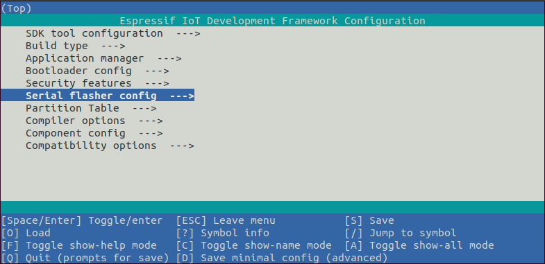

*Рисунок 39 — Экран menuconfig проекта ESP-IDF. Источник: [Хабр / EPAM](https://habr.com/ru/companies/epam_systems/articles/522730/).*


Типичная последовательность команд в терминале **настроенного ESP-IDF** из корня проекта:

```text
idf.py set-target esp32
idf.py menuconfig
idf.py build
idf.py -p PORT flash monitor
```

Вместо `PORT` указывают реальный последовательный порт платы, например имя COM, найденное в системе. Отдельный минимальный проект [idf_gpio](examples/idf_gpio/) содержит `CMakeLists.txt`, `main/CMakeLists.txt` и исходник `main.c`. Он показывает те же переключения GPIO23 средствами ESP-IDF 5.x:

```c
#include "freertos/FreeRTOS.h"
#include "freertos/task.h"
#include "driver/gpio.h"
#include "esp_err.h"

void app_main(void) {
    ESP_ERROR_CHECK(gpio_reset_pin(GPIO_NUM_23));
    ESP_ERROR_CHECK(gpio_set_direction(GPIO_NUM_23, GPIO_MODE_OUTPUT));
    int level = 0;
    while (1) {
        level = !level;
        ESP_ERROR_CHECK(gpio_set_level(GPIO_NUM_23, level));
        vTaskDelay(pdMS_TO_TICKS(500));
    }
}
```

FreeRTOS позволяет выделить задачу измерения, задачу сети и обмениваться структурами через очередь. Общие ресурсы защищают подходящими средствами синхронизации. `vTaskDelay()` переводит текущую задачу в ожидание, позволяя выполнять другие готовые задачи. Это отличается от бесконечного активного ожидания. При этом приоритеты и блокировки нужно проектировать: название «система реального времени» не гарантирует своевременность произвольного приложения.

<a id="s13"></a>
## 13. Диагностика, энергосбережение и выводы

Проверка устройства идёт от простого к сложному: питание и COM-порт, тестовый GPIO, шина датчика, физические величины, затем сеть и прикладной протокол. Если одновременно менять проводку, адрес датчика и Wi-Fi-настройки, становится трудно понять, какое действие исправило ошибку.

Таблица 8 — Типовые наблюдения при отладке

| Наблюдение | Что проверяют |
|---|---|
| Плата питается, COM-порта нет | Кабель передачи данных, USB-порт, драйвер USB-UART |
| Загрузка остаётся на Connecting | Порт, выбранную плату, BOOT/EN, занят ли порт другой программой |
| Плата сбрасывается при Wi-Fi | Питание, кабель, контакт GND и журнал причины сброса |
| I²C-сканер ничего не находит | SDA/SCL, питание, подтяжки, режим интерфейса, монтаж |
| DS18B20 недоступен | GPIO4, DQ-подтяжку, распиновку зонда, общий провод |
| HC-SR04 даёт тайм-аут | Питание 5 В, TRIG, делитель ECHO, отражающую поверхность |
| Сервер не открывается | Реальный IP, маршрутизацию, изоляцию клиентов, обслуживание HTTP |
| Старый пример LEDC не собирается | Версию Arduino-ESP32 и миграцию API 2.x/3.x |

Батарейный датчик полезно переводить в сон между измерениями. При deep sleep основная программа останавливается, а пробуждение обычно приводит к новому запуску с учётом сохраняемых RTC-данных. Потребление всего устройства включает стабилизатор, USB-UART, светодиоды, датчик и его нагреватель. Поэтому паспортные микроамперы SoC нельзя автоматически приписать собранной DevKit-метеостанции.

OTA позволяет обновлять программу по сети. Для надёжного обновления нужны достаточный раздел приложения, проверка образа и предусмотренное восстановление после неудачного запуска. Защищённый канал и проверка подлинности прошивки решают разные задачи. Этот материал связывает ESP32 с предыдущей лекцией о загрузчиках и обновлении встроенного ПО.

Основная последовательность разработки теперь видна на конкретных устройствах. Сначала определяется точная плата и её питание, затем выбираются GPIO и электрический интерфейс. После проверки локальных данных появляется дисплей или сетевое представление. BME680 показывает несколько физических величин, BMP180 с OLED даёт автономный прибор, DS18B20 демонстрирует 1-Wire, HC-SR04 — измерение временного интервала, HTTP и MQTT — два разных способа использовать полученные данные.

<a id="s14"></a>
## 14. Вопросы для самоконтроля

1. Чем отличаются SoC ESP32, модуль WROOM и плата DevKit?
2. Какие узлы платы позволяют подключать классическую ESP32 к USB компьютера?
3. Какие параметры выбранной платы нужно проверить до выбора настроек Arduino IDE?
4. Как распределяются задачи SRAM, ROM, Flash и PSRAM?
5. Почему нельзя переносить карту выводов ESP32-DevKitC на ESP32-C3?
6. Чем номер GPIO отличается от номера контакта разъёма?
7. Какие ограничения есть у GPIO6–11 и GPIO34–39?
8. Для чего нужны BOOT, EN и strapping-контакты?
9. Почему питание USB 5 В не допускает прямой подачи 5 В на GPIO?
10. Что подтверждают компиляция, загрузка и наблюдение результата устройства?
11. Почему `millis()` помогает обслуживать несколько действий?
12. Зачем нужны адрес и подтяжки I²C? Как проверить адрес BME680?
13. Какие величины измеряет BME680 и почему кОм нельзя подписать как ppm CO₂?
14. Почему BMP180 и OLED могут работать на общих SDA и SCL?
15. Для чего DS18B20 нужна подтяжка и чем полезен уникальный адрес?
16. Как разделение запроса и чтения DS18B20 помогает веб-серверу?
17. Откуда в формуле HC-SR04 возникает деление на два и что означает тайм-аут?
18. Чем отличаются режимы STA и AP? Нужен ли Интернет локальному серверу?
19. Как различаются запрос-ответ HTTP и публикация-подписка MQTT?
20. Почему к измерению и команде нужны признаки актуальности и обратное состояние?

## Источники


Дата обращения: 27.10.2026. Изложение и схемы соединений подготовлены для этой лекции. Обзоры служат отправной точкой; ограничения GPIO, программные интерфейсы и параметры датчиков уточнены по документации изготовителей. Старые статьи описывают состояние инструментов на дату публикации.

1. [3DIY. Wi-Fi модуль ESP-32: обзор, применение, характеристики](https://3d-diy.ru/blog/wi-fi-module-esp-32/).
2. [Right Electronics. ESP32: архитектура, модификации и технология](https://rightelectronics.ru/blog/esp32-arhitektura-modifikacii-i-tehnologiya).
3. [Хабр. ESP32-C3: первое знакомство. Заменим ESP8266?](https://habr.com/ru/articles/541874/) — исторический обзор 2021 года, различия архитектур.
4. [Хабр / EPAM. Программирование устройств на основе модуля ESP32](https://habr.com/ru/companies/epam_systems/articles/522730/) — организация проекта и программирование, статья 2020 года.
5. [AlexGyver. О ESP8266/ESP32, начало работы](https://alexgyver.ru/lessons/about-esp/).
6. [Kotyara12. Телеметрия на ESP32 + MQTT (Arduino)](https://kotyara12.ru/iot/esp32mqtt-arduino/).
7. [Microkontroller. Веб-сервер на ESP32 и BME680 с помощью ESP-IDF](https://microkontroller.ru/esp32-projects/veb-server-na-esp32-i-datchike-bme680-s-pomoshhyu-esp-idf/).
8. [Microkontroller. Подключение BME680 к ESP32 с помощью ESP-IDF](https://microkontroller.ru/esp32-projects/podklyuchenie-datchika-bme680-k-esp32-s-pomoshhyu-esp-idf/).
9. [Microkontroller. Веб-сервер на ESP32 и DS18B20 с помощью ESP-IDF](https://microkontroller.ru/esp32-projects/veb-server-na-esp32-i-datchike-ds18b20-s-pomoshhyu-esp-idf/).
10. [Microkontroller. Подключение BMP180 к ESP32 с помощью ESP-IDF](https://microkontroller.ru/esp32-projects/podklyuchenie-datchika-bmp180-k-esp32-s-pomoshhyu-esp-idf/).
11. [Microkontroller. Подключение HC-SR04 к ESP32 с помощью ESP-IDF](https://microkontroller.ru/esp32-projects/podklyuchenie-ultrazvukovogo-datchika-hc-sr04-k-esp32-s-pomoshhyu-esp-idf/).
12. [Espressif. ESP32-DevKitC V4 User Guide](https://docs.espressif.com/projects/esp-dev-kits/en/latest/esp32/esp32-devkitc/user_guide.html).
13. [Espressif. ESP32 GPIO & RTC GPIO](https://docs.espressif.com/projects/esp-idf/en/v5.5/esp32/api-reference/peripherals/gpio.html).
14. [Espressif. Installing Arduino-ESP32](https://docs.espressif.com/projects/arduino-esp32/en/latest/installing.html).
15. [Espressif. Migration from Arduino-ESP32 2.x to 3.0](https://docs.espressif.com/projects/arduino-esp32/en/latest/migration_guides/2.x_to_3.0.html).
16. [Espressif. Arduino-ESP32 LEDC](https://docs.espressif.com/projects/arduino-esp32/en/latest/api/ledc.html).
17. [Espressif. Arduino-ESP32 ADC](https://docs.espressif.com/projects/arduino-esp32/en/latest/api/adc.html).
18. [Bosch Sensortec. BME680](https://www.bosch-sensortec.com/en/products/environmental-sensors/gas-sensors/bme680).
19. [Espressif. Arduino-ESP32 Wi-Fi API](https://docs.espressif.com/projects/arduino-esp32/en/latest/api/wifi.html) и [I²C API](https://docs.espressif.com/projects/arduino-esp32/en/latest/api/i2c.html).
20. [Espressif. ESP-IDF HTTP Server](https://docs.espressif.com/projects/esp-idf/en/v5.5/esp32/api-reference/protocols/esp_http_server.html) и [сборка проекта](https://docs.espressif.com/projects/esp-idf/en/v5.5/esp32/get-started/start-project.html).
21. Espressif. Официальные страницы [ESP32](https://www.espressif.com/en/products/socs/esp32), [ESP32-S2](https://www.espressif.com/en/products/socs/esp32-s2), [ESP32-S3](https://www.espressif.com/en/products/socs/esp32-s3), [ESP32-C3](https://www.espressif.com/en/products/socs/esp32-c3), [ESP32-C6](https://www.espressif.com/en/products/socs/esp32-c6), [ESP32-H2](https://www.espressif.com/en/products/socs/esp32-h2).
22. Исходники библиотек [Adafruit BME680](https://github.com/adafruit/Adafruit_BME680), [OneWire](https://github.com/PaulStoffregen/OneWire), [DallasTemperature](https://github.com/milesburton/Arduino-Temperature-Control-Library), [WebServer Arduino-ESP32](https://github.com/espressif/arduino-esp32/tree/master/libraries/WebServer).


Полный список изображений с оригинальными адресами файлов: [Источники_иллюстраций.md](Источники_иллюстраций.md).
